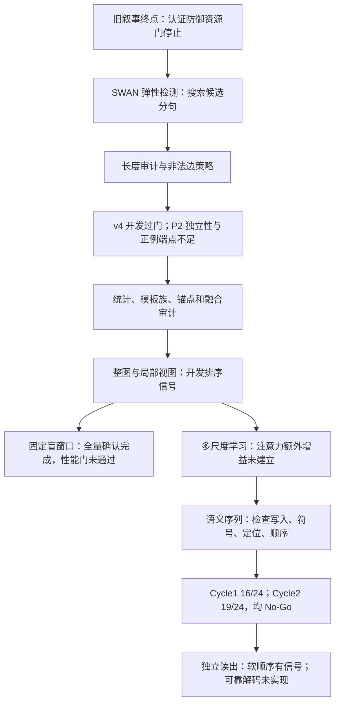

# 实验演进详细叙事 V2

> 本文续接[《叙事.md》](叙事.md)，只补写原文末尾没有记录的工作。原文最后一阶段为 Plan AE：SemStamp variable-`N` 全量资源审计完成，但双重放预算上界为 77.6152 GPU 小时，超过当时的 72 小时门，因此没有进入 certificate scoring。本文从此后的 SWAN 弹性检测探索开始，整理至 2026-10-25 的语义序列独立读出与复盘。
>
> 这次盘点时，`experiments/` 下有 196 个顶层目录。本文新增范围涉及 28 个顶层目录；一个目录可能包含方案、预检、多个执行版本和审计，不能将目录数当作独立实验数。其余目录属于旧阶段或辅助资产范围，不在本文重复展开。文末提供全部新增目录与正文的对应表。
>
> 本文是研究演进记录，不是新执行协议。历史报告的数字与后来的解释纠正一起保留；开发 Go、软件验证通过、正式性能确认、认证鲁棒性分别叙述。没有结果的阶段明确写成“未完成”或“未运行”，不从方案推断成果。原始冻结报告、失败记录与《叙事.md》均不修改。

## 先把后来这些实验连起来

原叙事结束时，项目已经确认了一个范围明确的现象：SWAN 的检测判定依赖输入如何分句；同时，精确认证路线虽然算法可行，但真实模型计算成本仍过高。后面的实验没有补出 SemStamp 证书，而是回到 SWAN，尝试回答另一个实际问题：**如果句界容易被改变，检测器能不能自己找到可靠的证据？**

第一步是“弹性检测”：保留多个可能边界，搜索其中最有利的划分。它确实能恢复一些正例，却同时暴露出长度错配、非法解析边、高分负例和统计门的问题。第二步转向统计审计，检查是否只是阈值不稳；这一阶段纠正了多个过强解释，也发现不能把同一文档的变体当作独立证据。第三步尝试整图、局部事件子图和不同长度窗口，开发集上出现排序与检出信号，但严格盲扫描时大量解析失败导致弃权，最终 S8 确认没有通过可用性门。

接着，项目尝试学习不同尺度的权重。普通门控和注意力都有开发信号，但“加注意力就会稳定更好”没有得到支持。最后，研究问题进一步缩小：先不宣称完成水印检测，直接检查语义结构能否写成四类符号、复述后能否读回，以及符号顺序能否提供超出频数的信号。最新结果是：**软顺序分数保留了相对排序增益，符号读回、事件筛选和完整序列还原仍不足。**

这条线中有不少“改好了工程，但没有解决研究问题”的阶段。把它们分开，才能看清哪些工作已经完成、哪些疑问仍然存在。

## 读后文需要区分的几个指标

| 名称 | 说人话 | 最容易混淆的地方 |
|---|---|---|
| FPR，误报率 | 没有水印的文本，被判断成有水印的比例 | 样本点值低于 1%，不等于总体上界已证明低于 1% |
| TPR，检出率 | 有水印的文本，被正确检出的比例 | 载体槽位检出率与整篇文档检出率是不同分母 |
| AUROC / AUC | 分数能否总体上把正例排在负例前面 | AUC 提高，不保证 1% FPR 这个严格工作点提高 |
| template top-k | 目标模板在模板排名中是否靠前 | 排名靠前，不等于匹配分数够高，也不等于盲检测成功 |
| 符号 BA | A/B/C/D 四类的平均召回率 | 有擦除和缺失时仍保留计划符号分母；不是水印 TPR |
| 位置 F1 | 找出的候选位置与目标事件位置有多吻合 | 候选很多会拉低精确率；不能只解释为漏找事件 |
| 身份 F1 | 位置和符号身份同时读对的程度 | 比“找到了附近的动作”更严格 |
| 顺序胜率 | 真源顺序在同一文本上优于多少替代顺序 | 77.48% 胜率不是 77.48% 文档被完整解码 |
| abstain，弃权 | 流程无法可靠完成，因此不给有效判定 | 弃权保留在全分母；低误报不能掩盖大量弃权 |
| 工程 Go | 达到某个继续开发的门 | 只授权下一阶段准备，不自动证明方法有效 |
| certificate，证书 | 对声明的全部合法扰动证明最坏情况仍安全 | 后文的经验恢复率和顺序 DP 都不是这类证书 |

本文中，`Null` 指没有水印的参考文本。校准集用来确定阈值；独立测试集用来检查固定流程的行为。一个文档的五种或七种编辑版本仍来自同一个源文档，统计时要按源文档处理相关性。

还要记住两种评分器：弹性检测早期使用项目的轻量 Bank scorer；后来的若干实验使用官方 S2Match。它们都比较图结构，但不是同一个函数，分数不能直接互换。

---

## Plan AF：先让检测器摆脱单一分句，再检查它是否真的可信

### AF1．Bank100 与经验 Null 的工程冒烟

**做什么、为了什么。**原 SWAN 接收分句器给定的句子。弹性检测改成构造候选分句格图，再寻找得分最好的完整路径。首先要确认候选图、Bank100、缓存、阈值制品和检测命令确实能接起来，且不需要知道文本注入时的目标模板。

**执行与结果。**`swan_elastic_bank_null_smoke1` 在本地和 RTX 3090 上通过 12/12 项相关测试。100 个模板自匹配全部为 1；505 个官方 raw positive 图中，498 个分数至少为 0.75。两篇冻结 C4 文本形成 413 个不同跨度，缓存重放为 413 命中、0 缺失、0 新 parser 调用，除创建时间外输出一致。

**反馈。**这说明管线可以运行，也说明缓存确实能省掉重复解析。但 Null 只有两篇，最小可分辨有限样本 p 值为 $1/3$，完全不足以评估 1% 误报。长跨度和软边界还产生了可恢复的 PENMAN warning，正式实验必须逐跨度保留恢复日志和图合法性证据。

**改进。**后续分成两件事：用独立校准与测试检查完整检测流程；同时把 parser warning、所选 beam、图合法性与 round-trip 审计纳入运行合同。模板自匹配通过不能替代这些检查。

来源：[工程报告](experiments/swan_elastic_bank_null_smoke1/REPORT.md)。

### AF2．`formal_smoke1`：准备了正式冒烟输入，但没有结果可讲

**做什么、为了什么。**`swan_elastic_formal_smoke1` 保存了校准窗口、独立测试窗口和输入 manifest，属于从小冒烟向正式校准过渡的准备制品。

**结果与反馈。**本次本地盘点没有发现这个目录下的结果报告。可以确认输入准备，不能确认它完成了 FPR 或 TPR 实验，也不能把下一个目录的结果挪给它。

**改进。**叙事按制品的实际状态记账；正式数值以 `formal_null1` 的完整结果为依据。

来源：[输入 manifest](experiments/swan_elastic_formal_smoke1/INPUT_MANIFEST.json)。

### AF3．正式 Null 校准：误报点值不错，严格 1% 上界没有通过

**做什么、为了什么。**`swan_elastic_formal_null1` 使用 1,000 篇校准文本建立经验 Null，再用没有参与拟合的 1,000 篇测试文本评估 FPR。这里检查的是“搜索了多个划分以后，完整流程是否仍能控制误报”。

**执行与结果。**独立测试误报为 6/1000，即 0.60%。双侧 95% 精确区间上界约 1.3013%，单侧 95% 上界约 1.1808%。校准与测试分别审计 37,232、37,276 个跨度；图合法性和 round-trip 全部通过，warning 逐跨度保留。

**反馈。**0.60% 是一个低的观察点值，但本项目要求“单侧 95% 上界不超过 1%”，这一次没有达到。它不是计数错误，也不能由“目标 alpha 是 1%”直接推成“总体 FPR 已被确认在 1% 内”。

**改进。**后续把“观察值”“置信上界”“开发门”“正式门”分开报告，并继续检查正例的长度与校准分布是否匹配。

来源：[正式 Null 报告](experiments/swan_elastic_formal_null1/results/REPORT.md)。

### AF4．旧短正例与攻击：初看恢复率很高，但长度口径有缺口

**做什么、为了什么。**`swan_elastic_positive_attack1` 将已建立的检测器用于 30 篇既有短正例及其历史句界攻击，检查它能否从受干扰的边界中找回证据。

**结果。**baseline 检出 28/30，攻击文本检出 27/30；在 baseline 已检出的 28 篇中，攻击后仍检出 27/28。

**反馈。**这一结果提供了开发动机，但使用的是旧短正例和较长文本的校准分布。弹性搜索的跨度、候选数和分数分布受文本长度影响，高恢复率不能单独证明“对短文本仍保持同样误报控制”。

**改进。**下一轮不继续只报正例恢复，而是把短 Null、短正例、标点压力条件和解析恢复一起审计。

来源：[正例与攻击报告](experiments/swan_elastic_positive_attack1/results/REPORT.md)。

### AF5．长度边界第一版：日志缺口导致永久停止

**做什么、为了什么。**`swan_elastic_length_boundary1` 试图直接审计上述长度错配，比较短文本在旧校准器下的行为。

**结果。**任务在已处理 192/1000 条时发现恢复日志没有正确绑定到所选 parser 输出，按冻结规则停止。它没有形成一个完整短文本 FPR 结果。

**反馈。**“parser 给出了一个能 decode 的图”不足以说明恢复过程可追溯。无绑定日志时，不能事后把所有已评分结果当成审计合格。

**改进。**另立 `swan_elastic_length_boundary_audited2`，补齐逐跨度恢复审计后重新执行。原第一版保留失败身份，不把补救结果追记为它成功。

来源：[计划](experiments/swan_elastic_length_boundary1/PLAN.md)、[解析审计补充](experiments/swan_elastic_length_boundary1/AMENDMENT_PARSER_AUDIT.md)。

### AF6．带审计重跑：长度错配和压力失效真正暴露出来

**做什么、为了什么。**新版本完成 7,214 条冻结记录，检查短 Null、正例、历史攻击与五个固定标点变体，并对恢复 ERROR 进行记账。

**结果。**短 Null 使用旧长文本校准时，误报达到 168/1000。扩充并重新校准后，干净短文本误报降为 10/1000，但单侧 95% 上界仍约 1.6903%。开发正例检出 26/30，历史句界攻击检出 17/30；在 baseline 可检出的 26 篇中，没有一篇在五个固定变体下全部存活，即 0/26。独立 Null 任一变体误报为 11/1000，选中 beam 含 ERROR 的跨度为 24 个。

**反馈。**这轮推翻了“旧攻击检出 27/30，就说明弹性检测已经稳健”的简单解释。首先，长度不匹配会大幅改变 Null 行为；其次，一个攻击版本能恢复，不代表多个预先声明的边界条件都能恢复；最后，错误恢复仍进入了所选路径。

**改进。**后续同时修两层：扩展候选边界以提高覆盖，明确非法或有错误恢复的边如何处理。改动后要整体重新校准，不能继续挂用旧阈值。这也是 v2、v3 的直接起点。

来源：[全量报告](experiments/swan_elastic_length_boundary_audited2/results/REPORT.md)、[裁决](experiments/swan_elastic_length_boundary_audited2/DECISION.md)、[收口](experiments/swan_elastic_length_boundary_audited2/CLOSEOUT.md)。

---

## Plan AG：v2、v3、v4——从边界覆盖转向合法路径，再调搜索惩罚

这几版的改变发生在检测流程中，不能只看 Bank100 是否相同来判断“检测器还是同一个”。边界格图、非法边策略、路径惩罚和 Null 校准都是版本的一部分。

| 版本 | 主要改变 | 实际结果 | 继续权限或终态 |
|---|---|---|---|
| v2 P0 | 扩展并验证边界恢复与候选路径 | 每类边界 120/120，5,150 条路径检查通过 | 可以进入冻结开发执行 |
| v2 development | 在真实文本上执行新候选格图 | 144/1000 校准完成后遇非法图；开发 0/210 | 工程 Stop，没有 P1 统计裁决 |
| v3 P0 | 非法解析/恢复/round-trip 边排除出搜索 | 无分数边界与路径检查通过 | 从 row 0 重做校准 |
| v3 development | 使用明确有效边策略 | baseline 20/30，条件联合存活 18/20，无选中非法边 | baseline 门不足，No-Go |
| v4 development | 多跳边惩罚改为 0.18 | baseline 25/30，条件联合存活 20/25，无选中非法边 | 仅开发 Go，进入 P2 新来源准备 |

### AG1．v2 preflight：先证明边界能够被恢复

**做什么、为了什么。**`swan_elastic_v2_preflight1` 先检查句界候选生成是否覆盖固定标点变体，以及格图是否存在完整合法路径。这样能把“根本没有正确切分候选”和“候选有了但打分不好”分开。

**结果。**各类边界恢复检查均为 120/120，路径核对共 5,150 条，通过 P0。这个阶段检验的是边界与路径软件合同，不是 FPR、TPR 或鲁棒性。

**反馈与改进。**几何覆盖通过以后，才有理由去真实 parser 和 Bank 评分上检查；不能用 P0 的通过数当成正例恢复率。

来源：[P0 裁决](experiments/swan_elastic_v2_preflight1/DECISION.md)、[协议](experiments/swan_elastic_v2_preflight1/PROTOCOL.md)。

### AG2．v2 development：真实 parser 让纯几何 Go 停下来

**做什么、为了什么。**`swan_elastic_v2_development1` 按冻结计划执行 1,000 条校准与 210 条开发记录。

**结果。**校准完成 144 条后，一个候选跨度的 PENMAN 图未通过结构合法性审计，任务停止；开发结果为 0/210，最终 RESULT 与 AUDIT 不可用。停止记录明确：它是 `engineering_stop_before_P1_decision`，不能称为 P1 No-Go。

**反馈。**合法的文本跨度不保证 parser 输出合法图；但直接因一个无效候选终止整个文档搜索，也可能让流程极易停机。需要预先确定：无效边剔除、完整路径不足时弃权、完整分母怎样保留。

**改进。**v3 为这些情况单独冻结策略，重做无分数 P0，从校准 row 0 开始，不续用这 144 条部分校准或旧 cache。

来源：[永久部分停止记录](experiments/swan_elastic_v2_development1/PARTIAL_STOP.json)。

### AG3．v3：合法边问题解决，原句检出仍不足

**做什么、为了什么。**`swan_elastic_v3_preflight1` 和 `swan_elastic_v3_development1` 将 invalid AMR、恢复错误和 round-trip 无效边排除出评分与 DP。没有完整有效路径的文档记为 abstain，仍保留在分母。

**结果。**P0 通过。开发 baseline 为 20/30，低于至少 80% 的门；这 20 篇中，五变体全部存活 18/20，即 90%。选中无效边为 0，整体 No-Go。

**反馈。**有效边策略能避免错误图进入最优路径，但不能自动恢复信号。只看条件存活 90% 会漏掉 10 篇连 baseline 都未检出的文档；按所有 30 篇看，baseline 且五变体全存活是 18/30。

**改进。**下一版在开发阶段调整多跳惩罚，检查是否过度处罚了恢复句界所需的路径。v3 的负结果保持不变。

来源：[v3 P0 裁决](experiments/swan_elastic_v3_preflight1/DECISION.md)、[开发裁决](experiments/swan_elastic_v3_development1/DECISION.md)、[报告](experiments/swan_elastic_v3_development1/REPORT.md)。

### AG4．v4：开发门过了，仍不是正式防御成功

**做什么、为了什么。**`swan_elastic_v4_development1` 将 2-hop、3-hop 的边界惩罚设为 0.18，重新校准完整流程。

**结果。**baseline 25/30，即 83.3%；baseline 可检出的文档中，五变体全部存活 20/25，即 80%；选中无效边为 0。因此开发裁决为 Go，只允许进入 P2 新来源准备。按完整 30 篇算，联合成功为 20/30。

**反馈。**这表明开发资产上存在一个能同时保住原句检出与条件存活的设置。但同一批数据经历了多轮开发，不能由此宣称独立泛化；后续还发现开发 runner 的部分 P0 调用被注释，以及本地与远端代码绑定缺口，严格前置资格不能事后补齐。

**改进。**必须用新来源、完整代码冻结、独立校准/测试及合格正例进入正式确认。目录中的报告标题有遗留版本标注问题；此处按目录、协议和实际裁决识别为 v4，不把标题当版本身份证据。

来源：[v4 裁决](experiments/swan_elastic_v4_development1/DECISION.md)、[原件复核中的工程缺口](experiments/swan_elastic_v4_p2_audit1/REPORT.md)。

---

## Plan AH：P2 的数字是真的，但正式证据链不完整

### AH1．P2 formal：51/5000 不能直接读成独立 FPR

**做什么、为了什么。**`swan_elastic_v4_p2_formal` 本来用于 v4 正式确认，希望同时验证误报、正例检出和多条件存活。

**结果。**保存结果中压力行阳性为 51/5000，即 1.02%。这些行实际来自 1,000 篇原文各五个变体；它们与 P2 校准原文的身份和窗口 SHA 交集为 1000/1000。正式 confirmation 正例被准备逻辑全部排除，正例及正例变体数为 0。评分结果保存后，报告生成又因代码错误中断，heartbeat 留在 `running`。

**反馈。**三个问题分别存在：同源压力集不满足独立测试；没有正例便不能确认 TPR；报告失败不代表分数未计算，也不代表进程还在跑。不能用一个“formal”目录名代替实际完成状态。

**改进。**先把原件拉齐并独立复算计数，再设计新的数据与工程门。原计数、原失败和正例空集合都保留。

来源：[保存结果](experiments/swan_elastic_v4_p2_formal/RESULT.json)、[失败记录](experiments/swan_elastic_v4_p2_formal/FAILURE.json)、[后续原件审计](experiments/swan_elastic_v4_p2_audit1/REPORT.md)。

### AH2．P2 audit：计数没有错，单独调 alpha 也没有补出联合解

**做什么、为了什么。**`swan_elastic_v4_p2_audit1` 不重跑模型，逐行核对输入/结果 SHA、身份、校准分布、p 值、路径 utility 和判定。要确定究竟是算错了，还是当前流程确实没有达到要求。

**结果。**保存 boolean、保存 p 值重判、独立从 Null 分布重算 p 值三种方式均得到 51/5000，逐行不一致为 0。按源文档算，任一变体误报为 13/1000；51 个阳性行只有 41 个不同文本 SHA。原压力集共有 4,124 个不同文本 SHA，不能算成 5,000 个独立文本来源。

经验上尾采用：

$$
p=\frac{1+\#\{S_i^{null}\ge S_{obs}\}}{n+1},
\qquad \mathrm{detected}=(p\le\alpha).
$$

相等 Null 分数计入上尾，不能通过换成插值分位、删行或忽略重复变体来“修好”原计数。

**反馈。**离线扫描固定检测器的 alpha 断点，没有设置能在这些已观察资产上同时满足 baseline 至少 80%、条件联合存活至少 80%、压力行误报不超过 1%。使用 P1b 校准并保住两个正例门时，最小压力行误报仍为 74/5000，即 1.48%。

此外，51 条原误报中有 22 条的最优路径全为 1-hop。在其余合同保持不变的条件下，只增大多跳惩罚，不能消除这些保留的 1-hop 路径；不能把 `0.18→0.19` 当成完整修复方案。

**改进。**停止在同一 P2 资产上反复寻找阈值。后继方案应先在新开发来源上建立正负分离余量，再冻结检测器和独立确认集。这里排除的是当前资产上的 alpha-only 联合修复，不是证明所有检测结构都不可行。

来源：[完整原件审计](experiments/swan_elastic_v4_p2_audit1/REPORT.md)、[后继条件](experiments/swan_elastic_v4_p2_audit1/FOLLOWUP.md)。

### AH3．高分误报机制：发现空路径奖励，但取消它尚未证明有益

**做什么、为了什么。**`swan_elastic_v4_mechanism1` 从 210 条开发、1,000 条干净原文和 5,000 条压力记录中导出 6,210 行分量特征，寻找高分 Null 的具体来源。

当前轻量匹配为：

$$
s_j=0.25C_j+0.50R_j+0.25P_j,\qquad s=\max_j s_j.
$$

其中 $P_j$ 比较 AMR 连续两条变量边构成的路径。实现规定两侧路径集合都为空时 F1 为 1，于是“都没有二跳路径”也会贡献 0.25 分。这里的图内二跳与文本边界格图的 hop 不是同一个概念。

**结果。**51 条历史误报中，39 条的所选路径含此奖励；30 篇 baseline 中也有 17 篇含它，空格变体为 29/30。固定旧模板和旧路径扣掉奖励后，baseline 对干净 Null 的代理 AUROC 从 0.9677 降为 0.9412，对最坏压力行也变差。

**反馈。**这是一项可明确解释的分数贡献，但它同时帮助正例和负例。不能把“39 条误报含奖励”写成“取消奖励能消除 39 条误报”。改分后可能换模板、换路径，阈值也需要重做；固定路径扣分仅是诊断。

**改进。**已写出只改路径分量空空结果的新开发比较合同，要求两臂分别重新校准并完整搜索。合同尚未物化新数据、实施候选或产生性能结果，本次 V2 不把它写成已完成修复。

来源：[机制报告](experiments/swan_elastic_v4_mechanism1/REPORT.md)、[未执行的开发合同](experiments/swan_elastic_v4_mechanism1/DEVELOPMENT_PROTOCOL.md)。

旧工作区入口还提及 `path0` 开发方向，但本次磁盘盘点没有找到对应的三个开发目录及其完整结果。这里保留这一证据缺口，不从启动说明或旧摘要推断它们的最终成功、失败或归档状态，也不将它们算入上述 28 个现存新增目录。

**这一组实验带来的转折。**弹性边界搜索确实扩大了恢复机会，也同时扩大了高分 Null 的机会。后续不再把“多找几个候选”视为天然防御，而是把完整搜索、打分和校准当成一个需要共同验证的检测流程。

---

## Plan AI：统计重构——先纠正判定，再检查证据是否足够

### AI1．verdict audit：工程门、统计门与证据资格必须分开

**做什么、为了什么。**`swan_verdict_audit1` 回看此前几个 Go/No-Go，检查是否把“没有证明严格上界”误说成“检测器失效”，或者把“点值很低”误说成“正式通过”。

**结果与反馈。**6/1000 的独立观察值可以保留，但单侧上界超过 1%；51/5000 的算术值可以保留，但其相关行与校准同源，不能用于独立 FPR 认证。统计未确认、工程停止和性能不达标是不同情况。

某些旧文字把“真实 FPR 恰为 1% 时永远无法通过该门”说得过于绝对。准确说法是：如果门要求有限样本上界不超过 1%，真实值位于边界时通过概率很低，但不是逻辑上永远不可能。

**改进。**报告允许“通过、未通过、证据不足”的区分，并保持历史工程裁决。后续以实际分母、独立性和区间回答问题，不靠一个总标签覆盖所有失败原因。

来源：[判定审计](experiments/swan_verdict_audit1/REPORT.md)。

### AI2．statistic design / feasibility：阈值估计会漂移，但不能把全部问题归给它

**做什么、为了什么。**`swan_statistic_design1` 提出重构 Null 和证据聚合的路线；`swan_statistic_feasibility1` 使用已有结果离线检查分布形态、尾部分位稳定性及变体相关性，没有新增 parser、GPU 或生成调用。

**结果。**1,000 条干净 Null 的偏度约 −0.035，超额峰度约 0.117；它们不支持简单的“明显重尾”判断。99% 分位的 bootstrap 95% 区间为 [0.075, 0.141]。反复 split-half 后，名义 1% 阈值的 held-out 误报中位为 1.2%，5%–95% 分位范围为 [0.2%, 2.4%]。

同一文档五变体的触发计数，观测方差与独立二项方差之比为 4.24，明显不能把五变体当独立重复证据。

**反馈。**有限样本尾部阈值漂移是真实问题，但这些诊断不能证明它是唯一主因。偏度和峰度接近正态不保证严格尾部正确，也不排除长度、搜索、分布错配和模型误差。Poisson-binomial 处理的是独立且不同成功概率的 Bernoulli 和，本身不是相关性修正模型。

旧报告还写过“解析阈值零估计误差，FPR 恒等于 alpha”。这只可能在特定理想参数已知情形讨论计算误差；离散检验通常给出 FPR 不超过 alpha，且往往明显更保守。真实系统的参数和单元命中概率仍要估计。

**改进。**后续检验“模板族能否提供不同证据单元”，同时保留估计误差与残余相关性。不再把“换成解析公式”本身当成误报控制已经完成。

来源：[统计设计](experiments/swan_statistic_design1/DESIGN.md)、[离线可行性报告](experiments/swan_statistic_feasibility1/REPORT.md)。

### AI3．B1 模板族计数：观察到较小过散度，但检出率很低

**做什么、为了什么。**`swan_b1_family_units1` 将 Bank 划成 5、10、20 个模板族，按族触发计数，尝试减少相近模板重复提供证据的问题。

**结果。**不同设置的计数过散度比为 0.96–1.04；在所用解析阈值下，正例行级 TPR 只有 0%–5.6%。数据包括 1,000 条干净 Null、5,000 条压力行和 180 条正例行；这 180 条正例实际是 30 篇 baseline 加五变体。

**反馈。**方差接近独立模型预期，只是一项矩诊断，不能证明族之间独立、计数服从 Poisson-binomial，也不能宣称阈值估计方差消失。更关键的是，实验只读取旧 DP 已选路径的单位，没有全部候选边，因此它评价的是这个冻结代理方案。

低 TPR 可以否定当前计数设置，不足以推出“检测端功效无解”或“必须转向嵌入端”。同一篇文本中可读证据少、聚合把分数离散化、模板分族规则都可能影响结果。

**改进。**先用相同冻结分数比较聚合方式，检查是否把已有弱信号过早压成了少量触发计数。

来源：[B1 报告](experiments/swan_b1_family_units1/REPORT.md)。

### AI4．B1b 聚合比较：求和优于单次最大值，但联合鲁棒性还不足

**做什么、为了什么。**`swan_b1b_statistic_power1` 在同一批分数上比较现役统计量 $S=U/\sqrt{N}$、max、mean、top-k mean 和阈值计数，避免把某一聚合的低检出误认为底层没有信号。

**结果。**在 fit/hold 拆分中，现役 S 的正例行检出约 81.1%–81.7%，单次 max 约 33.9%。但此时 held-out FPR 为 1.4%–2.0%，不能当成已经满足严格 1%。

按压力 Null 的观察工作点匹配 1% 后，S 的 baseline 为 21/30，任一压力变体检出为 23/30，五变体全部检出为 16/30。mean 对应为 20/30、21/30、13/30。

**反馈。**B1 的失败至少部分取决于聚合选择；分数并非完全没有区分力。另一方面，“任一变体能检出”是较宽松的端点，防御若要求所有声明条件都检出，应看 16/30。180 行不能生成 180 篇独立文档的置信区间。

观察测试分数后匹配 FPR 是开发 ROC 分析，可以比较当前排序与工作点，不能改写成一个新冻结检测器的正式通过。旧结论“信号与功效都不是瓶颈，唯一剩下是阈值”也过强。

**改进。**保留文档级联合端点，继续寻找能更直接对应目标结构的证据，而不是只在少数阈值上换统计公式。

来源：[B1b 报告](experiments/swan_b1b_statistic_power1/REPORT.md)。

---

## Plan AJ：锚点和 KARW 融合——保留探索，撤回不成立的因果解释

### AJ1．锚点稳定性：模板间相近，不等于已经得到鲁棒性半径

**做什么、为了什么。**`swan_anchor_stability1` 借鉴锚点稳定性的想法，检查 Bank100 中模板之间的相似度，以及边界变体后模板编号是否仍被选中。

**结果。**模板最近邻相似度中位为 0.932，定义的间距中位为 0.068；8/100 个模板有近乎重复的邻居。较大间距分层的模板存活观察值更高，但高间距组只由 3 篇文档支撑。

**反馈。**2026-10-20 的更正明确：这里的 margin 是模板与模板之间的分离度，不是待测文本第一名与第二名的差。multiset F1 没有在此证明距离度量或 Lipschitz 条件，不能直接套用“margin/2 内保持”的证书。

“存活”只是同一文档所选模板集合里仍出现某编号，没有对齐原来的同一事实。一个位置丢了、另一个位置碰巧命中，也可能被记为存活；它不等于符号读回。550 个模板×变体记录来自 30 篇文档，不能按 550 个独立样本解释。

**改进。**下一步应检验实际文本上的候选间隔、同一事件对应与独立 FPR。删合模板会同时改变生成载体和 Null 分布，需要重新验证；目前没有 Bank 重设计效果。

来源：[含解释更正的锚点报告](experiments/swan_anchor_stability1/REPORT.md)。

### AJ2．KARW × SWAN 融合审计：实现与身份错误使原总裁决失效

**做什么、为了什么。**`swan_fusion_audit1` 检查相关性修正、解析阈值、搜索空间效应和多个分数组件融合，原本用于判断融合方向是否有投稿价值。

**结果与更正。**审计后发现几个关键错误：去掉 calibration/test 前缀后，609 个编号碰撞被误认为同文档配对，真实来源和文本 SHA 交集却为 0；置换检验分桶规则前后不一致；代码定义了 Z 变换，却向融合函数传入原始特征；正例既用于确定方向又用于评价，且固定了旧选中路径。

**反馈。**原“22% 融合对比 80.7% 现役”、`p=0.8421` 和“攻击只有 0.11σ”等不能支持公平方法比较或无效结论。原综合 No-Go 作为选题裁决被撤回，不等于融合已成功。

**改进。**以完整来源身份和 SHA 配对，统一特征变换、候选搜索与校准，并分开训练、开发和测试。后面的多视图实验由此重新建立输入和评分口径，而不是直接接受“融合没价值”的旧结论。

来源：[含证据更正的融合审计](experiments/swan_fusion_audit1/REPORT.md)。

**这个阶段的意义。**统计审计没有产出一套成功防御，却清理了多个会误导后续选题的解释：不独立、配错文档、不同评分尺度和事后工作点不能由更漂亮的统计标签掩盖。

---

## Plan AK：多视图开发——整图丢失局部证据时，能否换个范围看？

主要目录为 `swan_multiview_development1`。它下面的 pipeline、dataset、Null 审计与盲窗口确认属于不同子阶段，必须分别解释。

### AK1．pipeline1 → pipeline3：先把“文本片段—事件图”对应做成原型

**做什么、为了什么。**第一版不只按句子整体匹配，而是从文本和 AMR 中提取事件，使用 MiniLM、角色、实体、否定和数字线索进行有容量的对应，尝试让一个较大解析图中的局部事件支持较短文本片段。

**结果。**一篇旧来源的七个条件形成 87 个候选出现、62 个不同片段。62 个图合法且 round-trip 通过；6 个片段有绑定的恢复 warning。保守模式可用 56/62 个不同片段。五个开发版本均能 cache-only 运行，七条结果完整 SHA 重放一致，23 项相关测试通过。

pipeline1 为初版；pipeline2 修订短支持排序与事件分组；pipeline3 复用相同指纹的图与恢复日志，保留旧结果。169 个匿名对应项的人工审核入口已准备，但真人标签为 0。

**反馈。**程序实现了跨片段对应，不等于对应正确。spaCy 的实体边界错误、事件描述细节不同、重复观察、名词性无事件载体都影响覆盖。原型使用的是轻量 scorer，不是官方 S2Match；只有一篇源文，未校准的统计量也不能当 TPR。

**改进。**改为在同线索下优先短支持图，并保守合并同事实观察；随后需要明确的数据集、官方评分与 Null 对照，而不是由几条 raw statistic 的上升决定扩规模。

来源：[第一版实现与 pipeline 演进](experiments/swan_multiview_development1/IMPLEMENTATION_REPORT.md)。

### AK2．generation probe 与 dataset2/4：首先发现“生成得出来”本身就困难

**做什么、为了什么。**工程探针检查能否生成正常长度文本，同时在其中嵌入多个可被官方 S2Match 接受的短载体。它也核对了轻量 scorer 与官方 S2Match 的差异。

**结果。**已有 87 个候选中，长度与 Bank 高分存在负相关，报告 Pearson $r=-0.646$。24 个模板、每个至多四次尝试的探针中，12/24 达到 0.75，共 72 次调用。增加连贯上下文时，有限探针的接受率降低；无上下文生成三个条目式文档，dataset2 接受 54/60 槽，文档为 125–139 词。

扩大模板池并去重后的 dataset4 有两篇文档，各 16 个接受载体，无篇内重复。它改善了句式重复，但仍是事件条目集合。

**反馈。**这轮暴露了自然行文、具体内容和抽象模板遵从之间的开发张力。它没有证明“长文本在数学上不可达”“只有不超过 12 词才有效”“自然性与载体可实现性必然互斥”或“已经找到质量上限”。这些都是原探针中的过强外推；有限模板和有限尝试不能建立普遍不可能性。探针文本也没有独立真人质量资格。

原报告一处“50 个模板筛出 24 个，54%”比例不一致，按该分母应为 48%；本文不使用这个不一致比例证明收益。

**改进。**将长文与短载体分开设计，保留生成失败、重复和质量边界；从 target-conditioned 恢复诊断开始，再逐步走向真正不知目标位置的检测。

来源：[生成探针](experiments/swan_multiview_development1/generation_probe1/FINDINGS.md)。

### AK3．dataset4 attack：评分器和成功判据混在一起，会得到错误归因

**做什么、为了什么。**两篇文档的 32 个载体，在七个条件下形成 224 个实例，检查编辑后目标结构是否仍可恢复。

**初步现象。**原文上，轻量 argmax 身份恢复为 25%，官方 S2Match 的已知目标恢复为 100%。初版把差异解释为换评分器，后来发现同时改了成功判据。

**2×2 复核结果。**

| 评分器 | argmax 身份判据 | 已知目标分数达标判据 |
|---|---:|---:|
| 轻量 scorer | 52/224，23.2% | 21/224，9.4% |
| 官方 S2Match | 50/224，22.3% | 120/224，53.6% |

**反馈。**两评分器的 argmax 指标接近，已知目标指标却相差明显，存在强交互。模板恰好排第一，可能只是所有模板都低；已知目标自身高分，也不能证明盲模式能确定它就是正确身份。

在这两篇合成文档上，S2Match 已知目标恢复在 baseline、分号、换行下为 100%，merge 为 0%，comma/space 约 6.2%。它支持当前候选和评分设置对边界变化敏感，不能写成所有文本下“语义结构崩塌”的普遍机制。

**改进。**以后同时保存目标分数、全库排名、是否达到阈值与盲身份，不再将任意一种“恢复率”当其他指标的替代。

来源：[攻击及口径消融报告](experiments/swan_multiview_development1/dataset4_attack1/REPORT.md)。

### AK4．dataset4 fusion：秩融合改善排序，门控的检测优势被撤回

**做什么、为了什么。**比较五个开发版本：

| 版本 | 方法 | 想解决的问题 |
|---|---|---|
| D1 | 整图 S2Match | 保留完整句级结构 |
| D2 | 事件子图匹配取最大 | 从大图中恢复局部结构 |
| D3 | 整图/子图 raw score 直接取最大 | 检查朴素加视图是否有效 |
| D4 | RRF 秩级融合 | 避开不同分数尺度直接比较 |
| D5 | 整图高分沿用 D1，否则退回 D4 | 尝试保留完整图优点并恢复低分条件 |

**结果。**目标模板 top5 从 D1 的 50.4% 升为 D5 的 57.6%。D3 虽然逐点分数不低于 D1，目标排名反而变差：它也把干扰模板抬得更高。

**反馈。**加入 Null 后发现 RRF 分数最高约 0.18，与 S2Match 0.75 不在同一尺度。严格校准阈值约为 0.8066，高于 D5 的分支门 0.75；退回 RRF 的部分不可能跨过判定阈值。于是此工作点 D5 与 D1 等价，排序收益没有变成检测收益。

原“Pareto 改进”“虚假 green 率降至 4.45%”被撤回。可以保留的是当前开发实例中的排序变化与 raw max 的失效，不能保留“零代价防御恢复”。

**改进。**后续先估计各视图的 Null，再做可比较的分位或标准化表示；评价完整文档判定，而不是仅用模板排名选方法。

来源：[含撤回说明的融合报告](experiments/swan_multiview_development1/dataset4_fusion1/REPORT.md)、[Null 审计](experiments/swan_multiview_development1/null_fp_audit1/REPORT.md)。

### AK5．Null 审计和对称机会修正：多扫几次本身就能提高高分

**做什么、为了什么。**把 Null 加入整图与局部视图的比较，检查局部高分究竟是恢复结构，还是小图更容易碰巧匹配。再修正正负两侧可用候选机会不对等的问题。

**结果。**局部相关版本在 Null 上出现约 83%–85% 的单元 green，说明原 0.75 不能原封不动充当新视图的误报阈值。这是单元命中，不是 83%–85% 文档 FPR。

正例平均扫描机会约 3.57，Null 约 4.80。对称修正后，一项融合 AUC 从约 0.965 降为 0.8975；对照 AUC 增量仍为 0.0272，区间 [0.0042, 0.0492]，但 1% 工作点的 TPR 增量从 +0.174 转为 −0.0179，区间跨 0。

**反馈。**原排序收益有部分来自候选机会和分数尺度。修正后全局排序仍可能改善，而严格尾部检出没有得到支持；不能用前者替代后者。

扩到 2,342 个 Null 单元后，正例仍只有 32 个载体各七变体。按载体聚类修正，5% 工作点的 TPR 增量区间为 [−0.0223, 0.2321]，仍不确定；AUC 增量约 0.0542 只作为开发证据保留。

**改进。**扩大正例文档、处理跨篇重复、统一候选机会，并区分载体层和文档层。Null 增样不能把仍只有两篇的正例变成大规模验证。

来源：[Null 审计](experiments/swan_multiview_development1/null_fp_audit1/REPORT.md)、[对称修正](experiments/swan_multiview_development1/null_fp_audit1/SYMMETRIC_CORRECTION_REPORT.md)、[扩样裁决](experiments/swan_multiview_development1/null_fp_audit1/SCALED_FINAL_VERDICT.md)。

### AK6．dataset5：局部校准出现开发收益，但载体位置仍已知

**做什么、为了什么。**将正例扩大为 30 篇，检查局部作用域与分位校准是否仍有信号。比较 A 整图原始、E 局部分位和 D 双域 Fisher。

**结果。**600 个计划槽中接受 471 个，接受率 78.5%；不同载体文本为 367 个，共 1,574 次调用。原报告另统计跨篇重复 145/471，这与“总行数减 unique 数”的重复盈余是不同口径，不能直接相减当作冲突或独立样本数。

开发载体指标中，AUC 为 A 0.8743、E 0.8990、D 0.9139；1% 观察工作点 TPR 为 A 33.9%、E 60.1%、D 35.1%。局部版本在 merge/comma/space 条件下更好，整图在完整边界的 5% 工作点更好。

**反馈。**这是重要开发信号，却仍利用注入时已知 span 汇聚重叠窗口；不能当作未知边界的盲文档结果。测试分数参与工作点匹配，文本是合成条目，多个载体重复，原报告关于“有效独立载体”“只剩阈值不确定”的措辞不能直接用于正式主张。

**改进。**继续修正文档编号、文档单元数和阈值口径，再走向不读取注入位置的全窗扫描。

来源：[dataset5 开发报告](experiments/swan_multiview_development1/dataset5_eval/P2_REPORT.md)。

### AK7．文档级重算：旧 63 篇是撞号形成的伪文档

**做什么、为了什么。**将载体分数聚合到文档后，检查是否真的能按文档区分正负。

**结果与纠正。**旧分片使用局部 `doc` 编号，合并后把不同文本并成同一个“文档”。旧 63 篇和相关文档结果作废。新版本改为全局唯一 ID，得到 215 篇校准、220 篇测试 Null。

同时处理正例 12–19 单元、Null 中位 6 单元的差异。按 $m=6$ 对齐后，观察测试 FPR 匹配在 5% 的文档 TPR 为 E 94.2%、A 58.7%；固定 $z=2.33$ 时，对齐 TPR 为 E 57.1%、A 25.3%。E 在 220 篇 Null 中有 2 篇越界。

**反馈。**不同阈值方案给出差异很大的结果，说明“94.2%”不能脱离阈值来源使用。测试工作点匹配仍是开发分析；2/220 的低点值也没有确认严格 1% 上界。候选仍与已知载体有关，旧伪文档结果不能作为额外证据累加。

**改进。**固定文本盲候选规则、完整校准器和弃权政策，再用新的文档级执行确认。

来源：[旧文档报告](experiments/swan_multiview_development1/dataset5_eval/DOC_LEVEL_TPR_REPORT.md)、[全局 ID 与 N 对齐重算](experiments/swan_multiview_development1/null_fp_audit1/SCALED_200_VERDICT.md)。

---

## Plan AL：真正盲扫窗口——开发亮点被可用性问题限制

### AL1．blind_eval1：不用注入位置，扫描全文

**做什么、为了什么。**冻结 P0 与 S6/S8/S10/S12，短窗均按文本几何位置扫描，不向检测器提供注入 slot 或目标模板。严格政策下，任一必需窗口失败，整篇弃权。

**执行与结果。**初次运行因 OOM 停止，没有完整结果；另立 run2 后，在 15 篇校准、15 对测试文档上形成完整开发结果。该执行涉及 150,128 个不同输入、86,309 个不同归一化图，正例七条件共 105 个版本。

**反馈。**之前的载体对齐只需在正确位置附近查看少量候选，全窗盲扫会产生更多困难片段。严格 fail-closed 能避免不可靠图偷偷进入分数，也会显著降低系统完成率。

P0 的零检出还包含计数容量限制：当分句器只给出一个单元时，官方 $\lambda=0.25$ 的 $z$ 最大为 $\sqrt{3}=1.732$，低于本轮共同文档阈值。merge 也同时受单元数量和匹配变化影响，不能将所有零检出只归于 parser 或“语义结构丢失”。

**改进。**既报告 TPR/FPR，也报告完整率、弃权及逐条件错误；避免只展示成功完成子集。

来源：[盲扫描 run2 报告](experiments/swan_multiview_development1/blind_eval1/run2/REPORT.md)。

### AL2．5% 阈值重评：误报下降，弃权没有消失

**做什么、为了什么。**复用已经完成的分数，把七条件校准负例的 95% 经验分位取最大，作为共同文档阈值。此规则提出时旧测试结果已知，因此属于事后开发诊断，没有新增模型调用。

**结果。**

| 方法 | 调整后检出 / 105 | 调整后误报 / 105 | 正例弃权 / 105 |
|---|---:|---:|---:|
| P0 raw | 44 | 0 | 0 |
| P0 strict | 44 | 0 | 29 |
| S6 | 52 | 2 | 50 |
| S8 | 11 | 0 | 81 |
| S10 | 5 | 0 | 94 |
| S12 | 4 | 0 | 101 |

**反馈。**这里的 105 来自 15 篇各七版本。S6 的 newline 误报仍为 2/15；S8/S10/S12 的零误报伴随大量弃权。每条件 0/15 的双侧 95% 上界约 21.8%，不能宣称总体误报已控制在 5%。

**改进。**按固定开发排序选择 S8：先最小化七条件中最大的实测 FPR，再比较 merge/comma/space 的平均全分母 TPR，之后比较完整率、候选数等。进一步做独立负例与可用性审计；新确认失败后不换窗口。

来源：[逐步阈值重评最终表](experiments/swan_multiview_development1/threshold5_reassessment1/P0_S6_S8_S10_S12/REPORT.md)、[最终开发与选择规则](experiments/swan_multiview_development1/FINAL_ROUND_PLAN.md)。

### AL3．newline 负例扩充与弃权审计：1/100 要同时看 1/59

**做什么、为了什么。**`newline_negative_expansion1` 增加 100 篇校准、100 篇测试参考，专门检查 newline 条件；`abstention_audit1` 回看失败窗口与完成子集。

**结果。**测试误报为 1/100，但 41 篇弃权，仅 59 篇完整完成。完成子集误报为 1/59，即 1.69%，其区间上界约 9.09%。39 篇文档受到共 46 个失败窗口影响。

**反馈。**全分母 1% 可以描述系统的阳性输出比例，却不能掩盖它只完成 59% 的事实。图全部可 decode，也不证明 warning 无害；结构能读入与语义/恢复可靠是不同问题。

**改进。**最终确认同时冻结人类参考误报、正负完整率和正例改善三项门，并保留不同来源的生成负例与人类参考，不混池降低误报。

来源：[newline 扩充报告](experiments/swan_multiview_development1/newline_negative_expansion1/REPORT.md)、[弃权审计](experiments/swan_multiview_development1/abstention_audit1/REPORT.md)。

### AL4．confirmation1 → 4：输入修复、预算停止、执行中断与最终全量完成

这四个身份的失败原因不相同，后继补救不追改原失败。

| 执行身份 | 做了什么 | 实际结果与反馈 | 后续改变 |
|---|---|---|---|
| final_completion1 | 准备新的 250 个生成文档槽位与独立确认输入 | 0 个完整合格；4,000 个表面检查中 1,912 个失败，另发现 `sha_file(str)` 类型错误；未进入正式 CUDA 评分 | 修复输入审计实现，另立版本 |
| final_completion2 | 用新版本修复并完整审计输入 | 修复版新增 2,371 次调用，203/250 文档合格，47 失败保留；预计 30.36 小时超过剩余 15.59 小时 | Readiness Stop，未形成完整确认指标 |
| final_completion3 | 新授权下以独立 48 小时预算执行冻结 S8 确认 | 发生 execution halt；只有预检/部分制品，没有完整 FPR/TPR | 保留永久停止记录；最终补救身份单列 |
| final_completion4 | 用户取消时间截止后，完成同一确认工作的最终执行 | 550 篇 × 五条件 × 三方法 = 8,250 条结果完成；数值重放通过 | 三性能门未通过，关闭本线 |

confirmation3 的本地最终报告与 HALT 只确认执行失败，没有足够证据在本文进一步指定某个 parser、网络或显存根因。confirmation4 的时间政策改变来自明确授权；它不把前三版改写成成功。

来源：[completion1](experiments/swan_multiview_development1/final_completion1/FINAL_REPORT.md)、[completion2](experiments/swan_multiview_development1/final_completion2/FINAL_REPORT.md)、[completion3](experiments/swan_multiview_development1/final_completion3/FINAL_REPORT.md)、[completion4](experiments/swan_multiview_development1/final_completion4/FINAL_REPORT.md)。

### AL5．最终 S8 结果：全量算完了，方法仍没有达到可用恢复

**冻结范围。**550 篇包括生成侧 100 校准负例、100 测试负例、50 正例槽位，以及人类参考 100 校准、200 测试。生成输入完整合格 203/250，具体为 76/100 校准负例、84/100 测试负例、43/50 正例；47 个失败槽位全保留。

**结果。**

| 方法与条件 | 完整正例 / 50 | 完整人类测试 / 200 | 可以报告什么 |
|---|---:|---:|---|
| P0 raw，baseline | 43 | 200 | 检出 18/50；人类参考误报 0/200 |
| P0 raw，newline | 43 | 200 | 检出 18/50；人类参考误报 0/200 |
| P0 raw，merge / comma / space | 各 43 | 各 200 | 各检出 0/50；人类参考各误报 0/200 |
| S8，baseline | 3 | 28 | 校准不可用，正式 TPR/FPR 为不可用 |
| S8，newline | 4 | 34 | 同上 |
| S8，merge | 3 | 33 | 同上 |
| S8，comma | 3 | 29 | 同上 |
| S8，space | 5 | 29 | 同上 |

P0 strict 与 S8 的校准均不可用。S8 人类测试完整率仅 14%–17%，正例仅 6%–10%；JSON 中 `positive_decisions=0` 是无可用校准时的记录值，不能写成“成功校准后 TPR=0%”。

**反馈。**三项预定门——五条件人类参考 FPR 上界、正负完整率至少 80%、正例改善——全部未通过。CUDA 精确重放、显存与当时资源就绪门通过，保守投影约 30.12 小时；因此这轮是“完成了失败结果的确认”，不是“计算没完成所以不知道”。

**改进。**当前线已关闭，不能继续宣称可用恢复成功。未来若研究这条路线，应先明确可用候选和解析质量策略，整体重新校准并测独立人类参考 FPR；本文没有启动新实验。S8 严格盲流程与之前 oracle 对齐局部版本不是同一设置，不能据此把旧开发信号全部当成算错。

来源：[最终数值](experiments/swan_multiview_development1/final_completion4/RESULTS.json)、[数值报告](experiments/swan_multiview_development1/final_completion4/REPORT.md)、[最终确认报告](experiments/swan_multiview_development1/final_completion4/FINAL_REPORT.md)。

---

## Plan AM：多尺度学习——普通门控有信号，交叉注意力的额外价值未建立

主要目录为 `swan_multiscale_attention_development1`。这条线把三个视图的 Bank100 分数送入学习模块：S6 短窗、S12 较长窗、事件子图 Ssub。注意力处理的是模板匹配分数，不是直接处理文本 token 或 AMR 节点；它不是完整端到端语义编码器。

### AM1．validation1：先与普通门控比较，不能只打赢单尺度

**做什么、为了什么。**在 30 篇旧正负文本缓存上，比较跨尺度注意力、普通门控及确定性基线。每次划分为 8 篇训练、3 验证、4 校准、15 测试；五个 seed 形成 15 组验证运行。

**结果。**1% 校准目标下，注意力平均 TPR/FPR 为 61.67%/0.51%，门控为 60.96%/0.57%。TPR 差为 +0.71 个百分点，区间 [−0.59, 2.12]，额外增益未建立。5% 目标下，注意力为 79.76%/1.10%，门控为 76.02%/0.99%。

**反馈。**学习融合相对一些单尺度基线有开发收益，但关键对照是“注意力有没有比简单门控更好”。平均 FPR 0.51% 还掩盖了 split 条件约 2.29% 的误报。五次 seed 来自同一批 30 篇文档，不能算五份独立新数据；缓存还使用已知载体 span。

**改进。**拆解特征、hard negatives 和注意力三项变化，单列 condition-specific FPR。

来源：[验证报告](experiments/swan_multiscale_attention_development1/validation1/REPORT.md)、[总入口与架构边界](experiments/swan_multiscale_attention_development1/README.md)。

### AM2．ablation1：高分负例训练比“继续加注意力”更值得追查

**做什么、为了什么。**20 组运行比较 A0 原门控、A1 新特征、A2 高分负例训练、A3 在 A2 上追加注意力。

| 方法 | 1% 目标 TPR | 实测 FPR | 相对作用 |
|---|---:|---:|---|
| A0 原门控 | 60.96% | 0.57% | 基线 |
| A1 特征改变 | 59.82% | 0.67% | 没有改善 |
| A2 hard-negative | 62.18% | 0.40% | TPR 小幅增量未确认，误报改善有开发信号 |
| A3 追加注意力 | 58.37% | 0.39% | 对 A2 的 TPR 差为 −3.81 个百分点 |

**反馈。**A3−A2 的 TPR 区间为 [−5.59, −2.08]，五个 seed 都降低；A2−A0 的增量 +1.22 区间 [−0.56, 2.91]，未确认正提升。5% 目标下 A3 又能比 A2 提高检出，但 FPR 从 1.57% 增到 2.03%。这是工作点权衡，不是全面优越。

**改进。**不把增加层数作为默认修复；先检查困难负例、特征尺度和逐条件误报，再对固定模型研究阈值。

来源：[四步消融报告](experiments/swan_multiscale_attention_development1/ablation1/REPORT.md)。

### AM3．operating_points1：统一照顾最坏条件，检出要付代价

**做什么、为了什么。**固定已训练模型，对 40 个工作点进行比较，将每个条件的校准阈值取最大，检测时不需要知道输入属于哪类扰动。

**结果。**相应保守设置下，A3 的 TPR/FPR 降为 53.38%/0.33%，split FPR 仍约 1.27%；A2 为 48.16%/0.25%。

**反馈。**总体平均误报更低，但条件门不自动全过；提高统一阈值会损失检出。不能把一次更低 FPR 单独称为净改善。

**改进。**将逐条件风险和 TPR 作为共同端点，后续困难样本训练要针对这种失败，而不是只优化 pooled mean。

来源：[工作点报告](experiments/swan_multiscale_attention_development1/operating_points1/REPORT.md)。

### AM4．family_hard1：重复 hard 名额修好了，训练收益没有确认

**做什么、为了什么。**引入载体族分组和困难负例训练，减少同一族重复占用 hard 样本名额，尝试压低 split 误报并保住 TPR。

**结果。**80 条训练轨迹、100 个冻结端点与独立重放完成；额外 hard 名额中的重复从约 65% 降到 0。32 个比较中，没有一项稳定达到“降低 split 假阳且保持 TPR”的联合目标。三个架构由训练/验证选择出的额外损失系数都是 0。

**反馈。**去重是明确的工程修复，但模型选择本身没有支持新增损失。不能把“训练全部跑完”写成“族训练成功增强防御”。

**改进。**停止在旧缓存上叠加复杂度，把研究重点转到更基础的语义结构可写入、可区分和可读回问题。

来源：[载体族训练报告](experiments/swan_multiscale_attention_development1/family_hard1/REPORT.md)。

---

## Plan AN：语义序列立项——先问符号能不能写入和读回

### AN1．设计：从“有没有高分”改问“读到的是什么”

**做什么、为了什么。**`semantic_sequence_stage1_design1` 把 24 个结构模板分成 A/B/C/D 四类，每类六个模板；每篇八个符号，每类出现两次。研究分成旧缓存必要性检查和新语料验证。

计划比较三种通道：W 完整 AMR，E1 单事件 AMR 子图，C 文本 embedding。只有先读回符号，才讨论事件定位和顺序；第一阶段不训练大型序列模型、不实现消息编码，也不宣称多比特容量、正式水印检测或认证。

八个位置且每类两次，一共有：

$$
\frac{8!}{2!\,2!\,2!\,2!}=2520
$$

种等频顺序。它们的频数完全相同，适合检查顺序分数是否提供了频数以外的信息。

**结果与反馈。**此目录是方案，不是成功结果；G0–G4 的人工资格、读回与顺序端点仍要在执行时检查。

**改进。**先以零新增推理的旧缓存判断是否值得付出新语料与解析成本。

来源：[第一阶段设计](第二篇_语义消息写入与读回/02_实验/semantic_sequence_stage1_design1/PROTOCOL.md)。

### AN2．Stage1A：旧缓存 S6 有四类信号，只允许进入新数据验证

**做什么、为了什么。**`semantic_sequence_stage1_run2` 的 1A 在已有 471 个载体记录上检查已知位置符号身份。不同文本等权的诊断使用 326 个不同文本；它与 dataset5 全部 367 个 unique 的取数范围不同，不能混成同一个分母。

**结果。**S6 clean BA 为 63.59%，split/merge/space 平均为 55.32%，通过该阶段必要工程门。S12 为 83.73%/42.88%，原 E_max 为 32.12%/32.38%，都没有通过各自完整门。

**反馈。**高 clean BA 不保证编辑后读回；E_max 的多子图最大值也不同于后续同锚点只选一个子图的 E1。旧缓存是经生成筛选且位置已知的载体，不能证明新文本里可盲恢复。

**改进。**另行生成新提示、新文本、不按得分筛选，检查目标结构是否真正写进去。

来源：[Stage1A 报告](第二篇_语义消息写入与读回/02_实验/semantic_sequence_stage1_run2/STAGE1A_REPORT.md)。

### AN3．Stage1B run2：432 个请求完成，目标结构实现却很差

**做什么、为了什么。**生成 24 对新场景，开发和读出各 12 对。正例按固定模板序列写入，无水印沿自己的上下文生成；全部一次生成，不重试、不按检测分数筛选、不补样。384 个保留载体、48 篇整段复述，共 432 个请求，派生 216 个文本版本。

**结果。**请求、回执、文本派生和 1,335 个文件 SHA 审计完成。载体完全重复为 0，但正例平均约 114.8 词，配对负例约 140.8 词，实测长度没有匹配。

后续授权 AI 代审，读出原文 96 个目标中，明确实现 1、未实现 89、不确定 6。全部不确定放行也只有 7/96，即 7.3%；全部原文为 3/192 明确实现。AI 工程裁决为 No-Go，当前批次不进入完整 W/E1/C 盲提取。

**反馈。**“生成结束且没有空响应”不等于写入成功。AI 代审提供停止投资的诊断依据，但不是两名独立真人，也不是精确 parser 金标准；原协议真人标签为 0，正式人工 G1 未完成。

**改进。**先检查提示如何表达抽象模板要求，以及自然语言文本能否实现完整论元、姓名、语气和未知信息。不能将生成失败全部算成解码器失败。

来源：[Stage1B 状态](第二篇_语义消息写入与读回/02_实验/semantic_sequence_stage1_run2/STAGE1B_STATUS.md)、[AI 代审](第二篇_语义消息写入与读回/02_实验/semantic_sequence_stage1_run2/ai_review1/AI_REVIEW_REPORT.md)。

### AN4．alignment review：生成提示与官方规范化不一致，parser 也会丢语义

**做什么、为了什么。**固定三个开发文档的 24 个载体，读取原句与可用复述 AMR，共 43 个解析，区分文本未实现、解析丢失和规范化变化。

**结果。**原句与复述完整目标图覆盖均为 0/24。18 个目标含 X，生成提示却把 X 解释为普通“未指定概念”，实际原句没有 `amr-unknown`；14 个目标要求多段姓名，实际没有对应多段姓名结构。统一要求过去时陈述也与疑问、命令模板冲突。

同时出现可观察的解析语义损失；43 个图中 34 个归一化节点类别与目标不同。没有独立 gold parser 标签，不能将全部差异分给某一层。

**反馈。**合法图不保证语义正确；高相似度也不保证完整模板实现。X、姓名操作数、论元方向和语气不是可以随意替换的占位文字。

**改进。**写入提示必须与真实规范化合同一致；后续修复保留未知信息、实体姓名结构与句子命题属性，逐项核对必要标记。

来源：[实际 AMR 复核](第二篇_语义消息写入与读回/02_实验/semantic_sequence_stage1_run2/alignment_review1/REVIEW_REPORT.md)、[诊断状态](第二篇_语义消息写入与读回/02_实验/semantic_sequence_stage1_run2/CURRENT_DIAGNOSTIC_STATUS.md)。

### AN5．transfer1 → transfer3：有 Bank 分数信号，但不等于能读回符号

**做什么、为了什么。**另设诊断，先完整计算新原句的官方 Bank100 分数，再尝试迁移旧多尺度融合模型。它与正式 W/E1/C 序列读出不是同一个端点。

| 版本 | 实际工作与结果 | 反馈及后继 |
|---|---|---|
| multiscale_transfer1 | 隔离官方规范化函数缺少依赖，在文档分数产生前停止 | 保存失败，另立 run2 |
| multiscale_transfer1_run2 | 先交错计算窗口，已有 283 个解析输入、0 完整文档记录 | 按要求改为先完整检查原句信号，新冻结 transfer2 |
| multiscale_transfer2 | 24 对、384 原句全部评分；三尺度完成首两对预检 | 全条件投影 12.9178 GPU 小时超过冻结 12 小时，停止 |
| multiscale_transfer3 | 冻结去重工作量与后继执行；完整原句信号核验，5 对 clean 三尺度部分完成 | 整卡 80% 显存门触发停止；全量融合/攻击未完成 |

**原句结果。**12 对读出载体 AUROC 为 0.74089，文档 AUROC 约 0.931，配对胜出 11/12；说明 Bank-max 仍有模糊正负区分。可是原句四类符号 BA 只有 35/96=36.458%，A/C 召回为 0，64 次预测集中在 D。

**反馈。**0/24 完整目标覆盖不意味着所有检测分数都无信号；AUROC 0.74 也不意味着四类身份写入成功。Bank-max 只问“像不像库里某个模板”，符号读回还要问“是不是计划的那一类”。

transfer2 保留的载体张量为 `[32,3,100]`，盲窗张量为 `[80,3,100]`；transfer3 为 `[80,3,100]` 和 `[208,3,100]`，五对都来自校准分区。它们不是全 384 个载体的融合验证。

transfer3 停止时没有保存触发瞬间的显存数值，因此不能推断是单个模型必然超过 80%，也不能确定外部占用因果。部分特征不能用来选择全量赢家。

**改进。**后续优先修写入合同，再做已知位置原句/复述符号检查。旧融合能否迁移仍未确认，不由部分 feature cache 宣告成功。

来源：[transfer1 停止](第二篇_语义消息写入与读回/02_实验/semantic_sequence_stage1_run2/multiscale_transfer1/SUPERSEDED.json)、[run2 顺序调整](第二篇_语义消息写入与读回/02_实验/semantic_sequence_stage1_run2/multiscale_transfer1_run2/SUPERSEDED_BY_STAGE_ORDER.json)、[transfer2 报告](第二篇_语义消息写入与读回/02_实验/semantic_sequence_stage1_run2/multiscale_transfer2/REPORT.md)、[transfer3 停止与信号报告](第二篇_语义消息写入与读回/02_实验/semantic_sequence_stage1_run2/multiscale_transfer3/OVERVIEW.md)、[原句符号诊断](第二篇_语义消息写入与读回/02_实验/semantic_sequence_stage1_run2/multiscale_transfer2/SYMBOL_DIAGNOSTIC.md)。

---

## Plan AO：Cycle1 / Cycle2——修正写入合同，先守住工程停止门

### AO1．Cycle1：未知节点、姓名、语气修复后，必要门仍只到 16/24

**做什么、为了什么。**`semantic_sequence_cycle1` 根据上一批失败修改提示，明确未知节点、实体姓名操作数和命令/疑问语气，并先运行三个提示对的 pilot。每篇八符号，共 24 个正例计划载体。

**结果。**54 次生成请求全部具有完成回执。真实原句解析后，同时满足必要写入—读回约束的载体为 16/24，低于预定 20/24，No-Go。后续 W/E1/C 全量符号、盲定位和顺序实验没有运行。

**反馈。**必要标记修复改善了可实现性，但没有达到继续投入门。另一个完整目标覆盖辅助诊断初报 0/24，后来发现带 `# ::snt` 的 AMR 注释没有正确进入规范化入口；修正后为 1/24。这个修正没有改变原始必要标记上的 G1e=16/24。

**改进。**不追改 Cycle1。下一版细化“一个实体的多段姓名”，而不是把多个单独姓名当作同一多段实体；继续保留失败槽位，重新冻结新 pilot。

来源：[Cycle1 最终报告](第二篇_语义消息写入与读回/02_实验/semantic_sequence_cycle1/FINAL_REPORT.md)、[后继问题](第二篇_语义消息写入与读回/02_实验/semantic_sequence_cycle1/FOLLOWUP.md)。

### AO2．Cycle2：写入工程门提高到 19/24，仍然低于门

**做什么、为了什么。**`semantic_sequence_cycle2` 细化姓名、未知信息、论元及语气要求，仍先执行固定三个开发提示对，不因为差一个就补样或放宽 20/24 门。

**结果。**必要写入—读回约束为 19/24，仍为 No-Go，没有生成计划中的其余 21 对。用户后来授权固定三对开发诊断，其工程补救分多个执行身份记录。

| 身份 | 发生了什么 | 保留的状态与改变 |
|---|---|---|
| execution1 / 初始执行 | 一篇负例复述与原文相同，按原完整性策略停止 | 保存回执和原停止；后继保留该未变换样本，不重新生成 |
| execution2 | 完成 CUDA pilot，G1e=19/24；协调器误将正常 `EXITED` 当异常 | 保留停止，不修改写入 No-Go |
| execution3 | 结果序列化遇到 NumPy boolean JSON 问题 | 新版修工程序列化，数据和回执不变 |
| execution4 | 18/18 盲预测已完成并封存；本地远程检查返回 255，协调器永久停止 | 当时没有后置指标，停止记录不覆写 |
| execution5 | 修复有限重试与断连暂停恢复，复用封存预测；新增三次位置参考 | 18/18 后置评估完成、独立复算通过，整体 No-Go 仍保留 |

**反馈。**这些身份主要反映工程恢复，不是五次独立科学试验。原始 54 个生成回执复用，execution5 累计 provider 请求为 57，没有重生成三对或扩成完整 24 对。

**改进。**把暂时远程检查失败与永久研究门失败分开处理：远程状态读取可以有限重试、暂停与恢复；未决请求不盲目重发；冻结样本和科学门不随工程修复改变。

来源：[Cycle2 完整历史状态](第二篇_语义消息写入与读回/02_实验/semantic_sequence_cycle2/REPORT.md)、[execution5 修复](第二篇_语义消息写入与读回/02_实验/semantic_sequence_cycle2/execution5/REPAIR.md)。

### AO3．execution5 开发诊断：完整图较好，但没有可靠读回

**做什么、为了什么。**在固定三对开发数据上，比较 W 完整 AMR、E1 单事件子图、C MiniLM，并选择随后独立读出的固定温度、阈值和主表示。

**结果。**

| 表示 | 原句 BA | 复述 BA |
|---|---:|---:|
| W 完整 AMR | 54.17%，13/24 | 50.00%，12/24 |
| E1 单事件子图 | 45.83%，11/24 | 33.33%，8/24 |
| C MiniLM | 33.33%，8/24 | 33.33%，8/24 |

每条件计划事件为 24 个，盲候选约 54–55 个；W 原句/复述身份 F1 为 42.30%/39.85%。这不是一个满足可靠读回目标的开发通道。W 在这批开发上被固定为主表示 $R^*$。

**反馈。**工程修好以后，原本缺失的指标终于可读，并没有把 19/24 变成通过。数据只有三对，也不能把 W 的点值领先当成已经证明完整图普遍优于事件子图。

**改进。**另做没有参与参数选择的 12 对新提示固定读出，保持 W 主表示和旧参数；新数据上不重新选赢家。这是 post-failure exploratory diagnostic，不是偷越原工程门开启原计划 main。

来源：[execution5 最终报告](第二篇_语义消息写入与读回/02_实验/semantic_sequence_cycle2/execution5/FINAL_REPORT.md)。

---

## Plan AP：独立 readout1——顺序有信号，符号和完整解码仍失败

### AP1．这一次“独立”具体指什么

**做什么、为了什么。**`semantic_sequence_readout1` 使用此前未生成、没有参加参数和原型选择的 12 个提示对，形成 72 个文本版本、每条件 96 个正例计划符号。228 次新 provider 请求全部完成，主表示固定为 W，所有文本、失败、擦除及未变换样本保留。

W 温度/阈值为 0.05/0.40，E1 为 0.10/0.25，C 为 0.10/0.55；没有按读出结果重新调参。新数据仍共享 24 模板、生成 provider 和开发原型，所以独立性限定于提示对与生成文本，不能称新模型外部复现。

**工程结果。**CUDA FP32 两次 fresh 重放误差为 0，预检整卡占用约 9.16%。独立 CPU 复算核对 216 组表示逐篇指标、1,088,640 个顺序代价和 648 组逐格检查，最大 DP 误差约 $3.55\times10^{-15}$。请求、两端任务及自动重启均已收口，没有未决请求。

**反馈。**复算提高了算术可信度，不等于新增独立样本、第二 parser 或真人语义验证。原 Cycle2 19/24 和 No-Go 不变。

**改进。**把诊断拆成写入必要标记、已知位置符号、盲定位身份和等频顺序四部分，避免一个好指标遮住其他失败。

来源：[readout1 最终报告](第二篇_语义消息写入与读回/02_实验/semantic_sequence_readout1/FINAL_REPORT.md)、[固定选择](第二篇_语义消息写入与读回/02_实验/semantic_sequence_readout1/LOCKED_SELECTION.json)、[独立审计](第二篇_语义消息写入与读回/02_实验/semantic_sequence_readout1/RESULT_AUDIT.json)。

### AP2．必要标记 82/96：仍没有确认目标语义写入成功

**做什么、为了什么。**读取已封存的整句 AMR，检查未知节点、姓名结构与要求的语气，判断写入必要条件是否比旧阶段更完整。

**结果。**82/96，即 85.42%，通过自动必要标记检查。14 条失败包含解析无效、未知节点不足、姓名结构不足、命令语气缺失，原因可重叠，不能相加当失败总数。

在标记通过的 82 条中，W 只读对 33 条，E1 读对 43 条。

**反馈。**自动标记只是必要条件，没有验证完整角色方向、事件结构和人类理解。33/82 的事后分层不能证明“写入已经正确，所以剩下都怪检测器”；它恰好说明标记通过不足以保证符号正确。

**改进。**用已准备的真人语义检查区分文本实现、parser 表达和分类错误。这里不能用 82/96 重新裁决旧 G1e。

来源：[必要标记诊断](第二篇_语义消息写入与读回/02_实验/semantic_sequence_readout1/WRITE_CONTRACT_DIAGNOSTIC.json)、[复盘派生指标](第二篇_语义消息写入与读回/02_实验/semantic_sequence_readout1/RETROSPECTIVE_METRICS.json)。

### AP3．已知位置仍读错：瓶颈不只是“没找到事件”

**做什么、为了什么。**给定构造或模型辅助参考位置，但不给目标模板，检查三表示的 A/B/C/D 读回。

**结果。**

| 表示 | 原句 BA | 复述 BA |
|---|---:|---:|
| W 完整 AMR | 39.58%，38/96 | 32.29%，31/96 |
| E1 单事件 AMR | 52.08%，50/96 | 38.54%，37/96 |
| C MiniLM | 16.67%，16/96 | 12.50%，12/96 |

W 原句为 38 正确、36 错误、22 擦除/参考缺失；复述为 31 正确、35 错误、30 擦除/缺失。只看实际输出的条件正确率分别为 38/74=51.35%、31/66=46.97%，但主 BA 仍保留完整 96 分母。

**反馈。**已知位置不等于可靠身份。C 复述的 28 次输出中 25 次为 D，且有 68 个擦除/缺失，表现出覆盖不足与类别偏好；不能把当前小型 embedding 通道当作成熟方法上限。

新数据 W 比旧开发 BA 低，也不能直接称为模型版本退化：模型设置固定，样本不同，反映的是开发选择向新数据迁移的不足。

**改进。**分别检查字典可分性、子图保留信息、类别偏好和阈值擦除，而不是只优化位置或增加注意力。G2 的原句至少 75%、复述至少 60% 数值目标未达到；这仍是诊断目标，正式人工门也未确认。

来源：[符号与混淆结果](第二篇_语义消息写入与读回/02_实验/semantic_sequence_readout1/RESULT.json)、[最终报告](第二篇_语义消息写入与读回/02_实验/semantic_sequence_readout1/FINAL_REPORT.md)。

### AP4．盲定位：可用参考几乎都覆盖到了，但多余候选很多

**做什么、为了什么。**三表示共用盲候选，检查不知位置时能否恢复事件与身份。

**结果。**

| 条件 | 计划符号 | 可用位置参考 | 候选覆盖的参考 | 全候选 | 未匹配候选 |
|---|---:|---:|---:|---:|---:|
| 原句 | 96 | 95 | 95 | 250 | 155 |
| 复述 | 96 | 89 | 89 | 253 | 164 |
| split | 96 | 95 | 94 | 250 | 156 |
| merge | 96 | 95 | 95 | 250 | 155 |

按报告的逐篇均值，位置 F1 为原句 55.87%、复述 52.08%；W 身份 F1 为 27.43%/22.19%，E1 为 31.35%/23.25%。

**反馈。**不能把约 52% 的位置 F1 直接解释为“只找到一半目标事件”。可用参考已经全部被候选覆盖，但原句候选加总精确率只有 95/250=38%，复述为 89/253=35.18%。主事件、嵌套动词和重复观察带来过多候选。

“未匹配”只表示没有匹配到计划参考，不等于真人确认的语义假事件，也不是 detector FPR。参考本身来自自动构造或同 provider 辅助，真人目标覆盖率仍未知。

**改进。**把事件筛选与符号判别分开处理：减少重复观察和非目标事件，同时保留可覆盖目标的位置。G3 身份数值目标未达到；不能靠位置召回来宣布盲身份恢复成功。

来源：[逐篇计数](第二篇_语义消息写入与读回/02_实验/semantic_sequence_readout1/RESULT.json)、[定位复盘](第二篇_语义消息写入与读回/02_实验/semantic_sequence_readout1/RETROSPECTIVE.md)。

### AP5．全部 2,520 等频顺序精确评分：得到真正值得保留的排序信号

**做什么、为了什么。**对同一待测文本，使用完全相同的观察位置、阈值和擦除，对 2,520 种 A/B/C/D 各两次的顺序进行精确 DP。先封存候选代价，再加入真实源顺序。

纯频数方法对全部候选并列，胜率为 50%。顺序 soft 分数允许插入、删除、替换；hard 是次级诊断。枚举的是查询序列，没有生成 2,520 篇文本，也没有随机采样序列或对齐路径。

**结果。**

| 复述指标 | W soft，主分数 | E1 soft，次级 | W hard，次级 |
|---|---:|---:|---:|
| 真源序列相对替代序列的胜率 | 77.48% | 88.12% | 62.05% |
| 胜率 95% 区间 | [66.63%, 87.10%] | [76.49%, 96.35%] | [46.20%, 75.97%] |
| 真源序列平均名次 | 568.21 | 300.33 | 957.08 |
| 进入并列第一的提示对 | 1/12 | 0/12 | 2/12 |
| 独占第一的提示对 | 0/12 | 0/12 | 0/12 |

W soft 主效应相对频数基线高 27.48 个百分点，95% 区间 [16.63, 37.10]，支持这批冻结查询中的正排序增益。W 唯一一次 soft 第一还与另外两条序列并列。

**反馈。**这不是“解码正确率 77.48%”。它表示真顺序比很多替代顺序好，但通常仍有大量替代顺序更好。按平局计半胜，胜率与平均名次满足：

$$
\mathrm{win\_rate}=\frac{2520-\mathrm{average\_rank}}{2519}.
$$

因此胜率和平均名次是同一排序事实，不能算两份独立证据；2,519 个对手也不是 2,519 个独立样本，区间单位仍为 12 提示对。

soft 保留非最大类权重，再由 DP 容忍部分错误，所以低符号 BA 和较高顺序胜率可以并存。hard 区间跨 50%，不能顺带宣称硬符号序列同样稳定。

**改进。**保留软顺序信号作为研究线索，同时把相对排序、top1、唯一还原和实际水印判定分开。当前不能排除词汇、模板、生成风格、局部位置偏好和部分符号信息；真人事件对应为 0，语义事件顺序机制尚未确认。

来源：[顺序结果](第二篇_语义消息写入与读回/02_实验/semantic_sequence_readout1/ORDER_RESULT.json)、[精确 DP 与排序复盘](第二篇_语义消息写入与读回/02_实验/semantic_sequence_readout1/RETROSPECTIVE.md)。

### AP6．E1 比 W 高，仍不能重新宣布它是整体赢家

**做什么、为了什么。**用预设配对对照评估 E1/C 相对固定主表示 W，而不是看到新数据后换主表示。

**结果。**E1−W 的复述身份 F1 差只有 +1.06 个百分点，95% 区间 [−4.74, 7.06]，没有确认主对照增益。E1−W 的复述 soft 顺序胜率差为 +10.63 个百分点，区间 [2.77, 18.71]，仅支持次级排序对照。

**反馈。**E1 的 BA 和顺序点值更高，不等于完整读回、定位、检测都更强。三通道的阈值不同，输出数和擦除率也不同，比较的是各自冻结整条通道，不能把差异全部归于图范围。

**改进。**维持 W 主表示身份，分别报告 E1 的次级优势与不确定项；没有重新选择参数、模板或读出表示。

来源：[表示配对对照](第二篇_语义消息写入与读回/02_实验/semantic_sequence_readout1/RESULT.json)、[顺序配对对照](第二篇_语义消息写入与读回/02_实验/semantic_sequence_readout1/ORDER_RESULT.json)。

### AP7．复盘与真人缺口：先查写入，再查读回，最后才做检测

**做什么、为了什么。**实验收口后新增 `RETROSPECTIVE.md`、派生指标和图，复核上述失败在哪里集中。原实验、参数、分母和公开归档保持不变，没有新模型调用、生成或实验重启。

**结果。**整理出三个直接缺口：必要标记通过不足以证明完整写入；已知位置的符号仍大量错误；盲候选覆盖参考较好但冗余多。顺序主效应可保留，但 W/E1 soft 均没有复述唯一 top1 还原。

两名真人各 264 项的盲评材料、说明与回收入口已准备，实际真人标签为 0。材料已准备不等于评审完成。正负长度也不完全匹配，复述正例中 1/12 未变换，全部按冻结规则保留。

**改进顺序。**

1. 先用语义检查区分目标未写入和 parser 未表达，不能只看通顺程度或自动标记。
2. 再拆解符号字典、候选筛选、重复观察与阈值擦除，检查已知位置仍失败的原因。
3. 保留顺序信号，但收紧为相对排序、唯一还原和 soft/hard 分开，不把它直接包装成语义鲁棒性。
4. 整条检测流程确定后，才冻结校准器并测试独立人类参考 FPR、TPR。目前这轮没有这类检测指标。

这些是已有证据导出的后续问题顺序，不是新实验授权或启动记录。

来源：[复盘正文](第二篇_语义消息写入与读回/02_实验/semantic_sequence_readout1/RETROSPECTIVE.md)、[复盘图](第二篇_语义消息写入与读回/02_实验/semantic_sequence_readout1/RETROSPECTIVE_FIGURE.png)、[真人材料说明](第二篇_语义消息写入与读回/02_实验/semantic_sequence_readout1/HUMAN_REVIEW.md)。

---

## 到这里，哪些结果成立，哪些问题还没闭环

| 问题 | 当前答案 | 主要证据边界 |
|---|---|---|
| SWAN 检测是否依赖句界 | 旧叙事已有固定词汇、词序的短文本可逆反例 | 后续不补成正常长度句数守恒确认 |
| 弹性搜索能否恢复一些旧正例 | 能，多个开发版本观察到恢复 | 严格独立 FPR、联合条件和质量资格不足 |
| v4 P2 的 51/5000 是否算错 | 没有，三路逐行复算一致 | 同源相关压力行，正例为空，不是正式确认 |
| 空路径奖励是不是一个真实分数机制 | 是，当前实现贡献可分解 | 取消后完整搜索与重校准效果未验证 |
| 局部视图是否有开发信号 | 有，若干排名、AUC 与工作点改善 | 已知载体位置、合成文本、重复和开发阈值限制 |
| S8 严格盲流程是否可用 | 没有通过，最终全量确认已完成 | 校准与完整率不足，不能主张恢复成功 |
| 交叉注意力是否稳定优于门控 | 未建立 | 某些工作点增加检出，同时增加误报；1% 下有负增量 |
| 新语义结构是否可靠写入 | 未确认，Cycle1/2 工程门均不足 | 必要标记、AI 代审与完整语义资格不同 |
| 固定参数是否可靠读回符号 | 不支持 | 新读出 W 原句/复述 BA 为 39.58%/32.29% |
| 软顺序是否含等频基线以外的信息 | 本批支持 | 查询排序增益，不是可靠序列解码或语义因果机制 |
| 能否从文本可靠还原完整序列 | 不支持 | W/E1 soft 复述均 0/12 唯一第一 |
| 真人语义评审是否完成 | 没有 | 材料齐备，真实标签为 0 |
| 是否已经得到低误报语义序列水印系统 | 没有评估完成 | 目前没有该读出流程的独立检测 FPR/TPR |
| 是否产生新的认证鲁棒性证书 | 没有 | 后续排序 DP 与经验防御不是 certificate scoring |

截至本文范围，S8 最终确认、Cycle2 后置指标、readout1 及其复盘均已有收口制品，各自任务的守护与自动重试已关闭。本文不据此推断工作区其他无关任务状态。

后来这些工作最实质的进展，是把一个大而模糊的问题拆成了可核验的接口：文本是否表达目标、parser 是否保留目标、候选是否覆盖目标、符号是否读对、顺序是否可区分、最终阈值是否控制误报。最新正信号位于软顺序的相对排序层；失败集中在写入资格、身份判别与候选筛选层。下一步的判断应围绕这些具体缺口，不能用复杂融合或更大搜索直接跨过它们。

## 新增 28 个顶层目录与正文对应

下表按研究链排列。目录内的 protocol、run、audit、closeout 是同一演进中的不同角色，已在相应章节分别说明。

| # | 顶层目录 | 正文 | 这一目录实际贡献的内容 |
|---|---|---|---|
| 1 | `swan_elastic_bank_null_smoke1` | AF1 | Bank、格图、缓存与校准接口工程冒烟 |
| 2 | `swan_elastic_formal_smoke1` | AF2 | 校准/独立测试输入准备；无本地结果报告 |
| 3 | `swan_elastic_formal_null1` | AF3 | 独立 Null 6/1000，严格 1% 上界未过 |
| 4 | `swan_elastic_positive_attack1` | AF4 | 旧正例与历史攻击恢复开发结果 |
| 5 | `swan_elastic_length_boundary1` | AF5 | 恢复日志绑定不足，192 条后停止 |
| 6 | `swan_elastic_length_boundary_audited2` | AF6 | 长度错配、五条件失效与恢复 ERROR 全量审计 |
| 7 | `swan_elastic_v2_preflight1` | AG1 | 新边界恢复、路径覆盖 P0 |
| 8 | `swan_elastic_v2_development1` | AG2 | 非法图导致部分工程 Stop，无 P1 裁决 |
| 9 | `swan_elastic_v3_preflight1` | AG3 | 非法边剔除与完整有效路径合同 |
| 10 | `swan_elastic_v3_development1` | AG3 | 20/30 baseline，开发 No-Go |
| 11 | `swan_elastic_v4_development1` | AG4 | 惩罚 0.18，25/30、20/25 开发 Go |
| 12 | `swan_elastic_v4_p2_formal` | AH1 | 51/5000 原结果；同源压力集、正例空与报告错误 |
| 13 | `swan_elastic_v4_p2_audit1` | AH2 | 原件复算、alpha 断点与后继条件 |
| 14 | `swan_elastic_v4_mechanism1` | AH3 | 空路径奖励诊断，后继候选未执行 |
| 15 | `swan_verdict_audit1` | AI1 | 统计上界、工程门和证据资格纠正 |
| 16 | `swan_statistic_design1` | AI2 | Null/聚合重构设计，非执行成果 |
| 17 | `swan_statistic_feasibility1` | AI2 | 有限样本分位漂移、相关变体诊断 |
| 18 | `swan_b1_family_units1` | AI3 | 模板族计数代理，低 TPR 与独立性解释限制 |
| 19 | `swan_b1b_statistic_power1` | AI4 | 聚合比较与文档级端点纠正 |
| 20 | `swan_anchor_stability1` | AJ1 | 模板间距描述；认证与因果主张更正 |
| 21 | `swan_fusion_audit1` | AJ2 | 身份误配、置换与融合实现审计，原裁决撤回 |
| 22 | `swan_multiview_development1` | AK–AL | 原型、生成、局部/整图、Null、盲窗、四次确认 |
| 23 | `swan_multiscale_attention_development1` | AM | 15 验证、20 消融、40 工作点、80 训练轨迹 |
| 24 | `semantic_sequence_stage1_design1` | AN1 | 四类符号与 2,520 等频顺序验证设计 |
| 25 | `semantic_sequence_stage1_run2` | AN2–AN5 | 缓存诊断、新语料、AI/AMR 复核、迁移停止 |
| 26 | `semantic_sequence_cycle1` | AO1 | 写入修复 pilot，16/24 No-Go |
| 27 | `semantic_sequence_cycle2` | AO2–AO3 | 19/24 No-Go、执行补救与开发读出选择 |
| 28 | `semantic_sequence_readout1` | AP | 固定参数新读出、精确顺序、独立审计与复盘 |

## 来源与可复核性

本文依据本地实验原件整理，不把记忆摘要、旧聊天结论或目录名当作最终数值来源。来源冲突时，优先使用绑定身份与 SHA 的结果、后续审计及明确的解释更正；旧报告中的强断言不因写进 V2 就成为当前主张。

原《叙事.md》的 SHA256 为：

`dc31a9ad31ce9bcf845455f6a5eccc0dfd45d926bdb75417f47ce90bb64d2431`

本次盘点范围、全部 196 个目录的范围分类、28 个新增目录覆盖、引用与来源 SHA 见[编写核验记录](report_assets/v2/SOURCE_MANIFEST.json)。SHA 用于确定“读的是哪一份文件”，不证明文件内容科学上正确，也不替代独立样本或真人标签。

本文只摘录方法和聚合事实，没有复制生成文本、sealed 源文、私有 provider 回执、凭据、远程访问地址或第三方图内容。原公开归档不改写；本地研究目录中的来源链接用于复查，不代表其全部内容具有公开再分发资格。
