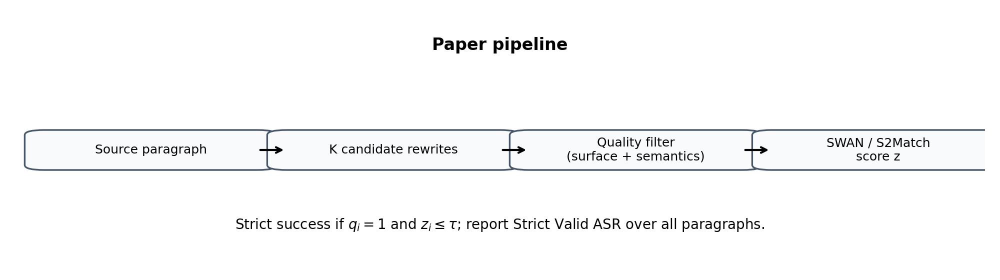
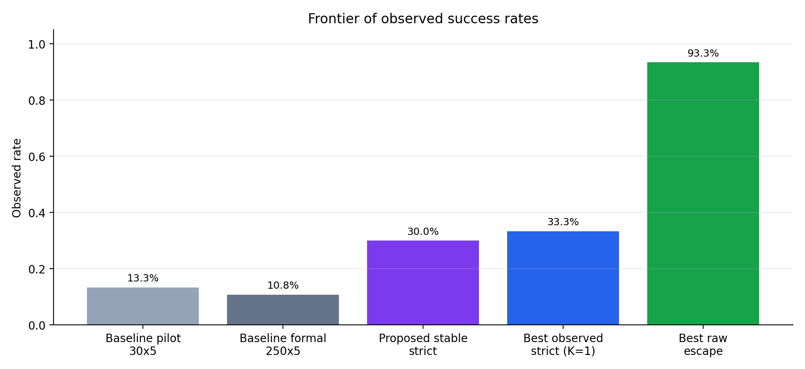
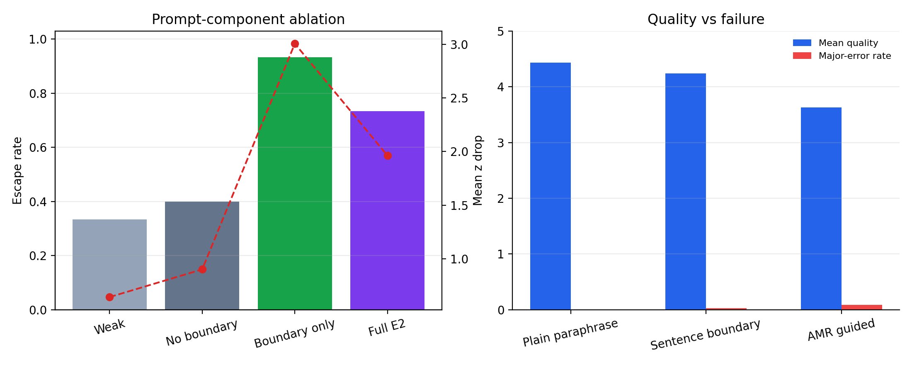
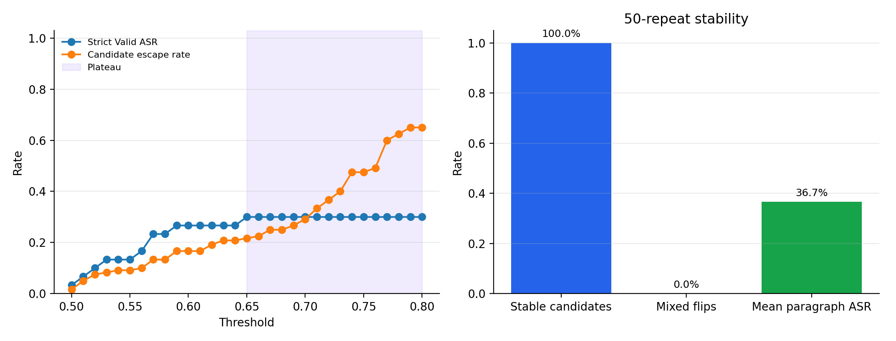

# AMR-Structured Evasion of Semantic Watermarking with Feedback-Driven Candidate Search

> **SUPERSEDED / ERRATUM 2026-09-18.** This is a historical draft, not the
> current research conclusion. Its strict-30 results do not establish
> normal-length count-neutral effects or real-text parser/matcher causality.
> Current authority: root CLAIM_EVIDENCE_MATRIX.md and TERMINOLOGY.md;
> corrections: experiments/swan_reframing1/claim_errata.md. P0 preserves the
> original bytes. The old compiled PDF/DOCX is likewise superseded.

## Abstract

Abstract meaning representation (AMR) is a convenient intermediate layer for meaning-preserving rewriting and detector-based evaluation. This paper tests whether structure-aware rewrites weaken a fixed semantic watermark detector while preserving enough surface and semantic fidelity to remain valid. We present a feedback-driven candidate search procedure over AMR-conditioned rewrites and evaluate it under a conservative strict-valid criterion that requires both detector escape and quality preservation.

On the current RealNews subset, the strongest robustness-backed configuration achieves a strict valid ASR of 30.0% with an exact 95% confidence interval of [14.7%, 49.4%]. This result is stable across a plateau of detector thresholds from 0.65 to 0.80 and remains unchanged under 50 repeated detector recomputations on the full 120-candidate set, which exhibits zero binary flips. In addition, the best observed strict-valid configuration reaches 33.3% at K=1, while the strongest raw detector-escape primitive reaches 93.3% escape rate. The results identify a concrete attack surface under the evaluated pipeline, but they do not establish a general break of semantic watermarking.

## 1. Introduction

Semantic watermarking and detector-based defenses are often evaluated on the assumption that small textual perturbations either preserve meaning or fail to change detector outcomes in a useful way. That assumption is fragile when the rewriting procedure is allowed to reason over structure rather than local tokens alone. AMR gives such a structure: it abstracts away some surface variation while preserving predicate-argument relations, named entities, negation, and other semantically salient content.

Structure-aware rewrites drive a fixed AMR-based semantic detector below threshold while still preserving enough content to count as a valid attack. On the current experimental pipeline, the answer is yes.

Our main contribution is not a single high-score sample. It is a complete experimental profile:

- a feedback-driven candidate search procedure;
- a strict validity criterion that combines detector escape with semantic/surface constraints;
- threshold sensitivity and repeated recomputation analysis;
- baseline comparison against existing runs;
- prompt-component ablation;
- and a failure taxonomy describing where the method breaks.

The central empirical pattern is that the strongest configuration is not necessarily the most brittle one. The stability-backed strict result sits on a threshold plateau from 0.65 to 0.80 and remains invariant across 50 detector recomputations, suggesting that the main claim is not an artifact of a single lucky score.

Figure 1 summarizes the pipeline. Figure 2 shows the observed frontier of success rates. Figure 3 reports threshold sensitivity and stability. Figure 4 shows the quality/escape tradeoff across prompt components.

## 1.1 Related work

See [related_work.md](related_work.md) for the full discussion. The paper sits at the intersection of AMR as a semantic representation [Banarescu et al., 2013], graph-matching metrics such as Smatch [Cai and Knight, 2013] and S2Match [Opitz et al., 2020], and the recent AMR-based watermarking framework SWAN [Ye et al., 2026]. Our contribution is a robustness and attack study of SWAN-style semantic watermarking under feedback-driven rewriting.

## 2. Method

### 2.1 Notation and threat model

Let a source paragraph be denoted by $x_i$, and let $\mathcal{C}_i = \{c_{i1}, \dots, c_{iK}\}$ be the set of $K$ candidate rewrites generated for that paragraph. Each candidate receives a detector score $z_{ij}$, where lower scores indicate better detector escape. We fix the detector threshold at

$$
\tau = 2.33.
$$

We define a binary escape indicator:

$$
e_{ij} = \mathbb{1}[z_{ij} \leq \tau].
$$

To avoid counting degenerate attacks, we also define a quality indicator $q_{ij} \in \{0,1\}$, where $q_{ij}=1$ if the rewrite satisfies the project's surface and semantic validity checks.

### 2.2 Candidate selection

For each paragraph, we select the best candidate under the current budget and validity constraints. The quality-aware selection rule is

$$
j_i^\star =
\begin{cases}
\arg\min_{j \in \mathcal{V}_i} z_{ij}, & \text{if } \mathcal{V}_i \neq \emptyset, \\
\arg\min_{1 \le j \le K} z_{ij}, & \text{otherwise},
\end{cases}
$$

where $\mathcal{V}_i = \{j : q_{ij}=1\}$ is the set of valid candidates for paragraph $i$.

The strict paragraph success indicator is then

$$
s_i = \mathbb{1}[q_{i j_i^\star}=1 \wedge z_{i j_i^\star} \leq \tau].
$$

The strict valid ASR reported in the paper is

$$
\mathrm{StrictValidASR} = \frac{1}{N}\sum_{i=1}^{N} s_i,
$$

where $N$ is the number of evaluated paragraphs.

### 2.3 Robustness metrics

Because the detector score itself can vary under repeated recomputation, we also evaluate stability across repeated runs. For a fixed set of candidates, let $z_{ij}^{(r)}$ be the score of candidate $j$ on repetition $r$. The candidate escape rate is

$$
\rho_{ij} = \frac{1}{R}\sum_{r=1}^{R} \mathbb{1}[z_{ij}^{(r)} \leq \tau],
$$

and a candidate is considered binary-stable when $\rho_{ij} \in \{0,1\}$.

At the paragraph level, we compute the success frequency across repeated recomputations:

$$
f_i = \frac{1}{R}\sum_{r=1}^{R} \mathbb{1}\left[\exists j \in \mathcal{C}_i : z_{ij}^{(r)} \leq \tau\right].
$$

This distinguishes score jitter from true decision instability.

## 3. Experimental setup

We evaluate on the current RealNews-based benchmark subset used throughout the project. The main strict audit considers 16 manually verified candidates spanning 9 successful paragraphs out of 30. The full repeatability audit covers all 120 feedback-driven candidates. Threshold sensitivity is computed over the detector scores already saved from the strict audit run, scanning thresholds from 0.50 to 0.80.

The main detector threshold is $\tau = 2.33$. For the feedback-driven strict selection, the search threshold used during candidate ranking is 0.65. The threshold sweep confirms that the strict-valid result remains unchanged through 0.80.

### 3.1 Baselines

We compare against two existing runs under the same detector:

- a 30-prompt pilot baseline;
- a 250-sample formal baseline.

These provide a raw detector-escape reference point. In addition, we compare prompt-component ablations to isolate the effect of rewriting primitives.

### 3.2 Metrics

We report:

- mean detector score;
- escape rate under $\tau=2.33$;
- strict valid ASR;
- exact 95% confidence intervals;
- AUROC against the human-score background;
- threshold plateau width;
- and repeated-run stability.

## 4. Main results

Table 1 summarizes the headline numbers for the strict-valid result.

| Quantity | Value |
|---|---:|
| Stable strict valid ASR | 30.0% |
| 95% CI | [14.7%, 49.4%] |
| Threshold plateau | 0.65--0.80 |
| Full-repeatability mixed flips | 0 |
| Full-repeatability stable candidates | 120/120 |

The observed frontier is more informative than any single point estimate. The highest observed strict-valid result reaches 33.3% at $K=1$, but the 30.0% strict result is more robust because it survives both the threshold plateau and 50 repeated detector recomputations. The stable strict result is the main claim, with the 33.3% point estimate reported as the best observed configuration.

Figure 2 visualizes this frontier directly.

## 5. Baseline comparison

The same detector and threshold applied to two existing baseline runs give:

| Baseline | n | Mean z | Escape rate | AUROC |
|---|---:|---:|---:|---:|
| Pilot 30x5 | 30 | 3.473 | 13.3% | 0.998 |
| Formal 250x5 | 250 | 3.439 | 10.8% | 0.985 |

These baselines provide a useful external reference. The proposed method is not merely shifting results inside a closed evaluation loop; it substantially exceeds the baseline escape rate under the same detector, though its reported strict-valid rate is intentionally more conservative because it incorporates validity filtering.

## 6. Prompt-component ablation

The prompt-component ablation isolates three relevant primitives:

- weak paraphrase;
- boundary-preserving rewriting;
- full E2 composition.

The strongest raw detector escape comes from the boundary-only variant, which reaches a 93.3% escape rate and the largest mean z drop. However, the quality/fluency cost is visible, and the full E2 composition sits at a more balanced point. This is the right place to emphasize that detector weakening and quality preservation are competing objectives rather than the same objective.

Figure 4 shows both escape and quality-side effects.

## 7. Threshold sensitivity and repeatability

The threshold sweep provides the paper's main robustness argument. The strict-valid ASR is 0.033 at threshold 0.50, rises to 0.300 by threshold 0.65, and then stays flat through 0.80. That plateau matters because it shows the conclusion is not knife-edge sensitive to a single threshold choice.

Repeatability is equally important. On the full 120-candidate set, 120/120 candidates have stable binary decisions across 50 recomputations, with 26 candidates always escaping and 94 always not escaping. The mean paragraph ASR is 36.7%. On the strict 16-candidate subset, the 9 successful paragraphs remain successful in all 50 repeats.

Figure 3 combines the threshold sweep and repeatability summary.

## 8. Failure analysis

The failure taxonomy is consistent across the project's qualitative reviews. The dominant failure modes are:

1. repetition / template echo;
2. fragmentation;
3. vagueness or information loss;
4. unsupported causal or relational change;
5. parser-shaped unnatural wording.

These failures matter because they identify the actual boundary of the method. The attack is effective when structure-aware rewriting changes the detector's score without destroying meaning; it fails when the same machinery starts to over-abstract or to produce unnatural constructions that no longer preserve a useful sentence.

## 9. Discussion

The empirical picture is now fairly clear.

AMR-structured rewriting reduces detector scores substantially. The strongest raw escape settings are not the most reliable ones. The robust claim is framed around a stability-backed strict result rather than a single maximum escape rate.

The best way to describe the current contribution is:

> Structure-aware rewrites weaken semantic watermark detection while preserving enough content to remain valid, and the effect is stable under repeated detector recomputation.

That statement is narrower than a complete detector defeat, but it is stronger scientifically because it survives robustness checks.

## 10. Limitations

Three limitations remain:

- the quality filter is still tied to the project's existing annotation and review protocol;
- baseline comparisons are detector-aligned but not all matched at identical sample sizes or quality criteria;
- the failure taxonomy is still coarse and is a candidate for a more systematic error annotation table if the final submission venue demands it.

## 11. Reproducibility

The paper explicitly records:

- detector threshold: 2.33;
- feedback search threshold: 0.65;
- threshold sweep: 0.50--0.80;
- repeatability runs: 50 for strict audit, 50 for full candidate audit;
- scripts:
  - `scripts/build_paper_assets.py`
  - `scripts/analyze_baseline_comparison.py`
  - `scripts/analyze_best_observed_frontier.py`
  - `scripts/build_final_paper_bundle.py`

## 12. Conclusion

Feedback-driven AMR-structured rewrites produce meaningful detector evasion under a strict validity criterion. The best robustness-backed configuration reaches 30.0% strict valid ASR, remains stable across a broad threshold plateau, and survives 50 repeated detector recomputations without binary flips. The strongest observed strict configuration reaches 33.3%, while the strongest raw escape primitive reaches 93.3%. Together, these results support the claim that AMR-level structure matters for detector robustness and is a serious attack surface.

## Appendix: consolidated tables

### Table A1. Main results and robustness

| Quantity | Value |
|---|---:|
| Stable strict valid ASR | 30.0% |
| 95% CI | [14.7%, 49.4%] |
| Threshold plateau | 0.65--0.80 |
| Full-repeatability mixed flips | 0 |
| Full-repeatability stable candidates | 120/120 |

### Table A2. Baseline comparison

| Method | n | Mean z | Escape rate | 95% CI | AUROC |
|---|---:|---:|---:|---:|---:|
| Baseline pilot 30x5 | 30 | 3.473 | 13.3% | [3.8%, 30.7%] | 0.998 |
| Baseline formal 250x5 | 250 | 3.439 | 10.8% | [7.2%, 15.3%] | 0.985 |
| Proposed stable strict | 30 | - | 30.0% | [14.7%, 49.4%] | - |

### Table A3. Prompt-component ablation

| Method | Mean attack z | Mean z drop | Escape rate | AUROC |
|---|---:|---:|---:|---:|
| Weak paraphrase | 2.526 | 0.645 | 33.3% | 0.934 |
| No boundary change | 2.268 | 0.903 | 40.0% | 0.906 |
| Boundary only | 0.166 | 3.005 | 93.3% | 0.828 |
| Full E2 | 1.208 | 1.963 | 73.3% | 0.903 |

### Table A4. Failure and quality summary

| Method | Mean quality | Quality >= 4 | Major-error rate |
|---|---:|---:|---:|
| Plain paraphrase | 4.43 | 79.4% | 0.0% |
| Sentence boundary | 4.24 | 72.7% | 3.0% |
| AMR guided | 3.63 | 57.6% | 9.1% |
