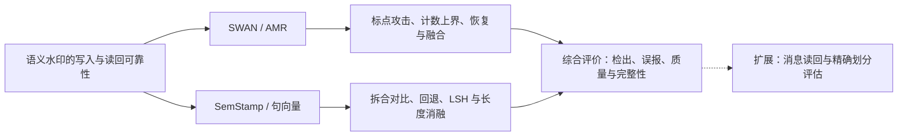

# 基于语义图与句向量的文本水印鲁棒性研究——SWAN 与 SemStamp 的实验分析

**Robustness of Text Watermarking with Semantic Graphs and Sentence Embeddings: An Empirical Study of SWAN and SemStamp**

2026-11-03 · 与综合正文同步的定位及导航稿 · 2026-11-04 更新表 8 分母核验

**阅读入口：[综合论文正文](综合论文_正文.md)。** 正文第 3 章为 SWAN/AMR 的攻击、机制与恢复，第 4 章为 SemStamp 的对比实验与消融分析，两者并列；第 5 章进行跨系统讨论及精确评估。本文件保留研究定位、历史工作映射和证据导航。

论文研究基于 AMR 语义图的 SWAN 与基于句向量的 SemStamp，分别整理其写入、编辑响应和检测评价。并列的是研究对象与论述地位；不同队列的模型、数据、误报口径与端点仍分别报告。本次写作不增加实验，不改变历史 Stop/No-Go。

## 1. 统一研究问题

**基于语义图和句向量的水印，能否在文本编辑后可靠读回？生成接受、实际划分、特征提取与统计判定分别如何影响检测？**

SWAN 研究线覆盖写入、分句、AMR 解析、模板匹配和分数汇总，以攻击验证和检测恢复为重点。SemStamp 研究线覆盖候选接受、句向量、LSH 和前句状态，以拆合对照、生成诊断与配置消融为重点。论文分析既有系统的鲁棒性，不把两个系统原有的设计作为本文提出的新方法。

论文主线可以概括为：

> 本文并列研究 SWAN 与 SemStamp。前者从可逆句界攻击展开 AMR 证据读回与恢复分析；后者从原始检测和结构编辑响应展开回退、LSH 位数及长度处理的消融。两条研究线共同说明，语义表示的稳定性需要经过实际写入、检测单元和完整校准才能转化为可靠判定。

这是问题和论证的关系图。箭头不表示各阶段都已通过正式端到端验证。

### 1.1 三条主线实际包含哪些研究工作

“攻击、机制、恢复”是组织贡献的三个层次，不是只有三项实验。按研究问题展开，SWAN/AMR 相关积累可以组织为以下八个模块。表中训练次数、条件数、候选数和来源数各有含义，不相加为独立样本量。

| 模块 | 已有研究内容 | 已核实的工作与结果 | 论文作用 |
|---|---|---|---|
| 1. 写入、复现与数据资格 | 原始流程复现、逐句接受与回退、模板库配置、正常长度写入、事实规划与语义去重 | 短文本 30 篇中 21 篇五句全接受；后续固定正常长度配方完成 200 来源但合格 0，不能作为攻击样本 | 建立正例资格，分析 AMR 约束与自然文本生成的接口 |
| 2. 多种攻击及反馈条件 | 图结构编辑、文本改写、结构改写、确定性标点攻击、固定候选与反馈选优 | 30 来源×3 组×4 候选的确认比较及配对机制实验；历史 250 来源攻击另列；受限反馈回放实际完成 180 会话、300 次查询 | 展开攻击面、预算和可用反馈，而非仅报告一次标点替换 |
| 3. AMR 与匹配机制诊断 | 单元数上限、整图和局部图、真实重解析与人工图、模板匹配及库规模 | 5→1→5 可逆结果与单元计数上界已经解释主攻击；其他图实验按真实输入与原端点报告 | 区分计分数量、观察范围、匹配和语义对应的影响 |
| 4. 聚合与弹性重构 | Mean/Median/Max/Top-k/soft-green、候选跨度、弹性路径、覆盖率、空路径奖励 | 重聚合比较使用各 250 篇人类/水印/攻击文本；AMR v3 已完成 1000 校准行和 210 开发行；S8 暴露覆盖率不足 | 说明仅重汇总或扩大候选范围能恢复什么、会引入什么问题 |
| 5. 多视图和学习融合 | 整图/子图、秩融合、归一化、简单平均、门控、注意力及交叉注意力 | 四阶段×五种子的 20 次模块消融；后续 24 对×六条件、13 个冻结模型迁移完成，12 对保留读出集上的简单平均存在排序收益 | 比较表示与融合设计，保留正面和负面观察 |
| 6. 负例、阈值与误报控制 | 困难负例、分族训练、拒绝规则、条件误报、path0 正负权衡 | 已有 80 条训练轨迹、100 个冻结端点及 40 个工作点分析；这些次数不代表独立测试样本 | 解释为何分数提高或 AUROC 较高仍可能无法满足目标误报要求 |
| 7. 证据身份与语义对应 | A0/A1/A2、候选容量、去重、文本支持、歧义及模型辅助审计 | 12 来源×7 条件的 84 行 A0/A1 完成；23,229 对候选对应完成模型规则展开，39/84 行可得完整模型参照；独立真人参照仍缺 | 进一步检查“读到的是否确实是对应证据” |
| 8. 语义载体与消息读回 | 模板到符号、已知位置与盲定位、等频顺序、全消息搜索、事实载体、解析与分类分层 | 旧通道已做 $4^8$ 消息空间搜索及位置/符号替换；原盲完整恢复为 0/12；新事实载体属于后继分层研究 | 扩展讨论：水印存在性检测与消息正确恢复是不同目标 |

模块 1、2、3 构成攻击及机制的主体；模块 4、5、6、7 构成恢复及其效用评价的主体；模块 8 提供更强读回目标下的补充证据。AMR v3 的 210 行、S8 的条件结果、迁移的 144 配对条件与 A0/A1 的 84 行不是同一个实验，也不拼成一个总成功率。[1、3–5、8–11]

历史负结果具有具体内容。例如，简单重聚合未恢复相应攻击下的检测、S8 覆盖不足、额外交叉注意力未建立目标工作点收益、调阈值存在检出与误报权衡。这些都是已执行比较的结果，可进入正文解释设计选择。它们不支持“所有融合都无效”；后来完成的简单多尺度平均迁移结果应一并呈现。[3、9]

独立秘密 Bank、多 Bank 联合检测和多独立解析器属于进一步扩展。已有建库、运行器或排队状态按实际完成度记录，没有最终比较的部分放在研究边界中。旧候选池上的二元反馈回放也不能改写为新的秘密 Bank 黑盒攻击成功。[10–11]

复现工程另外形成一个附录模块：冻结输入、代码与模型 SHA、图与分数回放、缓存隔离、完整分母、异常与恢复规则。这些工作支撑结果可信度，不与攻击效果一起计算“成功实验数”。

### 1.2 SemStamp 并列章节的内容

SemStamp 在[正文第 4 章](综合论文_正文.md#4-semstamp对比实验与消融分析)拥有独立的设置、结果表、消融与讨论。使用句向量、LSH 和前句相关接受区域的机制与 AMR 分别介绍。

| SemStamp 研究 | 已有证据 | 应如何使用 |
|---|---|---|
| 生成及五方法对照 | 100 水印正例、100 人类参照；原始 TPR 69%、AUROC 0.854；另列四种方法的原始与拆合参照 | §4.1–§4.2；平均 7.8 输入单元，最多十句不等于严格 fixed-N |
| 拆句与合句 | 原始/合并/拆分检出为 69/100、60/100、61/100，参照误报为 4/100、12/100、8/100 | §4.2；三条件各 100 正例＋100 参照已逐行核全，仍不是独立测试 FPR |
| 回退分桶 | 无回退 37 篇及回退 1%–30% 的 14 篇全部检出；高回退 49 篇检出 36.7% | §4.3；描述关联，不作唯一因果归因 |
| LSH 位数消融 | 3→8-bit：接受率 1.10%→1.48%，回退 220/683→169/699，AUROC 0.854→0.926 | §4.4；两侧 FPR 为 4%/1%，TPR 69%/71% 不能当同误报净收益 |
| 长度处理消融 | 截断→自然长度：重新校准阈值 1.347→1.807，TPR 69%→64%，AUROC 0.854→0.863 | §4.5；不是旧阈值跨长度迁移 |
| 顺序诊断 | 换序后 TPR 36%、人类参照误报 5% | §4.6；单列不保持词序的干预 |
| 独立原始检测 | 另批 1000 校准、1000 独立无水印测试及 1000 正例；47/1000 误报、954/1000 检出 | §4.7；不同配置与队列，不连接成 69%→95.4% 的改进 |
| 精确评估 | 评分适配、双重放与小实例算法核验完成；完整认证在资源门停止 | §5.3；不是实际认证成功率 |

上述内容已写成正文表 7–12 及相应分析。精确评估在综合分析中保留状态与范围，完整推导及资源日志可作为附录材料。[2、12–13]

表 8 的横向分母已另行逐行核验：SwordStamp 拆分正例仅 98 篇，检出为 80/98，检出率保留两位小数为 81.63%，两篇缺失单列；其余已运行条件各为 100 正例＋100 参照。PMark 合并、拆分未运行。详见[分母核验记录](表8_条件分母核验.md)。[14]

SWAN 与 SemStamp 的现有数据、生成模型和实验合同不完全一致。两个并列实证章保留各自的统计范围，综合分析对照机制与评价条件，不由绝对检出率直接排名，也不把差异唯一归因于 AMR 和句向量。SWAN 的 29/29 攻击成功与 SemStamp 的 954/1000 原始检出属于不同端点。

## 2. 中文摘要

语义水印使用语义图或句向量承载来源信号，但最终检测仍依赖文本生成、单元划分、特征提取和统计判定。本文并列研究基于抽象语义表示的 SWAN 与基于句向量及局部敏感哈希的 SemStamp，考察文本编辑后的检测变化、生成与读回环节的影响，以及恢复方法的实际收益。

在 SWAN 的 30 篇五句短文本上，确定性句末标点替换保持词汇与词序，将五个检测单元合为一个，使原本检出的 29 篇全部逃逸，条件攻击成功率为 100%（95% 精确置信区间：88.1%–100%）。恢复对应单元后，全部 30 篇的原始分数恢复；单元数量造成的统计量上界足以解释这一条件下的失败。恢复研究进一步比较重新分句、聚合、弹性跨度、多尺度融合及事实对应。新语料的 12 对保留读出文档上，简单多尺度平均在六个条件的 AUROC 为 0.910–0.938，复杂融合未稳定超过简单平均。

在 SemStamp 的百篇水印正例与百篇人类参照诊断中，原始检出比例为 69%，校准集经验误报为 4%。固定原始阈值后，合并与拆分的检出比例分别为 60% 和 61%，对应人类参照误报为 12% 和 8%。生成侧分析发现，高回退比例与较低检出相关；将 LSH 从 3-bit 调整为 8-bit，候选接受率由 1.10% 增至 1.48%，AUROC 由 0.854 增至 0.926，但不同实测误报水平限制了固定工作点的比较。另一个独立实验采用 1000 篇校准文本、1000 篇无水印测试文本和 1000 篇水印正例，原始检测的测试误报为 4.7%，检出率为 95.4%。

两组研究分别揭示了语义图水印的单元计数及证据读回问题，以及句向量水印的生成接受、相邻状态与条件误报问题。当前证据支持限定配置下的攻击、诊断和恢复比较；独立语义质量、正常长度计数守恒效应及低误报下的稳定防御仍待验证。真实文本的完整划分认证在资源门停止，尚无认证成功率。

**关键词：**文本语义水印；抽象语义表示；句向量；SWAN；SemStamp；鲁棒性；消融分析

## 3. 引言论述稿

语义水印尝试将来源信号置于比表面词汇更稳定的表示中。SWAN 使用 AMR 图与模板约束，SemStamp 使用句向量、LSH 区域和前句派生的接受规则。两者都要经过文本生成、实际分句、特征提取与统计判定；表示的设计目标能否转化为鲁棒检测，需要检查完整读写流程。

本文从一个已验证的攻击现象出发：在所测 SWAN 短文本中，保持词汇和词序、只替换句末标点，就能使原本检出的水印全部逃逸。恢复对应边界后，原始分数又全部恢复。该结果说明，句界属于实际可利用的检测接口。攻击成功可以在其明确的实验范围内成立，同时仍需要继续解释其原因：此次五单元合一的干预同时改变了计分次数和输入表示，而单单元的统计量上限已经低于检测阈值，足以造成逃逸。[1]

这个攻击结果需要放回 SWAN 的检测链路解释。句界变化既会改变计分次数，也可能改变一次解析的文本范围和图结构。单元数减少足以解释当前短文本主实验，不能进一步据此认定 AMR 语义本身已被破坏。整图、子图与模板匹配研究则用于检查另一层问题：当观察范围变化时，检测器能否辨认原先的水印证据，以及新匹配是否确有文本支持。[1、4–5]

既然给回对应单元能够恢复 SWAN 的原始分数，一个自然问题是能否自动找到有用的检测单元。历史研究据此探索了规则分句、弹性跨度、整图和子图、多尺度融合以及事实对应。这些结果并非全部相同：简单平均在新语料上存在排序收益，而更复杂的融合没有稳定额外优势；另一些恢复方法则暴露了误报、重复计数和错误对应问题。本文把这些观察用于分析恢复收益成立的条件，而不将其中任何一个局部指标直接当作稳定防御。[3–5]

恢复评价还应保持检测任务的端点一致：正例分数提高或候选排名变好，需要结合独立无水印测试才能解释为有效检测改善；匹配到一个语义候选，也不等于在目标模板库下获得有效水印证据。语义消息实验进一步区分了“检测到水印”与“恢复指定消息”，为完整读写链路提供补充诊断。[3–5、8]

SemStamp 提供另一条完整实验链：原始检测先暴露生成接受不足的可能性，拆合比较同时观察正例与人类参照，回退分桶、LSH 位数及长度规则进一步说明配置如何影响结果。它与 SWAN 并列回答同一可靠性问题，并不要求两个系统使用相同的诊断或具有相同失效原因。[2、12–13]

由此，正文分别建立 SWAN 的攻击与恢复论证，以及 SemStamp 的对比与消融论证，再在综合分析中讨论误报、质量和完整评估。精确划分算法不作为已完成的 SWAN 认证贡献。已有文献已经研究结构改写和对齐，本文的实证价值集中于所测系统和可复核结果，不主张首次提出句界攻击。[1–8、12–13]

## 4. 三项核心贡献

### 4.1 SWAN/AMR 的攻击与恢复分析

本文给出 SWAN 短文本上的确定性标点攻击及恢复对照，报告初始检出条件下的攻击成功率、全来源分母和完整写入子集，并通过单元计数上界限定机制解释。历史文本改写与图结构探索用于说明攻击面及实现条件。

**承担的内容：**正文第 3 章，包括 SWAN 主攻击、三组改写、历史 250 篇探索、AMR 读回机制及规则分句、弹性跨度、多尺度和事实对应恢复。各队列分别统计；恢复结果报告实际收益与误报限制。

### 4.2 SemStamp 的对比实验与消融分析

本文报告 SemStamp 的原始检测、五方法参照和拆合后的正负例响应，通过回退分桶、3/8-bit LSH 及长度处理对照分析生成和判定条件，另列独立千篇原始检测核验。

**承担的内容：**正文第 4 章与表 7–12。回退关联不当作唯一因果机制；不同实测 FPR 的 TPR 不当作同工作点增益；百篇与千篇结果不拼接。

### 4.3 跨系统的鲁棒性评价

本文对照两条读写链路，明确生成资格、条件误报、失败分母和完整流程校准的作用，并通过精确划分算法核验与资源停止记录界定经验诊断和完整保证的差别。

**承担的内容：**正文第 5–6 章。比较系统环节与证据范围，不用跨队列绝对分数排名；原始检测、局部排序和完整认证保持独立端点。

三项贡献的关系是：**SWAN/AMR 实证、SemStamp 实证、跨系统评价。** 攻击、机制和恢复仍保留为各研究线内部的问题组织。

## 5. 评估形式化与精确算法扩展

本节与正文 §5.3 对应。精确算法来自 SemStamp/SimMark 独立分支，尚未构成 SWAN 或 SemStamp 的真实完整认证结果；正文保留目标定义、算法核验和实际停止状态，推导及资源日志可另列附录。

设文本为 $x$，划分为 $P$，完整检测分数为 $S(x,P)$。原始检测器根据自己的分句规则获得 $P_0$，并在分数超过阈值 $\tau$ 时判定存在水印。

经验攻击提供某个允许的变换及其实际划分 $P_a$，使原始检出的文本失去检出。对于确定性标点攻击，词汇与词序保持，但文本字节和实际分段可以变化；对于模型改写候选，还必须单独记录词汇和语义改动。

恢复算法产生新的片段或对应并形成分数 $S_R(x)$。恢复可能采用候选搜索、融合或去重，因此 $S_R$ 通常不是原统计量。对恢复结果的评价必须使用完整恢复流程及其相应校准，不能直接继承原检测器的误报承诺。

精确评估则预先声明合法划分集合 $\mathcal A_k(x,P_0)$，计算：

$$
C_k(x)=\min_{P\in\mathcal A_k(x,P_0)}S(x,P).
$$

只有完成整个集合的有效求值，才能使用：

$$
C_k(x)>\tau
\quad\Longrightarrow\quad
\forall P\in\mathcal A_k(x,P_0),\ S(x,P)>\tau.
$$

旁线已有的固定单元数 DP 与五句合一攻击使用不同的划分集合。DP 的保证不覆盖五句合一，也不自动覆盖带全文归一化或内部恢复搜索的检测器。如果把恢复程序纳入精确评估，必须对其完整统计量重新检查可分解性；尚未完成这一推广。[2、6–7]

## 6. 两条研究线的主要结果

| 证据模块 | 现有主要结果 | 在综合论文中回答的问题 |
|---|---|---|
| SWAN 确定性标点攻击 | 30 篇中 29 篇原本检出，攻击后 29/29 新增逃逸；21 篇全接受子集同样成功 | 是否存在实际可利用的划分依赖 |
| 对应边界恢复 | 全部 30 篇的 $N$、$G$、$z$ 恢复原值 | 判定变化是否随划分可逆 |
| 三组四候选攻击 | 原本检出的 29 篇中，无反馈句界改写新增成功 28/29 | 成功是否完全依赖读取检测分数选优 |
| SemStamp 原始与拆合 | 100 正例及 100 人类参照；原始/合并/拆分 TPR 为 69%/60%/61%，参照误报为 4%/12%/8% | 编辑如何同时影响正例与无水印判定 |
| SemStamp 回退及配置消融 | 高回退 49 篇检出 36.7%；3→8-bit 的 AUROC 0.854→0.926；自然长度重新校准后 TPR 64% | 生成接受、哈希位数与长度规则如何影响表现 |
| SemStamp 独立原始检测 | 另批 1000 校准、1000 正例和 1000 独立测试负例；TPR 95.4%、FPR 4.7% | 对应配置下原始检测是否可用，不是完整认证 |
| 其他方法拆合（补充） | 现有指定配置下，正例与无水印响应存在差异；PMark 拆合未完成 | 提供背景参照，不扩张 SWAN 主结论 |
| 多尺度迁移 | 保留读出集 12 对、六条件，简单平均 AUROC 0.910–0.938；均高于所比较的 S6 单尺度 | 多尺度观察是否提供更好的排序信号 |
| A0/A1 对应 | 12 来源×7 条件的 84 行中，73 行统计量相等、11 行 A1 更低、0 行更高 | 增加对应是否一定提高现有统计量 |
| 精确 DP（独立旁线） | 5,669 个系统性对照＋2,000 个随机小实例；另有 1,000 个独立评分退化对照 | 限定评分结构的算法正确性，不是 SWAN 认证 |
| 完整认证（独立旁线） | v18 在容量及双回放预算门停止，认证制品为空 | 记录实际计算边界，不填补 SWAN 的验证缺口 |

上表是证据组织表，不把不同队列的样本相加，不做跨数据集绝对性能排名。SWAN 攻击为有效分数逃逸；多尺度结果为排序诊断；84 行对应结果来自 12 个来源；DP 对照为算法测试实例。[1–7]

### 6.1 多尺度结果应更新旧叙述

较早文档把恢复和融合概括为“未建立稳定收益”。综合稿应增加后来完成的新语料迁移结果：简单平均在六个条件中均高于所比较的单尺度 S6，复杂门控和注意力没有稳定超过简单平均。因此，准确的表述是“存在小样本排序收益，稳定低误报防御尚未建立”。[3]

这批比较的独立文档校准规模不足以支持目标 1%/5% 工作点，正负文本长度和生成风格也不完全匹配。官方原句聚合在 clean 条件的 AUROC 为 0.931；恢复实验表没有给出同一官方检测器的全部干预条件。因此不能把简单平均相对 S6 的收益改写成对官方 SWAN 的正式鲁棒性提升。

### 6.2 失败探索的解释位置

正常长度生成未通过某一固定写入配方，说明该配方不能提供所需正例；它不否定已经完成的短文本攻击。图编辑难以生成自然文本，说明从图操作到可用文本之间存在工程与质量障碍；它不证明所有 AMR 攻击不可能。完整认证因资源门停止，说明该配置尚未完成计算；它不等于算法错误，也不等于总体不可计算。

这些结果适合放在各章的适用条件与讨论中，用来解释研究路线为何演进。长日志、逐版本预算和所有尝试参数进入附录。

## 7. 历史工作如何全部归位

| 历史工作 | 正文或补充位置 | 应使用的叙述 |
|---|---|---|
| Plan A：复现、普通与结构改写 | 背景与实验设置 | 原始可检出性及初始攻击动机 |
| Plan B–D：图节点、边、角色、重入等操作 | 攻击章节简述，细节进附录 | 从图扰动到文本实现的探索及质量障碍 |
| Plan E 与 250 篇攻击 | 攻击章节 | 历史攻击面；固定预算与自适应补救分开 |
| 确认三组与严格标点 A-B-A | 核心结果章节 | 已成立的短文本攻击及可逆证据 |
| 人工组合图与真实重解析比较 | 机制诊断章节 | 匹配作用域诊断，明确人工图与真实 parser 输出不同 |
| SemStamp 生成、原始检测、拆合、回退及 LSH/长度消融 | 并列的 SemStamp 实验章节 | 基于句向量的独立研究线，含完整结果表及解释 |
| 其余方法拆合与原始检测 | 相关工作及补充对照 | 配置内比较，不作为本文主研究对象 |
| 随机换序 | 补充诊断 | 顺序/状态敏感性，单列为不保持词序的威胁集合 |
| 规则分句、弹性跨度、整图/子图、融合、A0/A1/A2 | 恢复章节 | 经验恢复、误报、对应可信度；模型审计与独立真人证据分开 |
| 精确 DP、SemStamp/SimMark 适配、固定/可变单元数探索 | 综合分析中的精确评估；推导与资源日志入附录 | 算法、原始检测与真实认证完成度分别报告 |
| 写入配方、事实规划、语义去重 | 数据资格与讨论 | 正例形成的前提及写入可行性边界 |
| AMR 符号序列与消息读回 | 扩展讨论或附录 | 从水印存在性检测延伸到消息恢复，使用独立端点 |
| SHA、回放、调用账本、终态与故障修复 | 复现附录 | 支持可检查性，不能据文件或测试数量增加独立实验证据 |

若“全部”包括原第二篇的消息写入与读回，也可收录为扩展章节，但需要明确它的问题更强：检测到水印不等于恢复指定消息，候选排序较好也不等于完整消息正确。本章沿用自身样本和恢复率，不借用 SWAN 的 29/29 证明可靠消息通信。这样能保留历史成果，又不让正文同时承担两套混杂的主端点。[8]

## 8. 已落实的正文结构与章节过渡

| 章节 | 主要内容 | 引向下一章的论述 |
|---|---|---|
| 1 引言 | 语义图与句向量的两条读写链路、相关工作、三项贡献 | 为什么需要完整流程评价 |
| 2 系统机制与实验设置 | SWAN/SemStamp 机制对应、独立队列、统计端点、质量与复现 | 明确两章实验各自的范围 |
| 3 SWAN/AMR：攻击、机制与检测恢复 | 写入与攻击面、可逆标点攻击、计数上界、反馈、聚合与弹性重构、多尺度、事实对应 | 从攻击见证到恢复收益及限制 |
| 4 SemStamp：对比实验与消融分析 | 原始与五方法参照、拆合、回退、LSH 位数、长度规则、顺序诊断、独立千篇核验 | 从编辑响应到生成和判定条件 |
| 5 两类系统的综合分析 | 两条链路对照、条件误报、完整流程校准、精确划分评估 | 哪些解释可跨系统讨论，哪些仍需独立验证 |
| 6 讨论与研究边界 | 正常长度、语义质量、消息读回、分母与来源完整性 | 界定现有结果与待验证端点 |
| 7 结论 | 并列归纳 SWAN 与 SemStamp 的发现 | 回答语义水印读写可靠性问题 |
| 参考文献与实验证据索引 | 论文入口、聚合报告、原始结果及终态审计 | 支持数字与解释回查 |

SWAN 与 SemStamp 分别占一个完整实证章，均包含设置、结果与分析。SWAN 内部七节承载原有攻击、机制和恢复积累；SemStamp 内部七节承载对比、消融和独立核验，章节并列不抹平证据强度差异。

当前正文包含 13 张表，SemStamp 的表 7–12 已完整补入。历史日志、逐版本预算、精确算法长推导及消息通道细节通过证据索引引用，可在排版时展开为附录。

## 9. 结论段落

本文并列研究了基于 AMR 的 SWAN 和基于句向量的 SemStamp。SWAN 的短文本实验确认了可逆句界逃逸，单元计数上界足以解释主攻击，恢复研究进一步展示了多尺度观察的局部排序收益及事实对应的限制。SemStamp 的百篇对照揭示了拆合后检出与误报同时变化，回退、LSH 位数和长度规则分析说明生成与判定条件会影响实验表现；独立千篇实验另行确认了对应配置下的原始检测能力。

这些结果共同表明，语义水印的鲁棒性应沿着生成接受、实际划分、证据读回与完整校准进行评价。现有工作提供了范围明确的攻击、对比与消融证据；独立质量、正常长度计数守恒效应、稳定低误报恢复和真实完整认证仍是待验证端点。

## 10. 证据入口

1. [SWAN 短文本攻击复核报告](../swan_short_text_attack_analysis_20261103/REPORT.md)、[重算指标](../swan_short_text_attack_analysis_20261103/metrics.json)：29/29、21/21、文本长度及恢复对照。
2. [前一主题的中文完整稿](../../论文/01_句界审计与精确评估/第一篇_中文完整稿.md)、[前一主题的贡献与摘要](../../论文/01_句界审计与精确评估/第一篇_核心贡献与摘要.md)：方法分类、相关工作、跨方法结果的修正来源；本次综合论文的题目、结构与贡献以[综合正文](综合论文_正文.md)为准。旧结果章节中已撤回的“唯一因果归因”等表述不沿用。
3. [新语料迁移结果更新](../../experiments/swan_research_completion_20261102/result_update1/UPDATE.md)、[迁移详细报告](../../experiments/swan_research_completion_20261102/result_update1/transfer4/REPORT.md)：12 对保留读出集、六条件、全部种子及比较限制。
4. [A0/A1 评分终态报告](../../experiments/swan_research_completion_20261102/atomic_scoring1/REPORT.md)：84 行开发结果及来源数。
5. [模型辅助语义复审](../../experiments/swan_research_completion_20261102/model_semantic_review3/REPORT.md)：对应支持、歧义及非独立评审范围。
6. [相邻评分算法核验](../../experiments/certified_resegmentation_pairwise_preflight1/audit_results.json)：5,669 个系统性对照、2,000 个随机小实例及 1,000 个退化对照，属于算法测试。
7. [v18 停止审计](../../experiments/certified_resegmentation_wp2_v18_b1_exact_certificate1/P0_STOP_AUDIT.json)：`decision=stop`、容量/预算失败门、空认证制品列表。
8. [语义消息通道分层审计](../../第二篇_语义消息写入与读回/01_论文文档/P2_语义消息写入与读回.md)：排序、符号身份、定位与消息恢复的不同端点。
9. [历史已完成消融与缺口审计](../../report_assets/unfinished_research_audit_20261102/REPORT.md)：本稿引用其中 C01–C08 已完成比较的规模与范围。W/X 项状态以 11 月 3 日后继记录覆盖，不能用这份较早审计断言后来仍未执行。
10. [受限二元反馈回放](../../experiments/swan_restricted_feedback1/REPORT.md)：30 来源、180 会话、300 查询；历史固定池、名义阈值、无新独立质量和秘密 Bank 端点。
11. [后继实验计划与完成记录](../../experiments/swan_research_completion_20261102/PLAN.md)：正常长度写入、对应评分、建库、读回及各冻结后继的实际进展。
12. [SemStamp 独立原始检测结果](../../experiments/certified_resegmentation_wp2_v17_b0_detector_health1/B0_RESULT.json)：原始检测端点，不是完整认证成功率；解释见当前中文完整稿 §6.2。
13. [五方法原始检测结果](../../experiments/sentence_watermark_method_matrix_20261029/formal_100_20261029/RESULTS_stage1.md)、[拆合及回退检查](../../experiments/sentence_watermark_method_matrix_20261029/formal_100_20261029/CHECKS.md)、[SemStamp LSH 位数诊断](../../experiments/sentence_watermark_method_matrix_20261029/formal_100_20261029/SEMSTAMP_LSH_COMPARISON.md)：解释采用当前中文完整稿 §5.2–5.5 的修正口径，不沿用历史结果章节中的严格 fixed-N、唯一因果归因或阈值跨长度迁移主张。
14. [表 8 条件分母核验](表8_条件分母核验.md)、[结构化审计](表8_条件分母核验.json)：补齐逐行来源、有限分数、分母和分子核验；更新 SwordStamp 拆分的实际分母，不修改历史原始证据。

本次仅重组论述并核对引用材料；没有新增模型、GPU、API 或检测调用，没有执行新的投稿操作。本文中的统计主张继承各自原始实验范围，写作整合不构成新的独立验证。
