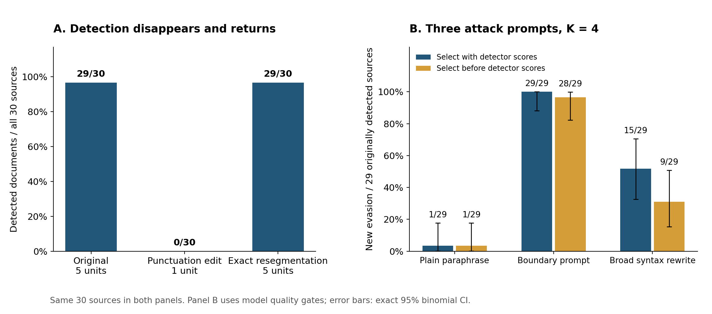

# SWAN 短文本句界攻击成功分析报告

**日期：2026-11-03｜性质：既有冻结实验的只读复核｜新增生成、解析、检测调用：0**

**结论：句界攻击已在现有 SWAN 短文本检测实验中成功。** 确认集包含 30 篇英文文本，每篇 5 句、17–46 词，平均 30.9 词。在基于 SWAN 官方组件的本地检测实现中，29 篇原本能检出；仅替换句末标点、保持词汇及其顺序后，这 29 篇全部逃逸。以原本检出的样本为分母，攻击成功率为 **29/29＝100%，95% 精确置信区间为 88.1%–100%**。[S3–S4]

五句均通过注入接受门的 21 篇子集，同样达到 **21/21 攻击成功**；按对应边界恢复五个检测单元后，全部 30 篇的原始分数均恢复。该结果确认了检测流程对句界划分的依赖，也表明完整写入的正例仍可被攻击。[S3–S4]

与 SWAN 原论文相比，确认集的**五句设置对齐，实际词数分布尚未证实对齐**。本报告主端点为“词汇保持、固定阈值下的检测逃逸”，适用范围为已验证的短文本与计分流程。长文本泛化、独立真人语义评价和其他检测入口属于另行验证的问题。[S1–S2]



*图 1：左图为检出数，分母是全部 30 篇；右图为新增逃逸数，分母是原本检出的 29 篇。两图使用同一批来源，不能合并成两次独立验证。右图候选通过的是模型质量门，误差线为 95% Clopper–Pearson 区间。*

## 1. 实验数据与 SWAN 基线对齐

本地确认集共 30 篇、150 个原始句子，按空白分隔统计共 927 个英文词，平均每句 **6.18 词**。这里的“词数”采用 `len(text.split())` 口径；模型 tokenizer 的 token 数是另一指标，不能直接互换。

| 比较维度 | 本地确认集 | SWAN 原论文 / 官方代码 | 对齐状态 |
|---|---|---|---|
| 样本数 | 30 篇 | 论文为 250 个样本 | 规模不同 |
| 每篇新生成句数 | 5 句 | 论文和代码均为 5 句 | **已对齐** |
| 每篇实际词数 | 17–46 词 | 已核实的论文设置未提供词数分布 | **未证实对齐** |
| 每篇平均 / 中位词数 | 30.9 / 30 词 | 无可核实数值 | 无法数值比较 |
| 逐句生成上限 | 50 tokens | 官方代码默认 50 tokens | 参数值对齐，不保证输出长度相同 |

上表本地长度由保存的 30 篇原文重算；论文设置与官方参数分别见 [S1–S3]。因此可以确认本地样本是很短的五句段落，但现有证据不足以量化它比原论文输出短多少。

| 对照项 | 已核实的设置 | 对当前判断的含义 |
|---|---|---|
| SWAN 论文 §4.1 | 给一句初始上下文，生成 **5 个新句子**；以段落为检测单位 | 基线没有把百词以上长文设为攻击有效性的必要条件 |
| SWAN 论文 §4.6 | 250 个样本 × 5 句，共 1,250 个生成句子 | 再次确认五句设置 |
| 官方代码快照 | `--num_sentences 5`；`max_new_tokens=50` 是逐句生成上限 | 50 tokens 不是整篇词数，也不是最短长度 |
| 官方保存逻辑 | `final_text = " ".join(current_sentences)` | 检测对象是新生成的文本，不是整篇 RealNews 新闻 |
| 本报告确认集 | 30 篇，每篇 5 句；17–46 词，中位数 30，均值 30.9 | 句数对齐，但不能据此声称字数、自然度或生成模型与论文完全匹配 |

这里应当区分三件事：新闻来源可以很长，生成段落可以只有五句，而检测器看到的单元数还会随句界变化。用 RealNews 作为提示来源，并不意味着检测整篇新闻。[S1–S2]

本地短文本由请求模型 `deepseek-v4-flash`、返回标识 `deepseek-flash` 生成。论文 §4.1 写的是 `DeepSeek-R1-Distill-Qwen-14B`；本地官方 README 又称论文注入使用 Claude 3.5 Sonnet v2。**论文与 README 的模型说明存在冲突**，所以本报告不把本地数据包装成原论文同模型复现。这个冲突不影响“论文与代码都明确采用五句输出”的核实结果。具体摘录见 [SOURCE_NOTES.md](SOURCE_NOTES.md)。

## 2. 正例资格与攻击成功判据

主证据来自已完成的 `confirmation_three_arm30` 及其配对机制实验 `confirmation_mechanism30`。两者复用同一批 30 篇来源。本报告使用这批已有正例，不将其他写入实验的草稿或未完成队列混入统计。[S3–S4]

30 篇均有生成检查点、句级注入记录、文本 SHA 和攻击前检测分数。其中：

- **29/30 篇在攻击前满足 $z>2.33$**，可以检验是否因攻击而失去检出。
- **21/30 篇的五个句子均通过注入接受门**；其余 9 篇涉及 13 个未通过接受门的句子槽，不能宣称所有 150 句均成功写入。
- 原本漏检的 1 篇保留在完整队列里，但不能计作攻击新创造的成功。

这批初始文本的篇章质量没有独立真人认证。新闻提示来源不自动保证输出是自然、连贯的新闻段落；通过注入门和检测门也不能替代文本质量评价。

定义 $D(x)=\mathbf{1}[z(x)>\tau]$。本报告的条件攻击成功率为：

$$
\mathrm{ASR}_{\mathrm{detected}}
=\frac{\sum_i \mathbf{1}[D(x_i)=1,\ D(T(x_i))=0]}
{\sum_i \mathbf{1}[D(x_i)=1]}.
$$

只有有限、有效的攻击后分数才参与这个判断。**NaN、缺失输出和解析失败不被自动算作逃逸。**

| 统计口径 | 结果 | 应如何表述 |
|---|---:|---|
| 原本检出的样本中，因攻击而逃逸 | **29/29，100%** | 主攻击成功率 |
| 全部来源中，新增逃逸 | **29/30，96.7%** | 保留完整队列的新增成功比例 |
| 全部来源中，攻击后低于或等于阈值 | **30/30，100%** | 攻击后逃逸比例，包含原有的 1 篇漏检 |

上述第一项是对可攻击的已检出样本做条件统计，同时完整公布 30 篇结果；没有静默删除失败来源或补样。

## 3. 主实验结果：标点干预与检测恢复

机制实验对每篇原文的前四个句末终止标点进行确定性替换，用分号连接，保留最后一句的句末标点。该操作不依赖检测分数挑选候选。逐条复核确认：

- 30/30 篇均符合保存的标点替换规则，词汇、大小写和词序不变。
- 检测单元全部经历 **5 → 1 → 5**。
- 四种分段变体均有有效、有限的分数；没有把异常输出记为成功。
- 精确恢复五个单元后，30/30 篇的 $N$、绿色命中数 $G$ 和 $z$ 分数都与攻击前一致。

这里的“精确恢复”是把合并后的文本按插入分号恢复为五个词汇对应单元；并非逐字节还原原标点。它是已知边界的诊断操作。[S4]

| 条件 | 检测单元 | 检出数，$z>2.33$ | 未检出数，$z\le2.33$ |
|---|---:|---:|---:|
| 原始文本 A | 每篇 5 | **29/30** | 1/30 |
| 仅替换标点 B | 每篇 1 | **0/30** | 30/30 |
| B 按现有通用规则重新分句 | 每篇 3–5 | 22/30 | 8/30 |
| B 精确恢复五个检测单元 A′ | 每篇 5 | **29/30** | 1/30 |

从原文到合句，29 篇由“检出”变成“未检出”，反方向变化为 0；配对 McNemar 精确双侧检验 $p=3.73\times10^{-9}$。这支持本队列中稳定的检测变化；它不证明所有文本、模型或 Bank 上都是 100%。

**结果并不依赖注入失败的那部分文本。** 只看五句全部通过注入门的 21 篇，仍然是 **21/21 原本检出 → 21/21 逃逸 → 21/21 恢复检出**。该子集攻击成功率为 100%，95% 区间为 **83.9%–100%**。这是本次补算的事后敏感性分析，不替换 30 篇主分母。

将阈值替换为此前独立人类校准集确定的 **1.8073922282301278**，主链条仍为 **29/30 → 0/30 → 29/30 检出**。因此，这个现象并非只在 2.33 这一个阈值上出现。[S5]

## 4. 攻击机制与检测入口

只要威胁模型允许修改句末标点，原本能检测到水印的文本经修改后不再被该检测流程检出，就已构成检测逃逸。攻击利用单元数减少，并不使成功失效；**单元数由可编辑句界决定，本身就是系统暴露的攻击面**。

该实现按每个单元与 50 个模板的最高匹配分数是否达到 0.65，计算绿色命中数 $G$。文档得分为：

$$
z=\frac{G-\lambda N}{\sqrt{N\lambda(1-\lambda)}},
\qquad \lambda=0.25.
$$

即使所有单元都命中，得分上界也只有：

$$
z_{\max}(N)=\sqrt{\frac{N(1-\lambda)}{\lambda}}=\sqrt{3N}.
$$

当合并后只剩一个检测单元时：

$$
z_{\max}(1)=\sqrt{3}\approx1.732
<1.8073922282301278<2.33.
$$

所以，只要进入这个有效单句计分路径，**一个单元即使命中模板，也无法越过本报告的两个阈值**。实际保存记录中，30 个合并文本的 $G$ 都为 0，$z$ 都为 $-0.57735$，匹配下降与单元数下降同时发生。

这组结果支持“**SWAN 组件检测系统依赖外部分句，句界合并可以造成可逆逃逸**”。但单元数下降已经足以解释越过阈值，因此不能仅据此断言“AMR 语义水印本身被擦除”，也不能把全部效果归因于 AMR 特有的匹配缺陷。要隔离后一个机制，才需要保持单元数相同的对照；这不是承认当前逃逸成功的前置条件。

### 检测入口差异

本地实验使用官方 AMR/模板匹配组件与本地评分包装器，保存有效单句 $z$；其单句计分规则与官方 `detect_from_parsed_amrs.py` 一致。**这次分析没有重新运行官方 CLI。**

官方另一入口 `detection_utils.detect_amr_sentences` 在句数小于 2 时直接返回 NaN。因此，本报告的“有效分数逃逸”只针对已经验证的本地计分流程，不能直接改写成“官方所有入口均返回无水印”。NaN 后系统拒绝、弃权还是放行，需要另外检查其上层处理逻辑。[S2、S6]

## 5. 固定四候选预算的三组攻击比较

同一批 30 篇来源还完成了三个攻击组，每组每篇固定生成 4 个候选，共 360 个候选，没有自适应补救。[S3]

“有反馈”先过质量门，再选择 $z$ 最低的候选；“无反馈”在读取攻击分数之前冻结第一个质量合格候选。无合格候选的来源保留为失败。两者都使用四候选预算；无反馈不意味着整个评测没有调用检测器。

| 攻击组 | 有反馈新增成功 / 29 | 95% 区间 | 无反馈新增成功 / 29 | 95% 区间 |
|---|---:|---:|---:|---:|
| 普通同义改写 `plain_paraphrase` | 1/29，3.4% | 0.1%–17.8% | 1/29，3.4% | 0.1%–17.8% |
| 句界改写提示 `boundary_only` | **29/29，100%** | 88.1%–100% | **28/29，96.6%** | 82.2%–99.9% |
| 广泛句法改写 `full_e2` | 15/29，51.7% | 32.5%–70.6% | 9/29，31.0% | 15.3%–50.8% |

历史文件以全部 30 篇为分母记录的质量合格逃逸数，依次为有反馈 **2、30、16**，无反馈 **2、29、10**；各组都包含原本漏检来源的成功记录。上表将这 1 篇从“新增成功”的分子、分母中同时剔除，避免虚增攻击效果。

有两条解释边界：

1. **`boundary_only` 是提示名称，不是严格的仅标点干预。** 本次核查发现，该组有反馈和无反馈各自选出的 30 个候选中，词汇序列与原文完全相同的均为 **0/30**。不能拿这一组证明“没有改词”；第 3 节的确定性标点实验才提供该证据。
2. **质量合格来自模型评审与自动检查。** 三组分别有 94/120、115/120、85/120 个候选过门。它们说明保存的质量规则下存在高成功率，不代表独立真人已经确认事实、语气、篇章连贯性完全保持。

这组补充结果说明，攻击成功不完全依赖读取分数选优；但它与主实验复用同一批来源，不能把两组 29/29 相加成 58 次独立成功。

## 6. 历史 250 篇探索结果

历史探索在固定 $K=4$、质量合格后取最低分的规则下，记录了 **191/250＝76.4%** 的有效逃逸；对失败项实施读取检测反馈的自适应补救后，累计为 **218/250＝87.2%**。固定预算结果的 250 篇中，239 篇位于 4–6 句区间。[S7]

它们支持“先前已经观察到较大攻击面”，但不能与确认集混算：来源、质量口径、候选选择及补救预算不同；也不能把 218/250 写成固定四候选或无反馈结果。本报告只将它们作为历史补充，核心结论由逐条配对的 30 篇标点实验承担。

## 7. 研究结论与适用范围

> 在基于 SWAN 官方组件的短文本检测设置中，30 篇来源均含五个句子，总长 17–46 词，平均 30.9 词。确定性的句末标点替换保持词汇顺序，却将检测单元数从五个降至一个。29 篇原本超过固定阈值的文本在干预后全部低于阈值，条件攻击成功率为 100%（95% 精确区间：88.1%–100%）。精确恢复五个检测单元后，所有来源的原始分数均恢复。五句均通过注入接受门的 21 篇子集也呈现相同结果。该证据确认了短文本攻击成功及所审计检测流程中的可逆句界依赖。

现有证据足以支持这一有明确范围的攻击成功结论。报告还需要保留以下限制：

| 问题 | 当前能说什么 |
|---|---|
| 是否已经有成功攻击 | **有**：29 个原本检出的短文本全部出现有效分数逃逸 |
| 是否有完整写入的正例 | **有**：21 篇五句全部通过接受门，且全部被成功攻击 |
| 是否与原论文同模型、同质量分布 | 未证明；模型说明还存在来源冲突 |
| 是否与原论文实际长度分布一致 | **仅确认五句设置相同**；原论文输出的词数分布仍缺少可核实数据 |
| 是否独立真人确认语义无损 | 未证明；标点也可能影响语气、问句功能或关系表达 |
| 是否可以报告正式 TPR@1% FPR | 本报告不能；固定 $z=2.33$ 不等于本数据实测 FPR 为 1% |
| 是否解决了长文本或所有 Bank/入口 | 未证明；属于后续推广问题 |
| 精确恢复是否就是可部署防御 | 不是已验证防御：这里用已知的对应边界作诊断，未建立其独立校准与误报保证 |

已有的人类测试参考也应准确使用：原句分段流程是 **3/250＝1.2% FPR**，规则分句流程是 **5/250＝2.0% FPR**，来自先前独立校准/测试实验；它们不是本次攻击条件下新测的同条件 FPR，更不是严格的 1% 保证。恢复检出效果不能替代防御误报审计。[S5]

置信区间使用文档级精确二项式区间，条件于当前固定队列和流程；没有覆盖生成模型变化、解析随机性、Bank 变化或评审误差。本次敏感性补算和报告整理属于事后分析，不追溯改写历史预注册状态。

**最终结论：短文本句界攻击成功，证据由有效分数逃逸、完整写入子集复核和原始分数恢复共同支持。** 原论文采用五句输出，说明五句段落本身具有基线相关性；实际词数尚未对齐，限制的是向原论文整体分布推广的程度。

## 8. 复核与文件

本次重新核验三份历史清单的 **7,220 条 SHA 记录，涉及 3,709 个去重文件，全部匹配**；另核验机制清单的 125 条依赖。逐条重算了 134 个机制记录中的 328 个分段变体、30 个原文分数和 360 个三组攻击候选分数，并核对质量检查点和候选选择规则。详见 [AUDIT.json](AUDIT.json)。

这是对已保存分数及证据链的复核，没有重新调用 AMR 解析器或 S2Match，也没有改写原始实验文件。交付目录不复制原文、候选文本、模型响应或运行端点。

| 文件 | 用途 |
|---|---|
| [metrics.json](metrics.json) | 全部重算指标、置信区间及匿名化的 30 行数值结果 |
| [attack_results.png](attack_results.png) | 可直接用于报告的结果图 |
| [reproduce.py](reproduce.py) | 从原地冻结证据复算；只写当前交付目录 |
| [INPUT_SHA256.json](INPUT_SHA256.json) | 本次引用证据的相对路径及 SHA256 |
| [SHA256SUMS.txt](SHA256SUMS.txt) | 交付文件校验清单 |
| [SOURCE_NOTES.md](SOURCE_NOTES.md) | 原论文摘录、版本差异及入口说明 |

在项目根目录执行：

```bash
.venv/bin/python deliverables/swan_short_text_attack_analysis_20261103/reproduce.py
```

脚本依赖现有 `scipy` 和 `matplotlib`。它复现数值分析与图表，不生成或重新检测文本，不自动改写报告正文。

## 证据来源

- **[S1] 原论文**：Ye et al., *SWAN: Semantic Watermarking with Abstract Meaning Representation*, arXiv:2605.04305v1；[§4.1 评测设置](https://arxiv.org/html/2605.04305#S4.SS1)、[§4.6 采样规模](https://arxiv.org/html/2605.04305#S4.SS6)。2026-11-03 核实。
- **[S2] 官方代码快照**：[README](../../third_party/SWAN_official_2ca0c207_clean/README.md)、[生成与保存逻辑](../../third_party/SWAN_official_2ca0c207_clean/injection/watermark_generation.py)、[预解析计分入口](../../third_party/SWAN_official_2ca0c207_clean/detection/detect_from_parsed_amrs.py)、[端到端入口使用的工具函数](../../third_party/SWAN_official_2ca0c207_clean/detection/detection_utils.py)。
- **[S3] 三组确认实验**：[final_analysis.json](../../experiments/confirmation_three_arm30/final_analysis.json)、[audit.json](../../experiments/confirmation_three_arm30/audit.json)、[候选选择实现](../../scripts/run_confirmation_experiment.py)；原始 `baselines/`、`injection/`、`quality/`、`evaluated/` 等证据保持原位。
- **[S4] 标点机制实验**：[summary.json](../../experiments/confirmation_mechanism30/summary.json)、[干预构造脚本](../../scripts/run_confirmation_mechanism.py)、[既有分析脚本](../../scripts/analyze_confirmation_mechanism.py)；逐条证据位于同目录 `detected/`，本次未复制其文本。
- **[S5] 既有独立校准与人类测试参考**：[segmentation_intervention/summary.json](../../experiments/segmentation_intervention/summary.json)。所引用阈值与 FPR 属于该历史流程。
- **[S6] 实际评分路径**：[run_segmentation_intervention.py](../../scripts/run_segmentation_intervention.py) 的 `detect` 与 [run_confirmation_experiment.py](../../scripts/run_confirmation_experiment.py) 的 `Detector.score`。
- **[S7] 历史补充与范围记录**：[milestone_a/results.json](../../experiments/milestone_a/results.json)、[BRANCH_C_SYSTEM_AUDIT.md](../../experiments/swan_reframing1/BRANCH_C_SYSTEM_AUDIT.md)。191/250 已从保存行数据重算；218/250 引自既有汇总，本次未重建补救过程。
