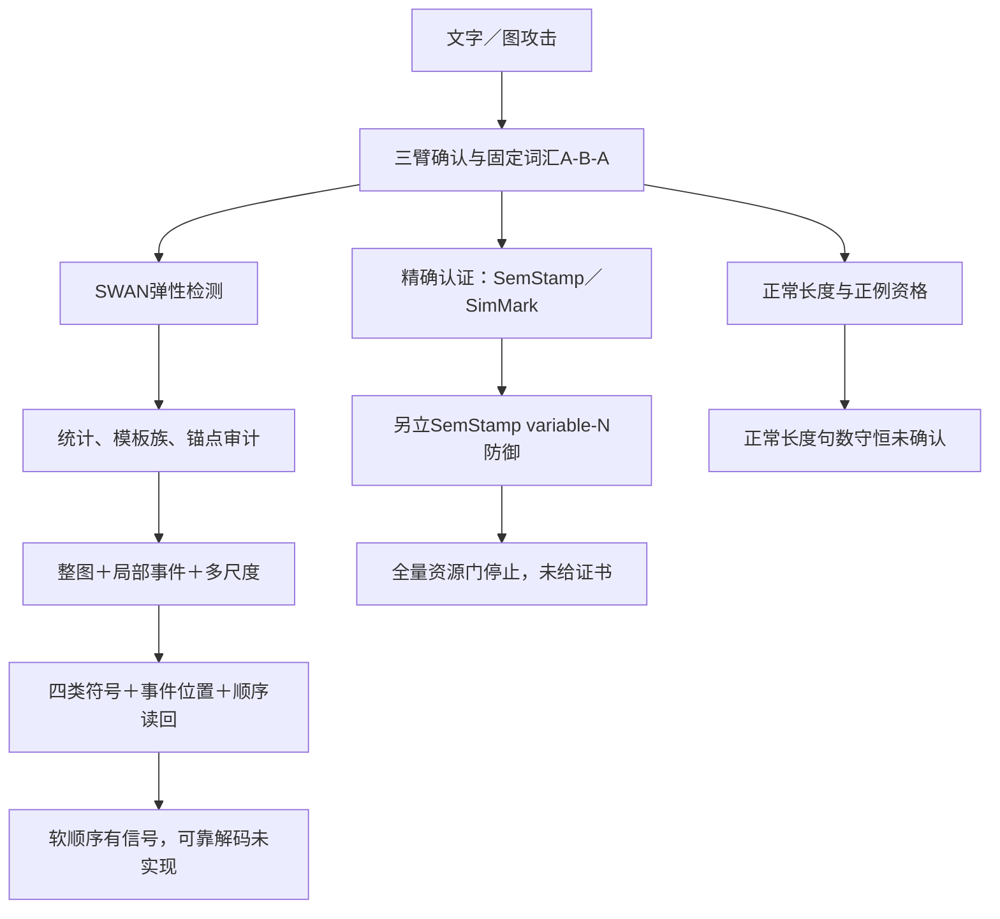

# AMR实验目录导读

核对日期：2026-10-25。范围：`experiments/` 下现存 **196个顶层目录，逐个覆盖、每个只列一次**。目录名保留原样，便于直接搜索和定位。

这196个目录并非196个独立科学实验。它们混合了候选生成、同方法扩量、前置资格审计、执行恢复、失败封存、独立确认和图表归档。下面按研究问题分类；分类用于阅读，不代表目录创建时间或预注册实验数。

每条同时说明**干什么、为什么做、属于什么角色，以及已有结果能说明到哪一步**。旧探索质量标签保留原来源，不追认为新协议的独立真人评审；没有完整结果的目录明确记为准备或未完成。方法细节和演进原因仍可沿[《叙事.md》](叙事.md)与[《V2.md》](V2.md)继续阅读。

## 先把研究问题连起来

| 阅读阶段 | 当时最想回答的问题 | 主要转折 |
|---|---|---|
| 早期攻击 | 改文字或AMR图，能否让SWAN降分？ | 图操作常被重解析抹平；强操作容易损伤事实。 |
| 受控确认 | 降分是否来自句界，而非“更复杂的语义攻击”？ | 新三臂和词汇词序固定的A-B-A，把问题收窄到句界依赖。 |
| 正例工程 | 能否在正常篇幅、质量合格正例上验证句数守恒效应？ | 生成、模板规模、来源和自然拆分条件反复卡门，正式端点未闭合。 |
| 精确认证两条支线 | 能否对全部合法重分句给出最坏值，而不是只试几个候选？ | 算法及健康基线有软件与实证证据，正式证书仍被资格或资源门阻断。 |
| 弹性检测 | 检测器能否自己恢复有用边界？ | 开发可恢复部分正例，但长度、非法边与P2独立性问题暴露。 |
| 统计与锚点 | 是否只需换统计量、分族或融合就能稳定？ | 有限样本与相关性需审计；多项过强机制解释被撤回。 |
| 多视图、多尺度 | 整图不可靠时，局部图和不同窗口能否互补？ | 开发排序有信号；严格盲扫受解析完整率限制，注意力稳定增益未确认。 |
| 语义序列 | 到底写入了什么符号，能否找出、读对并恢复顺序？ | 软顺序有排序增益，写入读回、盲定位与可靠解码仍不足。 |

图中箭头表示研究问题怎样转向，不表示后一条线为前一条线补齐证据。SWAN系统审计、旧certified-resegmentation和新SemStamp certified-defense有各自的数据、合同与终态。

## 目录名中的版本意味着什么

| 名字片段 | 通常在做什么 | 阅读时要注意 |
|---|---|---|
| `pilot` / `smoke` / `probe` | 小样本可行性或工程冒烟 | 通过常常只允许下一步准备，不是性能成功。 |
| `preflight` / `readiness` / `eligibility` | 检查能否合法、安全且在预算内开始 | 未过门可能发生在任何模型评分之前。 |
| `design` / `protocol` | 冻结算法、数据和判定合同 | 有方案不等于执行完成。 |
| `development` | 在开发资产上选择方案、参数或窗口 | 不能代替新来源的独立确认。 |
| `confirmation` / `formal` | 希望做正式或独立验证 | 必须回看实际输入、分母与结果，名字不保证独立性。 |
| `audit` / `reframing` | 复算原件、查身份、纠正主张 | 很多是零模型工作，不是新的模型实验。 |
| `v2` / `v3` / `run2` / `execution5` | 改合同、实现或恢复失败任务 | 不一定换了方法，也不一定重生成数据。 |
| `batch2`…`batch6` / `30` / `100` / `250` | 分批执行或目标规模 | 实际样本数以manifest和终态为准。 |
| `archive` / `report_assets` | 证据保管或画图 | 不计为独立实验。 |

`e1_invariance`、`e2_attack_pilot`、`e3_main`这一组编号，与`planE_e1_roundtrip`、`planE_e2_joint*`这一组编号来自不同阶段。不能看到“E2”就当成同一个实验；同样，SWAN v3、certificate v3和certified-defense v3是三套版本体系。

## 全部196个目录

“依据”链接可定位用途或结果原件。部分历史条目的总体数值来自带有后续口径纠正的《叙事.md》；局部探索报告若保留过强解释，以该纠正及《V2.md》的证据边界为准。

### 1．早期表层改写与图攻击（41个）

先寻找能让SWAN检测下降的改写方式，从句法变化走到节点、论元、重入和反馈式整段生成。这里大量目录是同一算子的小批次和扩量版本。

| 序号 | 目录与角色 | 干什么、为什么 | 已有结果与边界 | 依据 |
|---:|---|---|---|---|
| 001 | `api_natural5` 候选先导 | 先改少量单句的主动被动、名词化和关系从句，试探自然句法改写能否降分。 | 保存了候选与检测资产；属于小规模探索。 | [原件](scripts/run_api_natural5.py) |
| 002 | `api_natural_batch2` 分批候选 | 沿用 natural5 方法处理第2批单句，扩大同一种改写的覆盖。 | 分批执行资产，不是另一个新方法。 | [原件](scripts/run_api_natural_batch2.py) |
| 003 | `api_natural_batch3` 分批候选 | 沿用 natural5 方法处理第3批单句，检查效果是否重复出现。 | 分批执行资产，不能按独立方法计数。 | [原件](scripts/run_api_natural_batch3.py) |
| 004 | `api_natural_batch4` 分批候选 | 沿用 natural5 方法处理第4批单句，继续收集相同算子的候选。 | 保存候选及检测资产。 | [原件](scripts/run_api_natural_batch4.py) |
| 005 | `api_natural_batch5` 分批候选 | 沿用 natural5 方法处理第5批单句，补足预定的小样本覆盖。 | 保存候选及检测资产。 | [原件](scripts/run_api_natural_batch5.py) |
| 006 | `api_natural_batch6` 分批候选 | 沿用 natural5 方法处理第6批单句，完成这组分批候选生成。 | 保存候选及检测资产。 | [原件](scripts/run_api_natural_batch6.py) |
| 007 | `api_natural_paragraph30` 段落组装 | 把上述批次中改过的句子放回原段落，检查整篇检测是否下降。 | 目录名带30，但 meta 记录实际组装16篇；不能用名字作分母。 | [原件](experiments/api_natural_paragraph30/meta.json) |
| 008 | `api_natural223` 候选扩量 | 把自然句法改写扩展到更大的候选集合，并保存质量检查和检测结果。 | 历史逐句候选资产；不自动构成质量合格的整篇攻击。 | [原件](scripts/prepare_api_natural223.py) |
| 009 | `api_full_paragraphs` 段落组装与评估 | 将通过既有筛选的句子替换回完整段落，评估局部改写的段落效果。 | meta 保存97篇，附检测和抽样评价资产；历史质量口径保留。 | [原件](experiments/api_full_paragraphs/meta.json) |
| 010 | `api_joint_paragraph5` 整段改写先导 | 一次改写整段多个句子，同时要求句数、实体、数字和事实保持。 | 5个选定段落的小先导；检验整段指令是否比逐句替换方便。 | [原件](scripts/run_api_joint_paragraph5.py) |
| 011 | `api_joint_paragraph5b` 整段改写追加先导 | 换另一组固定段落，重复 joint_paragraph5 的指令。 | 同方法不同输入的小批次。 | [原件](scripts/run_api_joint_paragraph5b.py) |
| 012 | `api_joint_strict5` 约束提示先导 | 把实体和数字显式列进提示，并限制长度，减少整段改写中的事实漂移。 | 保存候选与检测；更严格提示不等于已确认语义保真。 | [原件](scripts/run_api_joint_strict5.py) |
| 013 | `api_syntax5` 生成候选 | 用保持句数的句法变化提示，先试少量整段改写。 | 本地仅见候选文件，没有独立检测报告。 | [原件](scripts/run_api_syntax5.py) |
| 014 | `api_syntax30` 生成候选扩量 | 将 syntax5 的句法改写探索扩展到预定30段规模。 | 本地仅见候选资产；不能宣称完成攻击确认。 | [原件](scripts/run_api_syntax30.py) |
| 015 | `planB_b0` 往返冒烟 | 不攻击图，先检查 AMR→文本→AMR 往返能否运行，建立对照。 | b0_roundtrip 记录10/10 valid；这是基础往返检查。 | [原件](experiments/planB_b0/b0_roundtrip.json) |
| 016 | `planB_b1` 基础图变换先导 | 先尝试节点概念替换，并汇总节点、边和序列化顺序三类基础操作。 | 10段先导；平均降分小，未建立稳定绕过。 | [原件](experiments/planB_b1/report.md) |
| 017 | `planB_b1_edge` 边角色变换先导 | 改 AMR 的语义边角色，经过生成和重解析后观察检测变化。 | 与 b1 同批10段的分支；边操作效果较弱。 | [原件](experiments/planB_b1/report.md) |
| 018 | `planB_b1_subgraph` 序列化负对照 | 改变子图书写或遍历顺序，检查只是换表达顺序会不会改变图级结果。 | 属于负对照；不能把线性书写变化算作语义攻击。 | [原件](experiments/planB_b1/report.md) |
| 019 | `planB_b2_node50` 节点替换扩量 | 在50段上进一步检查概念同义替换，观察重解析是否抹平改动。 | 保存变换与检测资产；仍为浅层图算子探索。 | [原件](experiments/planB_b2_node50/transform.json) |
| 020 | `planB_b2_reattach50` 拓扑变换扩量 | 把 modifier 子图重新挂到根节点，尝试改变实际图结构。 | 50段探索；强挂接可能改变原意。 | [原件](scripts/run_planb_b2_reattach50.py) |
| 021 | `planB_b3_combo50` 组合算子先导 | 同时做概念替换和 modifier 重挂接，看组合能否增加降分。 | 50段保存156次节点改动、39次重挂接；这些不是有效攻击数。 | [原件](experiments/planB_b3_combo50/transform.json) |
| 022 | `planB_b6_combo100` 同算子扩量 | 把 b3 的组合操作扩展到100段，观察先导效果能否维持。 | 同方法的规模版本，不是新攻击原理。 | [原件](scripts/run_planb_b6_combo100.py) |
| 023 | `planB_b7_combo250` 组合图攻击主规模 | 扩展到250段，验证简单图操作是否足够强。 | 历史低分率20.0%，仍有生成失真和重解析抹平问题。 | [原件](叙事.md) |
| 024 | `planC_modifier_swap30` 受限子图交换 | 只交换 mod 修饰子图，希望避免改动事件核心事实。 | 适用范围很窄；原叙事记录30段中仅5句可变换。 | [原件](scripts/run_planc_modifier_swap30.py) |
| 025 | `planC_modifier_family30` 扩大修饰关系族 | 将交换范围从 mod 扩展到地点、时间、数量等修饰关系。 | 覆盖有所扩展，但缺少严格类型检查会发生错误挂接。 | [原件](scripts/run_planc_modifier_family30.py) |
| 026 | `planC_argument_swap30` 核心论元交换 | 交换 ARG1/ARG2 子图，测试更强的事件角色扰动。 | 更容易动到施事、受事，语义保真成为主要风险。 | [原件](scripts/run_planc_argument_swap30.py) |
| 027 | `planC_mod_arg_combo30` 组合算子先导 | 把修饰关系和核心论元交换放进同一候选策略。 | 30段开发版本，保存质量筛选与检测资产。 | [原件](scripts/run_planc_mod_arg_combo30.py) |
| 028 | `planC_mod_arg_combo100` 组合算子扩量 | 扩展组合交换，正式观察降分与保真的权衡。 | 历史低分率约23%，质量通过约46%；不能只报低分。 | [原件](叙事.md) |
| 029 | `planD_reentrancy30` 重入结构探索 | 改共享节点、重绑定等重入结构，看更深的拓扑改动是否有效。 | 30段探索；已有算子收益有限，不能推成所有重入攻击都无效。 | [原件](scripts/run_pland_reentrancy30.py) |
| 030 | `planD_reent_arg30` 重入与论元组合 | 在重入修改的基础上再交换核心论元，增加结构扰动。 | 组合可能进一步伤害事实；与上一目录是同一研究问题的分支。 | [原件](scripts/run_pland_reent_arg30.py) |
| 031 | `planE_e1_roundtrip` 回译先导 | 使用跨语言往返回译产生改写候选，检查自然生成是否比手工图操作有效。 | 两条支线历史低分率20.0%与16.7%；只是先导。 | [原件](experiments/planE_e1_roundtrip/report.md) |
| 032 | `planE_e2_joint30` 反馈整段改写先导 | 允许句界、语态、名词化、句序与指代一起变化，再按检测反馈选候选。 | 30段先导，促成后续扩量；低分需另过质量门。 | [原件](experiments/planE_e2_joint30/report.md) |
| 033 | `planE_e2_joint100` 反馈整段改写扩量 | 将 joint30 扩展到100段，并补保存图完整性和质量检查。 | 探索性扩量；不能把自动质量检查当独立真人评审。 | [原件](experiments/planE_e2_joint100/quality_checks.json) |
| 034 | `planE_e2_joint250` 反馈整段改写主规模 | 每段生成4个候选，检验检测反馈下的结构改写攻击面。 | 249/250有低分候选；纠偏后固定预算有效成功191/250，补救累计218/250。 | [原件](叙事.md) |
| 035 | `planE_e3_combo30` 多生成策略组合 | 把回译、联合改写等候选来源组合起来，检查是否比单一路线更好。 | 保存候选和严格筛选；没有独立优势确认。 | [原件](experiments/planE_e3_combo30/strict_valid.json) |
| 036 | `planE_transfer_strict30` 模板子库迁移 | 将既有 Plan E 攻击交给不同模板子库，检查效果是否只依赖源库配置。 | 同文本的检测器侧重评，不能称跨水印迁移。 | [原件](experiments/planE_transfer_strict30/results.json) |
| 037 | `e1_invariance` 评分负对照 | 核对变量改名、三元组重排、空白等变化是否保持同一图的评分。 | 图级控制支持不变性，但字符串接口有序列化 caveat。 | [原件](experiments/e1_invariance/report.md) |
| 038 | `e2_attack_pilot` 三类改写先导 | 在50个基线正例上等预算比较普通复述、句界改写、AMR引导。 | 自动质量口径下有效率10%、34%、24%；仍缺独立真人质量。 | [原件](experiments/e2_attack_pilot/report.md) |
| 039 | `e3_main` 三类改写扩量比较 | 把普通复述、句界和AMR引导比较扩展到223个基线正例。 | 历史自动有效率6.7%、30.9%、21.1%；句界臂更强。 | [原件](experiments/e3_main/report.md) |
| 040 | `e4_ablation` 候选组件消融 | 拆开已有改写提示或候选策略，检查优势来自哪种操作。 | 保存候选及分臂检测资产；属于开发消融。 | [原件](experiments/e4_ablation/candidates.json) |
| 041 | `e5_transfer` 模板子库迁移 | 对 e4 两臂使用 first25/random25 子库重评，检查模板库规模影响。 | 逃逸率仅小幅变化；不是把SWAN攻击迁移到别的水印。 | [原件](experiments/e5_transfer/report.md) |

### 2．攻击确认、机制拆分与早期防御（22个）

不再只追求最低分，转而控制候选预算、质量、反馈、句界和跨水印范围；随后试图从局部图或新聚合恢复证据。

| 序号 | 目录与角色 | 干什么、为什么 | 已有结果与边界 | 依据 |
|---:|---|---|---|---|
| 042 | `targeted_sentence_attack` 目标选择准备 | 计算每篇最少翻转几个 green 句才能逃逸，再选最高分、近阈值和随机目标。 | 250篇的平均最少翻转数1.680；这里只算预算和目标。 | [原件](experiments/targeted_sentence_attack/report.md) |
| 043 | `targeted_sentence_pilot30` 靶向改写初版 | 按三种目标选择策略，只改指定句子，检查局部攻击是否可控。 | 90条生成记录中非目标逐字保留75条、目标改变39条；完整性不足。 | [原件](experiments/targeted_sentence_pilot30/validation.json) |
| 044 | `targeted_sentence_controlled30` 靶向改写受控版 | 收紧非目标句和句数约束，在完整配对段落上比较三种选择策略。 | 29段配对，逃逸0%–3.4%；未见靶向高分句优势。 | [原件](experiments/targeted_sentence_controlled30/report.md) |
| 045 | `prompt_component_ablation30` 提示组件消融 | 去掉句界、语态等指令组件，看检测下降与实际句数变化的关系。 | 30段等调用预算先导；模型未完全遵守部分指令。 | [原件](experiments/prompt_component_ablation30/report.md) |
| 046 | `milestone_a` 预算与选择策略审计 | 比较候选数 K 和质量后选优策略，纠正多候选最低分带来的指标膨胀。 | 191/250与自适应218/250属于不同预算口径；不能混写。 | [原件](experiments/milestone_a/report.md) |
| 047 | `candidate_budget16_pilot30` 大预算与严格质量审计 | 把候选预算扩到16，并检查事实约束补救、反馈严格筛选及难例对照。 | 内含多轮开发与复算；严格质量会大幅缩小原始低分收益。 | [原件](experiments/candidate_budget16_pilot30/final_30_assistant_audit.json) |
| 048 | `confirmation_three_arm30` 独立三臂确认 | 在新30个提示上等预算比较普通复述、仅句界指令与完整Plan E，并冻结无反馈选择。 | 无反馈有效成功分别2/30、29/30、10/30；句界臂最强。 | [原件](叙事.md) |
| 049 | `confirmation_mechanism30` 严格句界与统计拆分 | 做词汇词序不变的标点 A-B-A，并将句数与命中率的数值效应分开。 | 逃逸1/30→30/30→1/30；直接支持短文本句界依赖。 | [原件](experiments/confirmation_mechanism30/summary.json) |
| 050 | `mechanism_sentence_boundary` 回溯关联分析 | 按实际句数变化分组，查句界臂的降分是否主要出现在合句样本。 | 有句数和分数变化关联；不是单变量因果证明。 | [原件](experiments/mechanism_sentence_boundary/report.md) |
| 051 | `mechanism_e2_amr` 回溯图特征分析 | 检查选优攻击后的节点、边、重入、模板匹配与green-rate变化。 | 可定位相关现象；不能由相关系数证明攻击AMR语义。 | [原件](experiments/mechanism_e2_amr/report.md) |
| 052 | `parser_repeatability30` 解析与评分重复性 | 重复解析相同文本，再对固定AMR反复打分，区分parser与匹配随机性。 | 跨运行AMR150/150相同，z149/150相同；固定图评分仍有波动。 | [原件](experiments/parser_repeatability30/report.md) |
| 053 | `sira_adapted30` 强攻击基线 | 按相同30段和4候选预算适配SIRA，避免只与弱复述比较。 | 有反馈有效成功13/30；本地适配不等于原论文等价复现。 | [原件](叙事.md) |
| 054 | `cross_watermark_transfer30` 跨水印范围检验 | 分别生成KGW和SynthID自己的水印文本，再用冻结无反馈句界方法测试。 | KGW 0/30、SynthID 1/30；限定适用范围，非强系统因果证明。 | [原件](叙事.md) |
| 055 | `defense_aggregation` 聚合防御原型 | 保持已有句级分数，改用均值、中位数、最大值等聚合，试图恢复攻击后检测。 | 这些离线聚合均未恢复；基线分数重建也有边界差异。 | [原件](experiments/defense_aggregation/report.md) |
| 056 | `segmentation_intervention` 重新分句防御 | 对已有攻击重新切分并重新校准，看简单边界修复是否有效。 | 有效逃逸23/30降至19/30，p=0.125；独立人类误报上升。 | [原件](叙事.md) |
| 057 | `swan_amr_composition_decomposition1` 人工图作用域诊断 | 比较真实句级图、人工组合图和合句重解析图，检查扩大评分范围的影响。 | 目标green 108/108→0/108；人工组合不是自然parser反事实。 | [原件](experiments/swan_amr_composition_decomposition1/report.md) |
| 058 | `swan_amr_precision_recall1` 图匹配分量诊断 | 把上述匹配下降拆成precision与recall，观察局部证据如何被整图稀释。 | 人工组合precision下降更大；不能据此宣布真实攻击主因已识别。 | [原件](experiments/swan_amr_precision_recall1/report.md) |
| 059 | `swan_local_multi_instance1` 局部实例防御预检 | 从大图恢复多个互斥的局部模板实例，绕开whole-graph稀释。 | 现存报告原图恢复1/15、重解析0/15，未过门。 | [原件](experiments/swan_local_multi_instance1/report.md) |
| 060 | `swan_local_multi_instance2` 局部实例防御审计版 | 继续核对同类coverage、precision和互斥实例计数规则，完善可追溯审计。 | 现存报告与版本1给出相同关键计数；不能算两次独立成功。 | [原件](experiments/swan_local_multi_instance2/report.md) |
| 061 | `swan_template_specificity1` 模板背景校准防御 | 对不同模板分别估计人类背景尾概率，降低常见模板的误报贡献。 | 开发原图4/15、重解析2/15；门失败，holdout未评。 | [原件](experiments/swan_template_specificity1/report.md) |
| 062 | `swan_relation_motif1` 关系锚点定位防御 | 先通过关系motif定位局部子图，再与模板匹配。 | 原图/重解析recall@5为41/56、33/56，均差一项仍按门停止。 | [原件](experiments/swan_relation_motif1/report.md) |
| 063 | `feedback2_diagnostics` 阶段诊断与下一轮准备 | 汇总既有攻击、短文本、阈值距离和文献约束，决定下一轮该补什么证据。 | 属于诊断与协议准备，不是新增攻击结果。 | [原件](experiments/feedback2_diagnostics/report.md) |

### 3．正常长度、质量和正例构造（53个）

短文本句界反例成立以后，需要正常篇幅、事实可靠、确实注入且能自然拆分的正例。53个目录主要围绕这个前置条件排查，不是53次攻击。

| 序号 | 目录与角色 | 干什么、为什么 | 已有结果与边界 | 依据 |
|---:|---|---|---|---|
| 064 | `swan_count_neutral_boundary1` 句数守恒构造预检 | 寻找一处合并和另一处自然拆分，保持词汇、词序和总句数。 | 30篇中23篇可合并、0篇可自然拆分；未调用检测器。 | [原件](experiments/swan_count_neutral_boundary1/report.md) |
| 065 | `swan_oracle_composition1` 长度压力诊断 | 把已知短正例跨文档组合成长批次，检查不只句数项是否也会降分。 | 144–181词批次缺乏主题连贯性；不是正常长度确认文本。 | [原件](experiments/swan_oracle_composition1/report.md) |
| 066 | `swan_length_probe` 长度生成初版 | 探测短、中、长句提示与模板约束能否同时满足，准备正常长度基线。 | 保存单次调用与summary；正式完整18单元结果在v2。 | [原件](experiments/swan_length_probe/summary.json) |
| 067 | `swan_length_probe_v2` 长度生成完整探针 | 对3个新提示、2个模板、3档长度做固定18次生成。 | 18/18完成，但每档至少4/6联合通过门未达。 | [原件](experiments/swan_length_probe_v2/report.md) |
| 068 | `swan_sentence_growth1` 增加句数探针 | 用更多短句凑够总篇幅，检查长度达标后是否仍连贯。 | 39/40注入接受；5/20/40句前缀均未过质量，未跑攻击。 | [原件](experiments/swan_sentence_growth1/report.md) |
| 069 | `swan_generator_comparison1` 生成器配对对照 | 比较上游注入函数、本地适配和无水印逐句生成，查质量问题来自哪里。 | 同一提示的三条路径均未过联合门；不能叫官方生成等价复现。 | [原件](experiments/swan_generator_comparison1/report.md) |
| 070 | `swan_onepass_control1` 无水印整段对照 | 用一次整段生成检查同一模型能否写出不重复的正常长度段落。 | 单个127词输出通过辅助门；未注水印，也非稳定性确认。 | [原件](experiments/swan_onepass_control1/report.md) |
| 071 | `grounded_generation3` 事实约束生成对照 | 在3篇源文上比较逐句和整段摘要，限制新增事实并控制篇幅。 | 逐句0/3、整段1/3联合通过；未达到继续门。 | [原件](experiments/grounded_generation3/report.md) |
| 072 | `grounded_injection5` 事实约束注入先导 | 把5篇源文的正常长度摘要接入固定拒绝采样，检查模板接受率。 | 150次尝试最高约0.5607，无正常长度水印基线；停止该配置。 | [原件](experiments/grounded_injection5/report.md) |
| 073 | `swan_known_positive1` 已知正例链路核查 | 用已保存raw AMR、模板和提示样例核查归一化与S2Match。 | 基础链路通过；零接受不能简单归咎于parser坏掉。 | [原件](experiments/swan_known_positive1/report.md) |
| 074 | `swan_atomic_fact_preflight1` 短事实句预检 | 将正常源文拆成短事实句，先查图规模是否与Bank50兼容。 | 5篇均未过门；未发起付费注入。 | [原件](experiments/swan_atomic_fact_preflight1/report.md) |
| 075 | `swan_microfact_generation1` 微事实生成 | 一次要求生成多条短事实，试图同时满足篇幅与小模板。 | 父实验联合0/5；后验JSON修复与图规模分析不能改写失败。 | [原件](experiments/swan_microfact_generation1/report.md) |
| 076 | `swan_microfact_sequential2` 逐条微事实生成 | 改成按顺序逐条生成微事实，减少一次生成的结构错误和重复。 | 父实验质量0/5；后验图规模门也未过。 | [原件](experiments/swan_microfact_sequential2/report.md) |
| 077 | `swan_bank_scale_pilot1` 模板库扩容诊断 | 比较50/100/500/800模板，查扩大库是否改善长句与模板兼容。 | 兼容和green率上升；只授权独立校准准备，未证明FPR控制。 | [原件](experiments/swan_bank_scale_pilot1/report.md) |
| 078 | `swan_bank100_null_calibration1` 扩容后的Null校准 | 在Bank100下分别检查人类与无水印机器文本，避免扩容直接抬误报。 | 机器质量13/30，联合门失败；未进行注入或攻击。 | [原件](experiments/swan_bank100_null_calibration1/report.md) |
| 079 | `swan_bank100_microfact_null1` 同形式机器Null | 用与微事实正例相近的无水印生成形式，检查是否靠格式造成高分。 | 质量合格0/30，条件机器FPR不可用，不能写成0%。 | [原件](experiments/swan_bank100_microfact_null1/report.md) |
| 080 | `swan_natural_mixed_windows1` 天然混合窗口筛选 | 直接找既有自然文本中兼具篇幅和短句的窗口，减少人工生成依赖。 | 质量与图规模联合0/5；未进入注入。 | [原件](experiments/swan_natural_mixed_windows1/report.md) |
| 081 | `swan_natural_narrative_windows2` 天然叙事窗口筛选 | 增加叙事性条件，避免短句窗口只是列表或混杂片段。 | 扫描9563行仍未找到5篇合格窗口；后置模型调用0。 | [原件](experiments/swan_natural_narrative_windows2/report.md) |
| 082 | `swan_c4_train_narrative_windows3` 换语料窗口筛选 | 转向C4 train搜索正常长度、短事件句较多的叙事窗口。 | 质量与图规模联合0/5；没有检测结果。 | [原件](experiments/swan_c4_train_narrative_windows3/report.md) |
| 083 | `swan_quality_first_windows4` 质量优先窗口筛选 | 先保证自然段落质量，再数可承担水印的短句槽。 | 质量14/30，但覆盖0/30；优质段落的短载体仍不足。 | [原件](experiments/swan_quality_first_windows4/report.md) |
| 084 | `swan_partial_coverage_power1` 部分载体功效核算 | 检查只给部分短句注水印，整篇保留完整分母时能否达到检测阈值。 | Bank50对14篇保证0篇；Bank100仅敏感性分析，未授权注入。 | [原件](experiments/swan_partial_coverage_power1/report.md) |
| 085 | `swan_constrained_microfact1` 约束微事实构造 | 用局部生成和表面约束限制长度、词语和事实，使微事实更接近模板。 | 600候选仍联合0/5；未进入parser和注入。 | [原件](experiments/swan_constrained_microfact1/report.md) |
| 086 | `swan_deepseek_span_compiler1` 跨度计划编译 | 先让模型选源文跨度，再确定性编译成短事实，减少自由生成失真。 | 270个解码计划仍联合0/5；不足以构造可用文档。 | [原件](experiments/swan_deepseek_span_compiler1/report.md) |
| 087 | `swan_dependency_pruner1` 依存路径裁剪 | 根据依存路径剪掉多余成分，尝试保事实地缩小候选句。 | 构造0/5，评审只完成3/5；不能写质量0/5。 | [原件](experiments/swan_dependency_pruner1/terminal_report.md) |
| 088 | `swan_length_gate_tradeoff1` 长度筛选回溯 | 重算已保存605个候选，查长度门是不是挡住了本可接受的模板句。 | 359个历史分数精确重放；这是筛选诊断，无新生成。 | [原件](experiments/swan_length_gate_tradeoff1/report.md) |
| 089 | `swan_positive_asset_audit1` 正例资产可用性审计 | 查公开发布和本地历史资产，是否已有独立、正常长度、可追溯合格SWAN正例。 | 冻结检查范围内合格数0；不是断言任何地方都不存在。 | [原件](experiments/swan_positive_asset_audit1/report.md) |
| 090 | `swan_positive_collection1` 正式正例采集准备 | 冻结官方代码、依赖、来源、预算和5 pilot＋30 main的采集流程。 | 完成本地离线就绪审计；准备状态不等于正例采集完成。 | [原件](experiments/swan_positive_collection1/execution_readiness_report_v3.md) |
| 091 | `swan_positive_local_qwen_preflight1` 本地小模型注入预检 | 先用Qwen2.5-0.5B检查5个源的首槽能否达到官方模板接受门。 | 50次生成，接受0/5；本地路线Stop。 | [原件](experiments/swan_positive_local_qwen_preflight1/report.md) |
| 092 | `swan_positive_deepseek_preflight1` API后端注入预检 | 换DeepSeek检查相同类型首槽可行性，避免直接花钱生成大cohort。 | 41次生成接受1/5，未过3/5门；后端路线Stop。 | [原件](experiments/swan_positive_deepseek_preflight1/report.md) |
| 093 | `swan_positive_deepseek_confirmation1` 严格正例pilot | 要求每篇16槽全部严格接受，再进入正常长度质量和句界确认。 | 五文档pilot失败，main未启动；不是检测效果负结论。 | [原件](experiments/swan_positive_deepseek_confirmation1/pilot_terminal_report.md) |
| 094 | `swan_positive_deepseek_length_confirmation2` 长度门正例pilot | 调整长度资格并按新来源重做严格注入pilot。 | 3篇注入失败，第4篇不确定调用停止，第5篇未开始；操作性未完成。 | [原件](experiments/swan_positive_deepseek_length_confirmation2/pilot_operational_stop_report.md) |
| 095 | `swan_positive_deepseek_length_confirmation3` 新来源与停止策略准备 | 另立新来源，冻结7–12词候选和不确定调用后继续剩余分配的策略。 | 停在准备并被后续纠偏关闭，不能算已执行确认。 | [原件](experiments/swan_reframing1/decision_log.md) |
| 096 | `swan_count_neutral_confirmation1` 句数守恒确认方案 | 规定在独立正常长度合格正例上只移动边界、不改词汇与单位数的确认方法。 | 上游正例未过门，未形成正式A/B确认结果。 | [原件](experiments/swan_count_neutral_confirmation1/protocol.md) |
| 097 | `swan_final_confirmation1` 最终确认方案草案 | 收窄论文问题，准备同时验证正常长度句界、质量和机制端点。 | 前置协议资产，不等于最终确认完成。 | [原件](experiments/swan_final_confirmation1/protocol.md) |
| 098 | `swan_count_neutral_final1` 正式正常长度pilot | 改为按文档长度停止并如实记录fallback，生成8篇后过质量门。 | 8篇终态、6篇结构合格、冻结质量0/6；变换和main未运行。 | [原件](experiments/swan_count_neutral_final1/PILOT_CONCLUSION.md) |
| 099 | `swan_normal_length_feasibility2` 新正常长度可行性pilot | 另立新来源，检查正式注入与严格日志合同能否形成完整正常文档。 | 未捕获parser warning永久halt；8个fallback槽、0篇终态。 | [原件](experiments/swan_normal_length_feasibility2/RUNTIME_HALT.md) |
| 100 | `swan_source_anchored1` 源文绑定pilot | 把10个生成槽逐一绑定真实源句，再在parser前过表面门。 | 8篇中5篇结构过门，60个完成槽全fallback；后置质量和检测未跑。 | [原件](experiments/swan_source_anchored1/PILOT_CONCLUSION.md) |
| 101 | `swan_accepted_baseline_preflight1` 接受句基线预检 | 只拿历史真正接受且不重复的20句，拼两篇10句文档，检查注入→检测链路。 | 已保存detection原件；拼接阳性不证明连贯或独立正常长度质量。 | [原件](experiments/swan_accepted_baseline_preflight1/detection.json) |
| 102 | `swan_accepted_boundary_preflight1` 接受句边界预检 | 对固定接受句文档检查可合并边界、自然拆分及辅助位置控制。 | 已保存边界检测原件；标准C2与辅助位置控制不能互相替代。 | [原件](experiments/swan_accepted_boundary_preflight1/detection.json) |
| 103 | `swan_splittable_positive_pilot1` 可拆分句注入预检 | 尝试得到两条既严格接受又有自然内部拆分点的句子。 | 本地仅见设计与预算等准备制品，无完成结果。 | [原件](experiments/swan_splittable_positive_pilot1/protocol.md) |
| 104 | `swan_injection_only_pilot1` 最小注入能力检查 | 暂时去掉篇章、来源和可拆分要求，只问当前后端能否生成10条真接受句。 | 用于最窄的注入能力诊断，不能代表正常文档生成成功。 | [原件](experiments/swan_injection_only_pilot1/result.json) |
| 105 | `swan_injection_only_baseline1` 最小注入读回检查 | 将上个pilot的10条接受句原样拼接，验证能否被Bank50检测。 | 已保存detection原件；只核对注入和检测，不评价篇章连贯性。 | [原件](experiments/swan_injection_only_baseline1/detection.json) |
| 106 | `swan_coherent_injection_pilot1` 连贯注入初版 | 在10句连贯任务文档中使用严格接受，检查注入与篇章能否兼得。 | 4槽接受后slot耗尽，未完成10槽。 | [原件](experiments/swan_coherent_injection_pilot1/result.json) |
| 107 | `swan_coherent_injection_pilot2` 有利模板连贯注入 | 只用先导中有利的模板47，尝试完成10个主题相同事件。 | 10/10严格接受，但原辅助连贯门失败；有利模板选择需披露。 | [原件](experiments/swan_coherent_injection_pilot2/result.json) |
| 108 | `swan_coherent_injection_pilot3` 显式篇章连接注入 | 增加时间连接和固定工作流，试图修复pilot2的简略事件列表。 | 首槽耗尽，0/10接受；连接词会改变结构匹配。 | [原件](experiments/swan_coherent_injection_pilot3/result.json) |
| 109 | `swan_coherent_injection_pilot4` 事件日志形式注入 | 预先改用与简短事件日志匹配的评价规则，并换新主题人物。 | 首槽耗尽，0/10接受；未建立一般生成可行性。 | [原件](experiments/swan_coherent_injection_pilot4/result.json) |
| 110 | `swan_coherent_baseline1` 事后体裁复核 | 把pilot2固定文本按其实际事件日志体裁重新评价，不改任何文字。 | 明确事后辅助评价，不可追认预注册真人质量。 | [原件](experiments/swan_coherent_baseline1/protocol.md) |
| 111 | `swan_coherent_baseline_cached1` 缓存评分工程修复 | 缓存固定词向量，避免官方helper每个配对反复加载，再完成53词正例检测。 | Bank50 10/10 green，z=5.4772；仍是单篇定向工程正例。 | [原件](experiments/swan_coherent_baseline_cached1/CONCLUSION.md) |
| 112 | `swan_normal_length_coherent_pilot1` 定向正例长度扩展 | 将有利模板47的事件日志扩到20槽，检查能否达到正常篇幅。 | 126词、20/20严格接受，辅助质量通过；仍缺source anchoring和真人评审。 | [原件](experiments/swan_normal_length_coherent_pilot1/result.json) |
| 113 | `swan_normal_length_coherent_baseline1` 正常长度定向基线检测 | 对固定126词、20句输出做完整Bank50检测与缓存等价核对。 | 20/20 green，z=7.7460；单篇可检出不等于cohort及FPR确认。 | [原件](experiments/swan_normal_length_coherent_baseline1/CONCLUSION.md) |
| 114 | `swan_normal_length_boundary_location1` 正常长度边界位置诊断 | 在上述126词文档寻找句数守恒自然拆分，并另做N=19位置对照。 | 标准C2构造失败；辅助19/19→18/19仍高于阈值。 | [原件](叙事.md) |
| 115 | `swan_source_anchored_splittable1` 来源与可拆分联合pilot | 尝试21槽源文绑定、严格阳性和自然可拆分同时成立。 | 普通大写被误实现为PROPN门，按合同停止。 | [原件](叙事.md) |
| 116 | `swan_source_anchored_single_preflight2` 实现修复单槽预检 | 在全新源上修正PROPN合同，只试一个槽能否达到模板47接受门。 | 30候选仅3个进入评分，最高0.5625，0/1接受；未扩展21句。 | [原件](叙事.md) |

### 4．SemStamp／SimMark精确认证旧支线（27个）

从合成exact DP到真实模型、资格、吞吐、生成与健康门，尝试精确计算所有合法重分句的最坏分数。该支线不为SWAN提供正常长度证据。

| 序号 | 目录与角色 | 干什么、为什么 | 已有结果与边界 | 依据 |
|---:|---|---|---|---|
| 117 | `certified_resegmentation_preflight1` 独立跨度算法预检 | 先对简单跨度加性分数，精确寻找全部合法重分句的最坏值。 | 与穷举oracle通过；只证明算法正确，不是水印实证。 | [原件](experiments/certified_resegmentation_preflight1/audit_results.json) |
| 118 | `certified_resegmentation_interface_audit1` 官方接口审计 | 查SemStamp/SimMark真实检测公式是否符合独立跨度假设。 | 发现实际是一阶相邻跨度pair评分，需要换DP状态。 | [原件](experiments/certified_resegmentation_interface_audit1/INTERFACE_AUDIT.md) |
| 119 | `certified_resegmentation_pairwise_preflight1` 相邻pair算法预检 | 实现edge-state DP，精确求相邻跨度交互分数的最坏划分。 | oracle和退化一致性检查通过；零真实模型。 | [原件](experiments/certified_resegmentation_pairwise_preflight1/audit_results.json) |
| 120 | `certified_resegmentation_calibration_preflight1` 证书统计预检 | 用合成Null检查split-conformal阈值、严格平局和独立误报审计。 | 80个统计门通过；不是真实文本FPR结果。 | [原件](experiments/certified_resegmentation_calibration_preflight1/audit_results.json) |
| 121 | `certified_resegmentation_wp2_adapter_preflight1` 文本适配器预检 | 冻结文本到atom、边界、detector字符串的映射，并核对去重和cohort隔离。 | 模型无关oracle通过；只验证适配与拆分合同。 | [原件](experiments/certified_resegmentation_wp2_adapter_preflight1/audit_results.json) |
| 122 | `certified_resegmentation_wp2_adapter_scale1` 适配器规模预检 | 将适配与DP扩大到100/200/300 atom，提前检查规模成本。 | 合成规模不是主要瓶颈；真实模型成本尚未测。 | [原件](experiments/certified_resegmentation_wp2_adapter_scale1/audit_results.json) |
| 123 | `certified_resegmentation_wp2_readiness1` 真实执行合同 | 冻结官方模型、资产、角色、阈值和资源门，查本机是否具备执行条件。 | 当时本机No-Go；不能用合同文件证明执行完成。 | [原件](experiments/certified_resegmentation_wp2_readiness1/PROTOCOL.md) |
| 124 | `certified_resegmentation_wp2_execution1` 远端环境与等价预检 | 在Linux CUDA准备模型资产、做SHA绑定，有限比较官方与direct接口。 | SemStamp 258项、SimMark 240项一致；SimMark用sentinel gamma。 | [原件](experiments/certified_resegmentation_wp2_execution1/CONCLUSION.md) |
| 125 | `certified_resegmentation_wp2_eligibility1` 全量资格审计 | 不读模型分数，先查冻结旧资产是否满足长度、单位和角色数量门。 | 旧5–35 atom合同流失严重，容量不足Stop。 | [原件](experiments/certified_resegmentation_wp2_eligibility1/CONCLUSION.md) |
| 126 | `certified_resegmentation_wp2_v2_design1` 无损与原生长度修订 | 移除人为5–35限制，尝试lossless native-context适配。 | SemStamp主候选positive 0/1000合格，双系统Stop。 | [原件](experiments/certified_resegmentation_wp2_v2_design1/CONCLUSION.md) |
| 127 | `certified_resegmentation_wp2_v3_readiness1` 结构分隔符与稀疏DP | 用typed-list separator恢复官方unit列表等价，并跑Python sparse DP。 | 资格和小规模正确性通过，最大结构超时Stop。 | [原件](experiments/certified_resegmentation_wp2_v3_readiness1/CONCLUSION.md) |
| 128 | `certified_resegmentation_wp2_v4_sparse1` C++稀疏核心 | 将相同递推编译并压缩状态存储，解决Python规模问题。 | 最大真实结构约18.4秒，Algorithm-Ready；还未给证书。 | [原件](experiments/certified_resegmentation_wp2_v4_sparse1/CONCLUSION.md) |
| 129 | `certified_resegmentation_wp2_v5_scorer1` 真实评分接入初版 | 尝试物化全部相邻pair-score表，把模型分数送入exact core。 | 单篇5M外部pair-key门先失败，模型加载前Stop。 | [原件](experiments/certified_resegmentation_wp2_v5_scorer1/CONCLUSION.md) |
| 130 | `certified_resegmentation_wp2_v6_feature1` 特征因子化接入 | 只存跨度特征、按需组合pair，降低表物化成本并测真实吞吐。 | SemStamp可行，SimMark外推71.81小时超过48小时门；双系统Stop。 | [原件](experiments/certified_resegmentation_wp2_v6_feature1/CONCLUSION.md) |
| 131 | `certified_resegmentation_wp2_v7_throughput1` batch吞吐优化 | 测试增加SimMark batch是否能补足计算预算缺口。 | 最佳仅1.0027倍，未过1.15倍probe门。 | [原件](experiments/certified_resegmentation_wp2_v7_throughput1/CONCLUSION.md) |
| 132 | `certified_resegmentation_wp2_v8_global_reuse1` 跨文档缓存机会审计 | 查重复输入token能否让全局特征cache省下足够计算。 | 读取cohort范围违约，Invalid/Stop；探索复用仅0.6748%。 | [原件](experiments/certified_resegmentation_wp2_v8_global_reuse1/CONCLUSION.md) |
| 133 | `certified_resegmentation_wp2_v9_simmark_long1` 放宽时间后的探索长跑 | 用户对新v9撤销48小时门，完成SimMark fit和证书结构评分。 | gamma=0，clean TPR 89/1000，k=1 FPR 9.25%；健康基线未成立。 | [原件](叙事.md) |
| 134 | `certified_resegmentation_wp2_v10_semstamp1` 先健康再证书 | 改成SemStamp先检查固定检测器FPR/TPR，过门后才跑证书。 | P0误报上界失败，证书保持0/1799；节省后续计算。 | [原件](叙事.md) |
| 135 | `certified_resegmentation_wp2_v11_detector_reproduction1` 复现根因诊断 | 比较official/direct全量等价，并查模型prompt、pooling、数据split。 | 实现等价成立；全新确认资产仍不足，不恢复证书主线。 | [原件](叙事.md) |
| 136 | `certified_resegmentation_wp2_v12_fresh_assets1` 全新资产获取 | 冻结全新C4身份及替补队列，准备重新建立健康正例。 | 20条SemStamp smoke有2条prompt-only，未进入全量生成。 | [原件](叙事.md) |
| 137 | `certified_resegmentation_wp2_v13_semstamp_generation1` 替补感知生成 | 允许机械排除不合格生成并按冻结队列替补，凑满1000正例。 | attempt372陷入不可达fallback，326条eligible后运行Stop。 | [原件](experiments/certified_resegmentation_wp2_v13_semstamp_generation1/RUNTIME_STOP.md) |
| 138 | `certified_resegmentation_wp2_v13_offline_preparation1` 生成后续离线准备 | 在生成期间准备H0身份审计、B0/B1代码与第二系统缺口说明。 | 离线准备完成；不是第二次v13生成或detector运行。 | [原件](experiments/certified_resegmentation_wp2_v13_offline_preparation1/PLAN.md) |
| 139 | `certified_resegmentation_wp2_v14_bounded_generation1` fallback工程修复 | 给fallback循环加有界退出，并要求与v13已提交前缀严格重放一致。 | attempt2前缀身份不同，按合同Stop。 | [原件](experiments/certified_resegmentation_wp2_v14_bounded_generation1/RUNTIME_STOP.md) |
| 140 | `certified_resegmentation_wp2_v15_causal_prefix1` 因果前缀生成 | 只允许真实fallback引起可解释输出差异，继续固定队列生成。 | 自报1000正例中5条是空continuation；H0 Stop保持。 | [原件](experiments/certified_resegmentation_wp2_v15_causal_prefix1/H0_STOP.md) |
| 141 | `certified_resegmentation_wp2_v16_prompt_only_rescue1` 事后验证补救 | 机械剔除5条prompt-only，保留995条，再按固定队列补5条。 | combined 1000行身份零交集、H0 Go；不改写v15成功。 | [原件](experiments/certified_resegmentation_wp2_v16_prompt_only_rescue1/H0_RESULT.json) |
| 142 | `certified_resegmentation_wp2_v17_b0_detector_health1` 正式检测器健康门 | 用1000校准、1000独立Null、1000正例核对SemStamp固定基线。 | FPR47/1000、TPR954/1000，双重放一致，B0 Go。 | [原件](experiments/certified_resegmentation_wp2_v17_b0_detector_health1/B0_RESULT.json) |
| 143 | `certified_resegmentation_wp2_v18_b1_exact_certificate1` 证书计算资源预检 | 对全部3000行预估合法pair和双重放成本，过门才正式算证书。 | pair超50M、预算86.65小时超72；正式B1未启动，无证书端点。 | [原件](experiments/certified_resegmentation_wp2_v18_b1_exact_certificate1/B1_GATE_RESULT.json) |

### 5．SemStamp可认证防御新支线（15个）

在健康SemStamp基线上另立variable-N合同，覆盖边界插入、删除和移动。先验证完整载体、算法和资源，再谈证书引导生成。

| 序号 | 目录与角色 | 干什么、为什么 | 已有结果与边界 | 依据 |
|---:|---|---|---|---|
| 144 | `semantic_watermark_defense_plan_20261007` 新防御研究方案 | 另立SemStamp可认证防御，先证全部合法边界扰动，再研究证书引导编码。 | WP0与载体—读出合同；不续跑旧v18，也不提供防御结果。 | [原件](experiments/semantic_watermark_defense_plan_20261007/PLAN.md) |
| 145 | `semstamp_certified_defense_v1_wp2_algorithm1` variable-N算法初版 | 把边界插入、删除、移动都纳入exact DP，覆盖不同最终单位数。 | systematic/random与fixed-N reduction通过；零模型算法Go。 | [原件](experiments/semstamp_certified_defense_v1_wp2_algorithm1/RESULT.json) |
| 146 | `semstamp_certified_defense_v1_wp3_detector_health1` 初版载体健康审计 | 检查固定字节atom是否能逐字节还原v17的detector句子。 | 42/3000句界落在atom内，Health Stop；未进入smoke。 | [原件](experiments/semstamp_certified_defense_v1_wp3_detector_health1/AUDIT.json) |
| 147 | `semstamp_certified_defense_v2_wp1_threat_model1` refined-atom威胁模型 | 只在原NLTK端点细化atom，修复句界而保留原始字节和空白。 | 3000/3000恢复，42风险行与59个零字节gap全部保留。 | [原件](experiments/semstamp_certified_defense_v2_wp1_threat_model1/AUDIT.json) |
| 148 | `semstamp_certified_defense_v2_wp2_algorithm1` 细化后的算法重建 | 给零字节gap加入合法性检查，再验证variable-N DP与oracle。 | 双语义重放及独立枚举通过；仅算法和合同Go。 | [原件](experiments/semstamp_certified_defense_v2_wp2_algorithm1/RESULT.json) |
| 149 | `semstamp_certified_defense_v2_wp3_detector_health1` 分级健康预检 | 先做3000行无模型结构重放，再选覆盖风险的96行smoke输入。 | P0结构恢复通过；实际smoke/full分开冻结执行。 | [原件](experiments/semstamp_certified_defense_v2_wp3_detector_health1/FINAL_RESULT.json) |
| 150 | `semstamp_certified_defense_v2_wp3_detector_smoke_design1` smoke设计与正式执行 | 冻结96行双重放，核对renderer修复是否改变官方SemStamp分数。 | 192/192逐项一致，27/27审计通过；没有证书计算。 | [原件](experiments/semstamp_certified_defense_v2_wp3_detector_smoke_design1/FINAL_RESULT.json) |
| 151 | `semstamp_certified_defense_v2_wp3_detector_smoke_attempt0` 首次启动失败封存 | 保留smoke首次因缺确定性CUDA环境变量而失败的原始记录。 | 完成行、checkpoint、score均0；不是一次水印性能失败。 | [原件](experiments/semstamp_certified_defense_v2_wp3_detector_smoke_attempt0/ATTEMPT_RESULT.json) |
| 152 | `semstamp_certified_defense_v2_wp3_detector_full_replay_design1` 全量检测器重放 | 扩大到2×3000行，确认refined renderer和v17全量评分等价。 | 6000/6000一致，重现4.7% FPR和95.4% TPR；不是认证TPR。 | [原件](experiments/semstamp_certified_defense_v2_wp3_detector_full_replay_design1/FINAL_RESULT.json) |
| 153 | `semstamp_certified_defense_v2_wp4_resource_preflight_design1` 资源预检初版 | 在零分数条件下计算完整variable-N合法跨度和pair规模。 | 83行后发现只调用fixed-N分支，前缀封存不可续跑。 | [原件](experiments/semstamp_certified_defense_v2_wp4_resource_preflight_design1/DESIGN_RESULT.json) |
| 154 | `semstamp_certified_defense_v2_wp4_resource_preflight_correction1` 资源实现纠正 | 用fixed-N是variable-N子集的关系，独立重放最大核心样本证明硬门超限。 | 仅fixed-N已83,540,900 pair超50M；v2 Core-Cap Stop。 | [原件](experiments/semstamp_certified_defense_v2_wp4_resource_preflight_correction1/CORRECTIVE_RESULT.json) |
| 155 | `semstamp_certified_defense_v3_wp2_compiled_core1` 完整编译核心 | 另立C++ core，按最终edge count完整覆盖插入、删除、移动。 | 跨macOS/Linux双重正确性重放通过；不回写v2门。 | [原件](experiments/semstamp_certified_defense_v3_wp2_compiled_core1/PROTOCOL.md) |
| 156 | `semstamp_certified_defense_v3_wp2_compiled_core_scale2` 更大规模核心验证 | 预冻结放大实例，检验新200M pair合同能否实际承载。 | 133,713,262 pair放大实例与双重放通过。 | [原件](experiments/semstamp_certified_defense_v3_wp2_compiled_core_scale2/AUDIT.json) |
| 157 | `semstamp_certified_defense_v3_wp2_throughput1` SemStamp batch吞吐审计 | 检查batch64/128/256/512是否在不改变region的前提下提速。 | 大样本batch128与canonical64的region不同，语义Stop。 | [原件](experiments/semstamp_certified_defense_v3_wp2_throughput1/THROUGHPUT_RESULT.json) |
| 158 | `semstamp_certified_defense_v3_wp3_variable_n_profile1` 完整资源全量审计 | 用canonical batch64账本遍历3000行、半径0–3的全部合法层。 | 46,501层完成，双重放上界77.6152小时超72；证书与防御未启动。 | [原件](experiments/semstamp_certified_defense_v3_wp3_variable_n_profile1/PROFILE_RESULT.json) |

### 6．SWAN弹性检测（14个）

让检测器保留多个可能边界并搜索证据，随后逐层检查长度分布、非法图、路径惩罚和独立确认。

| 序号 | 目录与角色 | 干什么、为什么 | 已有结果与边界 | 依据 |
|---:|---|---|---|---|
| 159 | `swan_elastic_bank_null_smoke1` 弹性检测冒烟 | 构造多个可能句界，按Bank100评分搜索完整划分，并验证缓存可重放。 | 工程12/12通过；两篇Null不能评价1%误报。 | [原件](experiments/swan_elastic_bank_null_smoke1/REPORT.md) |
| 160 | `swan_elastic_formal_smoke1` 正式输入准备 | 准备校准与独立测试窗口、manifest，将小冒烟扩成正式校准输入。 | 仅确认输入制品，本地没有结果报告。 | [原件](experiments/swan_elastic_formal_smoke1/INPUT_MANIFEST.json) |
| 161 | `swan_elastic_formal_null1` 完整Null校准测试 | 用1000篇校准、1000篇独立Null检查搜索后误报。 | 6/1000，单侧95%上界约1.18%；严格1%门未过。 | [原件](experiments/swan_elastic_formal_null1/results/REPORT.md) |
| 162 | `swan_elastic_positive_attack1` 正例恢复开发 | 将弹性搜索用于旧30篇短正例及历史句界攻击，查能否找回证据。 | baseline28/30、攻击27/30；短正例与长校准长度错配未解决。 | [原件](experiments/swan_elastic_positive_attack1/results/REPORT.md) |
| 163 | `swan_elastic_length_boundary1` 短长度与压力审计初版 | 专门检查短Null及标点条件，不只看旧攻击恢复。 | 192/1000时恢复日志绑定缺口触发永久Stop。 | [原件](experiments/swan_elastic_length_boundary1/STOP.json) |
| 164 | `swan_elastic_length_boundary_audited2` 带解析日志重跑 | 补齐逐跨度恢复审计，完成短Null、正例、历史攻击和五变体。 | 旧校准短FPR168/1000；重校准后联合五变体存活0/26。 | [原件](experiments/swan_elastic_length_boundary_audited2/DECISION.md) |
| 165 | `swan_elastic_v2_preflight1` 边界覆盖P0 | 扩大候选边界，先不评分地验证恢复与完整路径覆盖。 | 各类120/120、5150条路径通过；不是TPR。 | [原件](experiments/swan_elastic_v2_preflight1/DECISION.md) |
| 166 | `swan_elastic_v2_development1` v2真实解析开发 | 按新格图执行1000校准和210开发，检查几何覆盖能否转成有效检测。 | 144条校准后非法图Stop，开发0/210；无P1统计裁决。 | [原件](experiments/swan_elastic_v2_development1/PARTIAL_STOP.json) |
| 167 | `swan_elastic_v3_preflight1` 非法边策略P0 | 冻结非法AMR、恢复和round-trip边剔除策略，完整路径不足则弃权。 | P0通过；要求从row0重做校准。 | [原件](experiments/swan_elastic_v3_preflight1/DECISION.md) |
| 168 | `swan_elastic_v3_development1` v3有效边开发 | 用有效边策略重跑，检查既保持baseline又抵抗五变体的能力。 | baseline20/30未过80%门；条件联合18/20，整体No-Go。 | [原件](experiments/swan_elastic_v3_development1/DECISION.md) |
| 169 | `swan_elastic_v4_development1` 路径惩罚开发 | 把多跳惩罚设0.18并整体重校准，避免过度处罚恢复句界路径。 | baseline25/30、条件联合20/25，开发Go；只允许P2准备。 | [原件](experiments/swan_elastic_v4_development1/DECISION.md) |
| 170 | `swan_elastic_v4_p2_formal` v4正式确认尝试 | 将v4扩展到压力Null与正式正例，检查独立泛化。 | 51/5000压力阳性，但源与校准重合、正例0；报告生成又失败。 | [原件](experiments/swan_elastic_v4_p2_formal/RESULT.json) |
| 171 | `swan_elastic_v4_p2_audit1` P2原件复算 | 不重跑模型，逐行重算p值、身份、路径和alpha断点，分清计算与设计问题。 | 三种计数均51/5000；alpha-only未补出联合解。 | [原件](experiments/swan_elastic_v4_p2_audit1/REPORT.md) |
| 172 | `swan_elastic_v4_mechanism1` 高分Null机制诊断 | 拆出模板概念、关系、路径及utility，查误报由哪些评分项贡献。 | 发现空路径奖励；取消该项尚未证明改善完整检测。 | [原件](experiments/swan_elastic_v4_mechanism1/REPORT.md) |

### 7．统计量、模板族与锚点审计（7个）

在冻结数据上检查判定门、尾部阈值、相关单元、模板族和融合解释。离线诊断可以推翻解释，但不能事后改写旧协议。

| 序号 | 目录与角色 | 干什么、为什么 | 已有结果与边界 | 依据 |
|---:|---|---|---|---|
| 173 | `swan_verdict_audit1` 历史裁决复审 | 用PASS/INCONCLUSIVE/FAIL统一看点值与置信区间，检查旧门是否混用。 | 诊断可提示欠功效；不能事后改写冻结Go/Stop或放宽门。 | [原件](experiments/swan_verdict_audit1/REPORT.md) |
| 174 | `swan_statistic_design1` 统计量重构方案 | 尝试将搜索最大分换成确认计数，减少阈值不稳和相关通道影响。 | 设计假设；不能把理想独立零分布套给真实DP选后数据。 | [原件](experiments/swan_statistic_design1/DESIGN.md) |
| 175 | `swan_statistic_feasibility1` 统计可行性离线验证 | 查真实Null是否重尾、99%分位是否漂移、同源变体是否独立。 | 干净Null近正态、阈值会漂、变体相关；不足以归因全部误报。 | [原件](experiments/swan_statistic_feasibility1/REPORT.md) |
| 176 | `swan_b1_family_units1` 模板族计数验证 | 把相近模板分成族，按族确认数统计，试图减少证据重复。 | 已有选中路径上过散度较小，但检出率低，不能证明族独立。 | [原件](experiments/swan_b1_family_units1/REPORT.md) |
| 177 | `swan_b1b_statistic_power1` 聚合与功效比较 | 保持冻结单元分数，比较最大值、均值、top-k和求和等工作点。 | 有开发分离信号；同源变体分母和联合鲁棒性仍有限。 | [原件](experiments/swan_b1b_statistic_power1/REPORT.md) |
| 178 | `swan_anchor_stability1` 锚点稳定性移植 | 查模板间隔与同一文档模板编号存活是否相关，探索KARW思路。 | 描述性关联；不是候选margin证书或同一事实符号恢复。 | [原件](experiments/swan_anchor_stability1/REPORT.md) |
| 179 | `swan_fusion_audit1` KARW融合审计 | 检查相关性修正、多假设机会与特征融合能否解释或改善SWAN检测。 | 发现跨集合撞号、置换与融合实现问题；原综合No-Go撤回。 | [原件](experiments/swan_fusion_audit1/REPORT.md) |

### 8．多视图与多尺度（2个）

从整图换到局部事件图和不同长度窗口，再学习怎样融合。两个顶层目录中实际容纳了很多开发与确认阶段，后文另行拆解。

| 序号 | 目录与角色 | 干什么、为什么 | 已有结果与边界 | 依据 |
|---:|---|---|---|---|
| 180 | `swan_multiview_development1` 多视图、盲窗与确认总线 | 比较整图和局部事件图，从已知位置开发走向全文盲扫，再独立确认固定S8。 | 最终8250条完成；S8校准不可用、完整率低，性能门未过，已收口。 | [原件](experiments/swan_multiview_development1/FINAL_ROUND_PLAN.md) |
| 181 | `swan_multiscale_attention_development1` 多尺度融合学习 | 融合S6、S12和事件子图分数，比较普通门控、可信度特征、高分负例和注意力。 | 有开发信号；注意力额外稳定增益未建立，最坏条件工作点仍有代价。 | [原件](experiments/swan_multiscale_attention_development1/ablation1/REPORT.md) |

### 9．语义符号序列与独立读回（5个）

把问题收窄到四类语义符号能否写入、复述后能否读回、位置能否找准，以及顺序是否提供超过频数的信号。

| 序号 | 目录与角色 | 干什么、为什么 | 已有结果与边界 | 依据 |
|---:|---|---|---|---|
| 182 | `semantic_sequence_stage1_design1` 语义符号与序列设计 | 把24模板划为ABCD四类，每篇写8个符号，单独检验频数之外的顺序信息。 | 冻结字典与读出对象；方案不是可靠解码结果。 | [原件](第二篇_语义消息写入与读回/02_实验/semantic_sequence_stage1_design1/PROTOCOL.md) |
| 183 | `semantic_sequence_stage1_run2` 初轮符号读出执行 | 先用旧缓存查四类信号，再生成新文本、审查parser对齐并做transfer诊断。 | 432请求完成，但目标结构实现差；有高分不等于符号读对。 | [原件](第二篇_语义消息写入与读回/02_实验/semantic_sequence_stage1_run2/CURRENT_DIAGNOSTIC_STATUS.md) |
| 184 | `semantic_sequence_cycle1` 写入读回修复pilot | 修正未知节点、姓名和语气合同，先过写入→解析必要门。 | 16/24低于20/24，No-Go；剩余大样本与后置步骤未执行。 | [原件](第二篇_语义消息写入与读回/02_实验/semantic_sequence_cycle1/FINAL_REPORT.md) |
| 185 | `semantic_sequence_cycle2` 第二轮写入与盲定位诊断 | 进一步修复合同，并比较完整AMR、事件子图和embedding的符号与定位读回。 | 19/24仍No-Go；五execution主要是工程恢复，18/18诊断已完成。 | [原件](第二篇_语义消息写入与读回/02_实验/semantic_sequence_cycle2/execution5/FINAL_REPORT.md) |
| 186 | `semantic_sequence_readout1` 独立读出与顺序复盘 | 在12对新文本上分开测语义写入、已知位置符号、盲定位和2520等频顺序。 | W原句/复述BA39.58%/32.29%；软顺序胜率77.48%，可靠解码未实现。 | [原件](第二篇_语义消息写入与读回/02_实验/semantic_sequence_readout1/FINAL_REPORT.md) |

### 10．选题、主张、投稿与辅助资产（10个）

这些目录负责研究定位、证据纠偏、稿件准备和结果保管。它们有研究价值，但不应计成新的模型实验。

| 序号 | 目录与角色 | 干什么、为什么 | 已有结果与边界 | 依据 |
|---:|---|---|---|---|
| 187 | `literature_novelty_audit1` 创新性审计 | 查句界攻击、重分句和防御是否已有工作，决定剩余论文增量。 | 收窄到SWAN系统审计；旧机制表述以之后纠正为准。 | [原件](experiments/literature_novelty_audit1/report.md) |
| 188 | `unitization_go_no_go1` 广义课题立项审计 | 评估把SWAN现象扩成普遍unitization漏洞是否足够新。 | 广义主线No-Go，仅保留精确认证条件方向。 | [原件](experiments/unitization_go_no_go1/UNITIZATION_GO_NO_GO.md) |
| 189 | `swan_reframing1` 主张、术语与冻结纠偏 | 保留原件和SHA，修正AMR对象、质量来源、机制归因与Branch C边界。 | 证据治理目录，不是一次新模型实验。 | [原件](experiments/swan_reframing1/BRANCH_C_SYSTEM_AUDIT.md) |
| 190 | `research_direction_reconciliation_20261002` 证据流归位 | 决定SWAN与certificate怎样进入同一稿件，同时保持系统主张独立。 | 旧v18终止，不建v19；统一投稿不等于互相补证。 | [原件](experiments/research_direction_reconciliation_20261002/DECISION.md) |
| 191 | `swan_branch_c_submission_readiness_20261002` 投稿就绪与制品审计 | 检查稿件主张、复现材料和公开包是否符合实际证据边界。 | TMLR统一稿准备Go，主会立即投稿No-Go；不是外部提交记录。 | [原件](experiments/swan_branch_c_submission_readiness_20261002/SUBMISSION_DECISION.md) |
| 192 | `swan_branch_c_final_literature_refresh_20261002` 投稿前文献与稿件资产 | 保存唯一一次文献刷新、venue裁决和TMLR稿件制品。 | TMLR被选为目标；这个目录的出现不证明已经投稿。 | [原件](experiments/swan_branch_c_final_literature_refresh_20261002/VENUE_DECISION.md) |
| 193 | `baseline_comparison` 历史方法对照汇总 | 把已有baseline与攻击的分数、逃逸和AUROC放到同一张汇总图。 | 再分析资产，不是重新生成和检测的独立实验。 | [原件](experiments/baseline_comparison/baseline_comparison.json) |
| 194 | `best_observed_frontier` 历史最佳观察汇总 | 分别记录严格有效率、稳定性支持和原始低分的最好观察值。 | 不同质量与预算口径不能合成一个全局最优结论。 | [原件](experiments/best_observed_frontier/best_observed_frontier.json) |
| 195 | `archive_20260725` 旧资产归档 | 保存早期结果压缩包与manifest，供复查原始证据。 | 归档目录，不是实验。 | [原件](experiments/archive_20260725/manifest.json) |
| 196 | `report_assets` 历史图表资产 | 保存攻击率和AUROC等叙事配图。 | 图表输出目录，不是独立数据采集。 | [原件](experiments/report_assets/attack_rates.png) |

## 几个大目录里为什么还会有很多小版本

下面拆解的是上表已经计入的顶层目录，不增加196的计数。对重要嵌套阶段按实际研究角色解释；`inputs`、缓存、私有运行资产和`figures`等是辅助制品，不逐文件充作科学实验。

### 候选预算目录：同一批候选的质量与选择审计

`candidate_budget16_pilot30` 的主体是30段开发输入与最多16候选的预算曲线。`fact_constrained_rescue` 检查更严格事实约束下的补救；`feedback_driven_strict30` 检查反馈选优后是否仍满足严格质量；`final_hardcase_control` 聚焦难例与对照。候选、质量评价、阈值扫描和重复性审计回答不同问题，不能把每个结果文件都计成一次独立攻击。原始低分很多而严格有效候选较少，正是这一目录要查清的差别。

依据：[最终30段审计](experiments/candidate_budget16_pilot30/final_30_assistant_audit.json)、[严格反馈审计](experiments/candidate_budget16_pilot30/feedback_driven_strict30/assistant_audit.json)。

### 多视图目录：从已知位置原型到真正盲确认

| 子阶段或目录 | 干什么 | 实际角色 |
|---|---|---|
| `pipeline1` → `pipeline2` → `pipeline3` | 建立“文本片段—AMR事件图”的候选、对应、去重和评分原型 | 工程实现迭代；最早只有一篇源文的多个版本。 |
| `generation_probe1`、`dataset1*`、`dataset2`、`dataset3_concrete`、`dataset4` | 改生成形式与候选数据，让正常长度文本含有多个可接受短载体 | 数据与生成开发，不能当独立检测确认。 |
| `dataset4_attack1` | 在开发文本上比较边界变化与轻量／官方评分 | 后续统一argmax身份与已知目标成功判据，修正评分器归因。 |
| `dataset4_fusion1` | 比较整图、事件子图和RRF秩融合 | 排名收益与阈值检出收益分开；原门控检测优势被撤回。 |
| `cache_audit1`、`null_fp_audit1` | 检查缓存绑定、重复机会与高分Null | 不只是“找到了更多高分”；要对称校准正负机会。 |
| `dataset5`及其`*_eval`、`*_paired_neg*`、`*_shards` | 扩展局部开发与成对负例，核对模板与文档分母 | 多处仍知道载体位置；不能叫全文盲检测。 |
| `blind_eval1` | 按P0及S6/S8/S10/S12固定几何窗口扫描全文 | 不提供注入slot或目标模板；严格必需窗口失败则整篇弃权。 |
| `threshold5_reassessment1` | 换到5%目标重新评工作点，并按冻结规则选S8 | 开发重评；零误报伴随大量弃权。 |
| `newline_negative_expansion1`、`abstention_audit1` | 扩充换行负例，区分全分母与完整文本条件误报 | 低误报必须同时看有效结果覆盖率。 |
| `final_completion1` | 修复正式确认的输入长度资格 | 新输入身份与实际长度要闭合。 |
| `final_completion2` | 执行冻结S8确认，但到达该版时间预算 | 预算Stop，不能补写完成。 |
| `final_completion3` | 在新48小时预算下执行，发生工程halt | 失败独立保留，不等于最终确认的终态。 |
| `final_completion4` | 用户取消时间截止后的最终完成与复算 | 550篇×五条件×三方法＝8250条；三性能门未通过，当前线收口。 |

最终严格S8人类测试完整率仅14%–17%，正例完整率6%–10%，校准不可用。保存的`positive_decisions=0`不能解释成“成功校准后的TPR为0%”。这轮证明当前严格盲流程未达到可用性；它也不能把先前已知位置局部排序信号一概抹去。

依据：[多视图完整演进](V2.md)、[最终开发与确认计划](experiments/swan_multiview_development1/FINAL_ROUND_PLAN.md)。

### 多尺度目录：逐项拆开“融合更好”的原因

| 子目录 | 干什么 | 读结果时要看什么 |
|---|---|---|
| `validation1` | 比较单尺度、普通门控和多尺度注意力 | 注意力要与普通融合公平比较，不能只打赢单尺度。 |
| `ablation1` | 原门控→可信度特征→高分负例训练→交叉注意力，4阶段×5种子 | A2有开发价值；检出差区间跨零，A3稳定额外收益未确认。 |
| `operating_points1` | 同时照顾最坏编辑条件，冻结不同误报工作点 | 干净检出提高与最坏条件稳定不总能兼得。 |
| `family_hard1` | 将困难负例按载体族训练，检查hard名额重复与收益 | 修好重复名额是工程改进，不自动证明训练有效。 |
| `cache_audit1` | 核对缓存与数据身份绑定 | 同一模型的比较首先要保证输入与角色不泄漏。 |

这里注意力读的是S6、S12和事件子图的Bank分数，而非直接读全文token或AMR节点；它不是完整端到端语义编码器。依据：[消融报告](experiments/swan_multiscale_attention_development1/ablation1/REPORT.md)、[工作点报告](experiments/swan_multiscale_attention_development1/operating_points1/REPORT.md)、[载体族训练](experiments/swan_multiscale_attention_development1/family_hard1/REPORT.md)。

### Stage1与Cycle2：研究迭代和工程恢复要分开

`semantic_sequence_stage1_run2` 同时保存Stage1A旧缓存四类识别、Stage1B新生成，以及`alignment_review1`和几轮`multiscale_transfer*`。对齐审查问“提示中的语义与官方规范化是否一致”，transfer问“换窗口或视图是否保留评分信号”。高模板分数和正确读出A/B/C/D是两个端点。

Cycle2的五个execution主要是同一pilot的工程执行身份：

| 执行版本 | 为什么产生这一版 | 研究结论是否因此变好 |
|---|---|---|
| 初始执行／execution1 | 一条负例复述与原文相同，按完整性策略停止 | 不替换该样本，失败保留。 |
| `execution2` | 新合同下保留未变样本并完成CUDA pilot；协调器误判正常EXITED | 写入门19/24仍No-Go。 |
| `execution3` | 修复NumPy boolean不能直接JSON序列化 | 数据与生成回执不变；不是新模型效果。 |
| `execution4` | 18/18盲预测已封存，但远程检查返回255导致协调器停止 | 当时缺后置指标，不冒充完整完成。 |
| `execution5` | 修复有限重试、断连暂停恢复，复用封存预测并补位置参考 | 18/18后置评估与复算完成；整体No-Go仍不变。 |

Cycle2原有54个生成回执复用，execution5累计57个provider请求，没有重生成三对文本或扩成完整24对。依据：[Cycle2过程](第二篇_语义消息写入与读回/02_实验/semantic_sequence_cycle2/REPORT.md)、[最终诊断](第二篇_语义消息写入与读回/02_实验/semantic_sequence_cycle2/execution5/FINAL_REPORT.md)。

`semantic_sequence_readout1` 是12对新文本上的独立读出，不能与Cycle2工程恢复混为一谈。主表示W的原句／复述符号BA为39.58%／32.29%；复述真顺序对全部等频替代顺序的软胜率77.48%，只说明相对排序有增益。平均名次仍约568，只有1/12篇并列第一，可靠完整解码尚未实现。真人评价实际完成数为0。

依据：[独立读出](第二篇_语义消息写入与读回/02_实验/semantic_sequence_readout1/FINAL_REPORT.md)、[真人状态](第二篇_语义消息写入与读回/02_实验/semantic_sequence_readout1/HUMAN_REVIEW_STATUS.json)。

## 这些迭代分别在改变哪一层

| 迭代类型 | 典型目录 | 解决的问题 |
|---|---|---|
| 方法变化 | Plan B→C→D→E | 从手工图操作换成生成搜索；改变候选怎么产生。 |
| 数据资格变化 | length／microfact／source-anchored／positive | 有无正常篇幅、质量可靠且真正注入的可测对象。 |
| 载体合同变化 | certificate v2/v3、certified-defense refined-atom | 原始单位与字节是否能准确还原，合法扰动是否完整定义。 |
| 实现和资源变化 | sparse／feature／throughput／compiled-core | 同一数学对象是否跑得动，优化是否保持完全等价。 |
| 检测变化 | elastic v2/v3/v4、multiview、multiscale | 边界候选、无效边策略、评分、融合或惩罚改变；需整体重校准。 |
| 证据与统计变化 | audit／verdict／reframing／readout | 分数是否算对、身份是否独立、实际分母是什么、结论能否成立。 |
| 工程恢复 | Cycle2 execution2→5 | 协调器、序列化和远程状态检查修复；不产生五次独立pilot。 |

因此，目录多既有正常的“上一轮指出缺口，下一轮验证缺口”，也有在正例工程和资源工程上长时间停留的成本。应按这七类变化阅读，才能看出研究问题是否推进，而不是仅看版本号增长。

## 当前证据落点与查阅顺序

最早稳固的行为结果仍是SWAN短文本、词汇词序不变的可逆句界反例。正常长度、独立真人质量、句数守恒的SWAN主确认未完成。旧certificate链在v18计算前停止；新SemStamp防御链在完整3000行资源profile后因77.6152小时超过72小时门停止，不能报告证书或防御收益。

后来的弹性检测与局部视图有开发信号，固定S8严格盲确认没有过门。最新研究内容是语义符号序列读回：Cycle1为16/24，Cycle2为19/24，均未通过写入工程门；独立readout保留软顺序排序信号，但符号识别、候选精确定位和完整解码不足。上述已收口任务不是正在等待自动续跑的新实验。

快速看全部目录用途，可读本文的196条索引；想看为什么转向及每轮反馈，可读[《叙事.md》](叙事.md)与[《V2.md》](V2.md)；若要引用数字或决定重做，应回到相应冻结协议、终态和SHA原件。导读不改变历史结果，不授权任何新实验。

## 覆盖与可复核性

- 196个现存顶层目录全部覆盖，没有漏项、额外项或重复条目。
- 依据链接均检查文件存在；补充嵌套阶段链接一并检查。
- 《叙事.md》和《V2.md》的SHA256在生成前后相同。
- [机器可读索引与SHA清单](report_assets/experiment_guide/SOURCE_MANIFEST.json)保存分组、逐目录条目、引用文件哈希、覆盖核验与本导读哈希。
- 本轮只读取本地证据并新增导读及索引；未启动模型、远端实验或付费调用，未删除、移动或改写旧实验材料。
